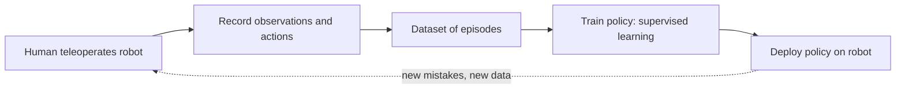

<LessonMeta level="Advanced" time="45 min" prereqs={["A machine learning refresher for robotics", "Control and PID", "Deep learning for detection and segmentation"]} />

قمیض تہہ کرنے یا کیبل لگانے کے قواعد و ضوابط لکھنے کی کوشش کریں۔ سینکڑوں چھوٹے چھوٹے فیصلے کپڑے کی شکل اور چھونے کے انداز پر منحصر ہوتے ہیں۔ اب اس کے بجائے تصور کریں کہ آپ روبوٹ کو بیس مرتبہ اس کام کی عملی رہنمائی فراہم کرتے ہیں، اور وہ ان مثالوں سے سیکھتا ہے۔ یہی **تقلیدی تعلیم (imitation learning)** ہے، اور یہ حالیہ برسوں کے سب سے شاندار مینیپولیشن ڈیموز کو تقویت بخشتی ہے۔

<Objectives>

- مظاہروں (demonstrations) پر سپروائزڈ لرننگ کے طور پر behavior cloning کی وضاحت کریں۔
- Covariate shift اور وقت کے ساتھ چھوٹی غلطیوں کے بڑھتے جانے کی وضاحت کریں۔
- وضاحت کریں کہ DAgger اصلاحی ڈیٹا کس طرح اکٹھا کرتا ہے، اور اسے ہر وقت ایک ماہر کی ضرورت کیوں ہوتی ہے۔
- تصوراتی طور پر وضاحت کریں کہ Action Chunking with Transformers اور Diffusion Policy ایکشنز کا آؤٹ پٹ کیسے دیتے ہیں۔
- LeRobot کو ایک عملی imitation learning ورک فلو میں شامل کریں۔

</Objectives>

## Behavior cloning

ایک <Term def="روبوٹ جو کچھ دیکھتا ہے اس سے وہ کیا عمل کرتا ہے اس کا نقشہ (mapping)">policy</Term> $\pi_\theta(a \mid o)$ کسی مشاہدے $o$ (کیمرے کی تصاویر، جوائنٹ پوزیشنز) کو ایک عمل یا ایکشن $a$ (جوائنٹ ٹارگٹس، اینڈ-ایفیکٹر کی حرکت، گرپر کمانڈ) میں تبدیل کرتی ہے۔ **Behavior cloning** (BC) میں آپ کسی ماہر سے مظاہرے اکٹھے کرتے ہیں، جو عام طور پر روبوٹ کو ریموٹ سے چلانے (teleoperating) والا انسان ہوتا ہے، اور ہر قدم کو ایک لیبل شدہ مثال کے طور پر لیتے ہیں: مشاہدہ ان پٹ، اور ایکشن آؤٹ پٹ۔ پھر آپ روایتی سپروائزڈ لرننگ کے ذریعے تربیت کرتے ہیں، بالکل پچھلے سبق کی طرح:

$$
\theta^* = \arg\min_\theta \; \mathbb{E}_{(o, a) \sim \mathcal{D}} \left[ \, \ell\big(\pi_\theta(o), a\big) \right]
$$

جہاں $\mathcal{D}$ مظاہروں کا ڈیٹاسیٹ ہے اور $\ell$ اسکوائرڈ ایرر (squared error) جیسی کوئی چیز ہے۔ کوئی انعامات نہیں، روبوٹ پر آزمائش اور خطا (trial and error) کا کوئی چکر نہیں، اور یہ کسی مخصوص کام کے لیے محض چند درجن مظاہروں کے ساتھ بھی کام کر سکتا ہے۔ یہی سادگی BC کو پہلا بنیادی نقطہ آغاز بناتی ہے۔



## اصل رکاوٹ: covariate shift

یہاں مسئلہ پیدا ہوتا ہے۔ ٹریننگ کے دوران، پالیسی وہی حالتیں دیکھتی ہے جن کا ماہر نے مشاہدہ کیا۔ ڈیپلائمنٹ کے دوران، پالیسی کی اپنی چھوٹی چھوٹی غلطیاں اسے ایسی حالتوں میں دھکیل دیتی ہیں جن کا ماہر نے کبھی دورہ نہیں کیا تھا، جہاں اس کے پاس کوئی ٹریننگ ڈیٹا نہیں ہوتا اور وہ بڑی غلطیاں کرتی ہے، جو اسے مزید دور دھکیل دیتی ہیں۔ ریاستوں کی ٹریننگ ڈسٹری بیوشن اور ڈیپلائمنٹ ڈسٹری بیوشن کے درمیان اس عدم مطابقت کو **covariate shift** کہا جاتا ہے۔

کسی ماہر کی ویڈیوز دیکھ کر گاڑی چلانا سیکھنے کا تصور کریں۔ ماہر کبھی فٹ پاتھ کی طرف نہیں بھٹکتا، اس لیے ویڈیوز میں فٹ پاتھ کی طرف بھٹکنے سے سنبھلنے کی کوئی مثال نہیں ہوتی۔ پہلی بار جب آپ حقیقی معنوں میں بھٹکتے ہیں، تو آپ مکمل طور پر بے بس ہوتے ہیں۔

باضابطہ طور پر، اگر پالیسی ماہر کی حالتوں پر فی قدم $\epsilon$ امکان کے ساتھ غلطی کرتی ہے اور ایک کام $T$ اقدامات تک جاری رہتا ہے، تو متوقع کل لاگت $T \epsilon$ کے بجائے $T^2 \epsilon$ کی طرح بڑھ سکتی ہے (Ross, Gordon and Bagnell, 2011)۔ غلطیاں آپس میں جڑتی چلی جاتی ہیں۔ کام جتنا طویل ہوگا، مسئلہ اتنا ہی شدید ہوگا۔

<KeyIdea title="ڈیٹا کے کناروں پر تقلید ناکام ہو جاتی ہے">
کلون کی گئی پالیسی صرف ان حالتوں پر قابل اعتماد ہوتی ہے جو مظاہروں سے ملتی جلتی ہوں۔ چونکہ پالیسی کی اپنی غلطیاں اسے ان حالتوں سے دور لے جاتی ہیں، اس لیے آپ کو یا تو ایسے مظاہروں کی ضرورت ہے جن میں سنبھلنے کا عمل (recovery) شامل ہو، انہیں جمع کرنے کا کوئی طریقہ ہو، یا ایسا ماڈل ہو جو بھٹکنے کو برداشت کر سکے۔ Imitation learning میں زیادہ تر پیش رفت اسی ایک مسئلے کے مختلف حل ہیں۔
</KeyIdea>

آپ اسے ایک چھوٹے سے تجربے میں دیکھ سکتے ہیں۔ نیچے دیا گیا کوڈ ایک ایسے کھلونا نظام کا استعمال کرتا ہے جو صفر سے دور ہٹ جاتا ہے جب تک کہ اسے واپس نہ دھکیلا جائے۔ ایک بہترین ماہر ایک تنگ دائرے میں رہتا ہے، اس لیے تمام مظاہرے ایک بہت ہی چھوٹے حصے کا احاطہ کرتے ہیں۔ ہم ان پر ایک نیٹ ورک کی تربیت کرتے ہیں، سیکھنے والے ماڈل کو کچھ شور کے ساتھ چلانے دیتے ہیں، اور اس بات کا موازنہ کرتے ہیں کہ ڈیمو کی حالتوں کے مقابلے میں وہ ان حالتوں پر کتنا غلط ہے جن کا وہ حقیقت میں دورہ کرتا ہے۔

```python title="covariate_shift.py"
import numpy as np
import torch
from torch import nn

torch.manual_seed(0)
rng = np.random.default_rng(0)


def expert(pos):
    return -float(np.clip(10.0 * pos, -1.0, 1.0))    # firm push back to 0, but it saturates at 1


def rollout(policy, start, steps=40, act_noise=0.0):
    """Unstable 1D system: left alone it drifts away from 0."""
    pos, states = start, []
    for _ in range(steps):
        states.append(pos)
        a = policy(pos) + act_noise * rng.standard_normal()
        pos = pos + 0.1 * (0.8 * pos + a)
        if abs(pos) > 3:
            break
    return states


def fit(states, epochs=2000):
    X = torch.tensor(states, dtype=torch.float32).unsqueeze(1)
    Y = torch.tensor([expert(s) for s in states], dtype=torch.float32).unsqueeze(1)
    net = nn.Sequential(nn.Linear(1, 64), nn.Tanh(), nn.Linear(64, 1))
    opt = torch.optim.Adam(net.parameters(), lr=1e-2)
    for _ in range(epochs):
        loss = nn.functional.mse_loss(net(X), Y)
        opt.zero_grad()
        loss.backward()
        opt.step()
    return net


def as_policy(net):
    def policy(pos):
        with torch.no_grad():
            return net(torch.tensor([[pos]], dtype=torch.float32)).item()
    return policy


def mistake(net, states):
    """Average gap between the learner's action and what the expert would do, on these states."""
    pol = as_policy(net)
    return float(np.mean([abs(pol(s) - expert(s)) for s in states]))


# Demonstrations: the expert is nearly perfect, so it visits only a tiny band around 0.
demo = [s for _ in range(30) for s in rollout(expert, rng.uniform(-0.1, 0.1), act_noise=0.1)]
net = fit(demo)
print(f"demo states span {min(demo):+.2f} .. {max(demo):+.2f}")

# Let the learner drive and look at the states IT visits.
probe = lambda: [s for st in rng.uniform(-0.2, 0.2, 20) for s in rollout(as_policy(net), st, act_noise=0.8)]
visited = probe()
print(f"learner states span {min(visited):+.2f} .. {max(visited):+.2f}")
print(f"mistake on demo states:    {mistake(net, demo):.3f}")
print(f"mistake on learner states: {mistake(net, visited):.3f}   <- covariate shift")

# DAgger: add the learner's own states, labelled by the expert, and retrain.
data = list(demo)
for it in range(3):
    data += probe()
    net = fit(data)
    print(f"DAgger round {it + 1}: mistake on the same learner states {mistake(net, visited):.3f}")
```

اسے چلائیں۔ آپ دیکھیں گے کہ سیکھنے والے ماڈل کی حالتیں مظاہرے کی حد سے کہیں آگے پھیل جاتی ہیں، ڈیمو حالتوں پر غلطی صفر کے قریب ہے، اور سیکھنے والے کے ذریعے وزٹ کی گئی حالتوں پر غلطی واضح طور پر زیادہ ہے۔ DAgger کے چند راؤنڈز کے بعد، انہی حالتوں پر غلطی کم ہو جاتی ہے۔ آپ کے PyTorch ورژن کے مطابق درست اعداد و شمار مختلف ہو سکتے ہیں، لیکن بنیادی مقصد اس پیٹرن کو سمجھنا ہے۔

## DAgger: ماہر سے اصلاح کی درخواست کرنا

**DAgger** (Dataset Aggregation) سیدھا covariate shift پر وار کرتا ہے۔ اس کا طریقہ کار یہ ہے:

1. موجودہ ڈیٹاسیٹ پر پالیسی کی تربیت کریں۔
2. *سیکھنے والے* (learner) کی پالیسی کو چلائیں، اور ان حالتوں کو ریکارڈ کریں جن کا وہ دورہ کرتا ہے۔
3. ماہر سے پوچھیں کہ وہ ان میں سے ہر حالت میں کیا عمل کرتا۔
4. ان نئی لیبل شدہ حالتوں کو ڈیٹاسیٹ میں شامل کریں اور عمل کو دہرائیں۔

اب ٹریننگ ڈیٹا میں وہ حالتیں شامل ہوتی ہیں جن میں سیکھنے والا درحقیقت پھنستا ہے، اور ان کے درست حل بھی موجود ہوتے ہیں۔ DAgger کی غلطی $T^2 \epsilon$ کے بجائے تقریباً $T \epsilon$ کے تناسب سے بڑھتی ہے۔

اس کی قیمت یہ ہے کہ آپ کو ہر وقت ایک ماہر کی ضرورت ہوتی ہے، اور بعد میں لیبل لگانا ہمیشہ فطری نہیں ہوتا۔ روبوٹک بازو نے جن حالتوں کا دورہ کیا ہے، ان پر بعد میں انسان کے لیے لیبل لگانا خاصا مشکل ہوتا ہے۔ عملی اقسام میں **human-gated** یا **interventional** ڈیٹا کلیکشن شامل ہیں: روبوٹ خود چلتا ہے، ایک شخص دیکھتا ہے اور جب معاملہ بگڑنے لگتا ہے تو وہ کنٹرول سنبھال لیتا ہے، اور کنٹرول سنبھالنے کے ان حصوں کو ڈیٹاسیٹ میں شامل کر دیا جاتا ہے۔ ایک اور سستا حل مظاہروں کے دوران **noise injection** ہے: روبوٹ کو ہلکا سا جھٹکا دیں جب ماہر اسے درست کر رہا ہو، تاکہ ڈیٹا میں سنبھلنے کی صلاحیت (recovery behavior) شامل ہو جائے۔

## جدید پالیسیاں: چنکس اور ڈسٹری بیوشنز کی پیش گوئی

حقیقی روبوٹس پر مزید دو مسائل سامنے آتے ہیں۔

**ملٹی موڈیلٹی (Multimodality):** فرض کریں کہ ماہر کبھی کسی رکاوٹ کے بائیں طرف سے گزرتا ہے اور کبھی دائیں طرف سے۔ Squared error کے ساتھ تربیت یافتہ نیٹ ورک درمیانی اوسط سیکھتا ہے، جو روبوٹ کو سیدھا رکاوٹ میں دے مارتا ہے۔ پالیسیوں کو *متعدد* درست جوابات پیش کرنے کی صلاحیت رکھنی چاہیے۔

**سنگل سٹیپس میں غلطیوں کا جمع ہونا:** تیز رفتاری سے ایک وقت میں صرف ایک عمل کی پیش گوئی کرنے سے غلطیوں کو جمع ہونے اور بڑھنے کے کئی مواقع مل جاتے ہیں۔

### ایکشن چنکنگ مع ٹرانسفارمرز (ACT)

<Term def="Action Chunking with Transformers: ایک پالیسی جو ایک ہی وقت میں مستقبل کے ایکشنز کے ایک مختصر سلسلے کی پیش گوئی کرتی ہے">ACT</Term> کو ALOHA کم لاگت بائی مینوئل (دو ہاتھوں والے) روبوٹ سسٹم (Zhao et al., 2023) کے ساتھ متعارف کرایا گیا تھا۔ فی قدم ایک ایکشن کے بجائے، پالیسی موجودہ کیمرے کی تصاویر اور جوائنٹ پوزیشنز سے اگلے $k$ ایکشنز کے ایک **چنک (chunk)** کی پیش گوئی کرتی ہے۔ روبوٹ اس چنک کو انجام دیتا ہے، پھر اگلے کی پیش گوئی کرتا ہے۔ چنکنگ مؤثر فاصلے یا دورانیے کو کم کر دیتی ہے: $k = 100$ کے ساتھ، 1000 اقدامات والے کام کو صرف دس کے قریب فیصلوں کی ضرورت ہوتی ہے، اس لیے غلطیوں کے بڑھنے کے مواقع کم ہوتے ہیں۔ ACT کا نیٹ ورک ایک ٹرانسفارمر ہے، جسے conditional variational autoencoder (CVAE) کے طور پر تربیت دی جاتی ہے، جو اسے مظاہروں کے درمیان کے تنوع کو محفوظ کرنے کی اجازت دیتا ہے۔ چلتے وقت، ہموار حرکت کے لیے بیک وقت کی جانے والی پیش گوئیوں کو *temporal ensembling* کے ساتھ جوڑا جا سکتا ہے، یعنی ایک ہی لمحے کے لیے کی گئی پیش گوئیوں کی اوسط نکالی جاتی ہے۔

### ڈیفیوژن پالیسی (Diffusion Policy)

**Diffusion Policy** (Chi et al., 2023) تصاویر بنانے والے ماڈلز کا تصور ادھار لیتی ہے۔ یہ ایکشن کی ترتیبات کو پیدا کی جانے والی تصویر کی طرح سمجھتی ہے۔ بے ترتیب شور (random noise) سے شروع کرتے ہوئے، ایک نیٹ ورک موجودہ مشاہدے کی بنیاد پر بار بار ترتیب سے **شور کو دور (denoises)** کرتا ہے، یہاں تک کہ یہ ایک قابل فہم ایکشن سیکوئنس بن جائے۔ چونکہ سیمپلنگ بے ترتیب شور سے شروع ہوتی ہے، اس لیے مختلف کوششیں مختلف درست طریقوں (رکاوٹ کے بائیں یا دائیں طرف) کو منتخب کر سکتی ہیں، جو ملٹی موڈیلٹی کو قدرتی طور پر سنبھالتی ہیں۔ یہ چنکس کی پیش گوئی بھی کرتی ہے اور انہیں receding-horizon کے انداز میں انجام دیتی ہے۔ اس کا نقصان فی فیصلہ زیادہ کمپیوٹیشنل لاگت ہے، کیونکہ شور کو دور کرنے کے لیے کئی نیٹ ورک پاسز کی ضرورت ہوتی ہے۔

| تصور | حل | سمجھوتہ (Trade-off) |
|---|---|---|
| Behavior cloning | سادگی | بڑھتی ہوئی غلطی، تمام طریقوں کی غیر فطری اوسط نکالنا |
| DAgger | Covariate shift | سیکھنے والے کی حالتوں پر ماہر کے لیبلز کی ضرورت |
| Action chunking (ACT) | طویل دورانیہ، جھٹکے دار حرکت | ایک چنک کے اندر فوری ردعمل کی کمی |
| Diffusion Policy | ملٹی موڈل رویہ | فی ایکشن زیادہ کمپیوٹیشن |

:::note
نئے imitation-learning ماڈلز، بشمول بڑے پری ٹرینڈ وژن-لینگویج-ایکشن (vision-language-action) ماڈلز، انہی بنیادی اجزاء پر بنے ہیں: مظاہرے کا ڈیٹا، چنک شدہ ایکشن آؤٹ پٹس، اور ایک جنریٹو ہیڈ۔ بعد کے اسباق ان کا احاطہ کریں گے۔ جدید ترین ماڈلز کی تفصیلات کے لیے حالیہ ریلیزز دیکھیں۔
:::

## ٹول کٹ کے طور پر LeRobot

**LeRobot** Hugging Face کی طرف سے ایک اوپن سورس PyTorch لائبریری ہے جو اس ورک فلو کے عملی حصوں کو یکجا کرتی ہے۔ یہ ایک معیاری ڈیٹاسیٹ فارمیٹ فراہم کرتی ہے جسے آپ Hugging Face Hub کے ذریعے لوڈ اور شیئر کر سکتے ہیں، ACT اور Diffusion Policy سمیت پالیسیوں کے نفاذ، ٹریننگ اور ایویلیوایشن کے اسکرپٹس، اور کم لاگت روبوٹ ہارڈویئر اور سمیلیٹرز کے لیے سپورٹ فراہم کرتی ہے۔ عام طریقہ کار یہ ہے: روبوٹ کو ریموٹ سے چلائیں اور مظاہروں کو ڈیٹاسیٹ میں ریکارڈ کریں، اس پر پالیسی کی تربیت کریں، روبوٹ پر یا سمیلیشن میں اس کی جانچ کریں، پھر جہاں وہ ناکام ہو وہاں مزید ڈیٹا ریکارڈ کر کے اس عمل کو دہرائیں۔

LeRobot میں کمانڈز کے نام اور آپشنز مختلف ورژنز میں بدلتے رہے ہیں، اس لیے پرانی پوسٹس سے کمانڈز کاپی کرنے کے بجائے موجودہ ورژن کے README اور دستاویزات پر عمل کریں۔

:::tip[پیشہ ورانہ مشورہ]
اپنی محنت مظاہروں پر لگائیں۔ کام کرنے کے کسی ایک طریقے کے مسلسل، ہموار، اور سوچ سمجھ کر کیے گئے مظاہرے اکثر دوگنے لاپرواہ اور بے ربط مظاہروں سے بہتر ہوتے ہیں۔ ڈیپلائمنٹ کے وقت متوقع تبدیلیوں (چیزوں کی پوزیشنز، روشنی) کا احاطہ کریں، اور غلطیوں سے سنبھلنے کی حرکات کو بھی ریکارڈ کریں۔
:::

## عملی لیب

<Steps>

1. `covariate_shift.py` کو محفوظ کریں اور اسے چلائیں۔ پرنٹ شدہ حدود (spans) اور غلطیوں کو نوٹ کریں۔
2. ڈیمو رول آؤٹ میں مظاہرے کے شور کو `act_noise=0.1` سے بڑھا کر `0.4` کر دیں۔ ڈیمو کی حد اور "سیکھنے والے کی حالتوں پر غلطی" کیسے بدلتی ہے؟ ایسا کیوں ہے؟
3. سیکھنے والے کے `act_noise` کو 0.8 سے بدل کر 0.0 کر دیں۔ کیا covariate-shift کا فرق کم ہوتا ہے؟ یہ آپ کو کیا بتاتا ہے کہ یہ مسئلہ کب زیادہ اہمیت اختیار کرتا ہے؟
4. DAgger راؤنڈز کی تعداد بڑھا کر 6 کر دیں۔ کیا غلطی مسلسل کم ہوتی رہتی ہے، یا یہ ایک جگہ رک جاتی ہے؟
5. کامیابی کا معیار یہ ہے: آپ دو جملوں میں وضاحت کر سکیں کہ غلطی ڈیمو کی حالتوں پر صفر کے قریب لیکن سیکھنے والے کی حالتوں پر زیادہ کیوں ہوتی ہے۔

</Steps>

## مشقیں

<Exercise title="BC اوسط کیوں نکالتا ہے؟" level="Beginner">

آپ کے آدھے مظاہرے رکاوٹ کے بائیں طرف سے اور آدھے دائیں طرف سے گزرتے ہیں۔ Squared error کے ساتھ ٹرین کی گئی BC پالیسی سیدھی رکاوٹ میں جا ٹکراتی ہے۔ کیوں؟

<Solution>

Squared error اہداف کے اوسط (mean) کے ذریعے سب سے کم ہوتی ہے۔ فیصلے کے موڑ پر، آدھے اعمال "بائیں مڑیں" اور آدھے "دائیں مڑیں" کہتے ہیں، اور ان کا اوسط "سیدھے جائیں" بنتا ہے، جو کہ وہ واحد انتخاب ہے جو کسی صورت درست نہیں ہے۔ ایسی پالیسی استعمال کریں جو متعدد درست جوابات کی نمائندگی کر سکے، جیسے کہ diffusion policy یا mixture model، یا پھر مظاہروں کو یکساں بنائیں۔

</Solution>
</Exercise>

<Exercise title="صحیح حل کا انتخاب کریں" level="Intermediate">

آپ کی پالیسی 10 سیکنڈ تک کام کرتی ہے، پھر ایسی پوزیشنز میں بھٹک جاتی ہے جو اسے کبھی نہیں دکھائی گئی تھیں اور ناکام ہو جاتی ہے۔ آپ 100 مزید مظاہرے اکٹھے کر سکتے ہیں یا مداخلت پر مبنی (interventional) ڈیٹا کلیکشن چلا سکتے ہیں۔ آپ کس کا انتخاب کریں گے، اور کیا ریکارڈ کریں گے؟

<Solution>

Interventional کلیکشن۔ پالیسی کو چلائیں، اسے ناکام ہونے دیں، اور جس لمحے معاملہ بگڑے کسی شخص کو کنٹرول سنبھالنے اور کام مکمل کرنے دیں۔ کنٹرول سنبھالنے کے ان حصوں کو شامل کریں، جن میں سنبھلنے کا عمل (recovery behavior) شامل ہے جس کی اصل ڈیٹا میں کمی تھی۔ 100 مزید صاف ستھرے مظاہرے زیادہ تر انہی حالتوں کو دہرائیں گے جنہیں پالیسی پہلے ہی سنبھال سکتی ہے۔

</Solution>
</Exercise>

<Exercise title="چنک کی لمبائی کا سمجھوتہ" level="Advanced">

آپ فی قدم ایک عمل کی پیش گوئی کرنے کے بجائے 50 Hz پر 50 ایکشنز کے چنکس پر منتقل ہو جاتے ہیں۔ ایک فائدہ اور ایک خطرہ بتائیں۔

<Solution>

فائدہ: فی کام کم فیصلے، جس کے نتیجے میں جمع ہونے والی غلطی میں کمی اور زیادہ ہموار حرکت۔ خطرہ: روبوٹ ایک چنک کے اندر ایک سیکنڈ تک اوپن لوپ چلتا ہے اور اگلی پیش گوئی تک کسی اچانک رکاوٹ یا جھٹکے پر فوری ردعمل ظاہر نہیں کر سکتا۔ Temporal ensembling یا چھوٹے ایگزیکیوٹڈ چنکس (50 کی پیش گوئی کریں، 10 پر عمل کریں) ردعمل کی صلاحیت کو بہتر بنانے کے لیے کچھ روانی قربان کرتے ہیں۔

</Solution>
</Exercise>

## اپنی سمجھ کی جانچ کریں

<Quiz questions={[
  {q: "تقلیدی تعلیم (imitation learning) میں covariate shift کیا ہے؟", options: ["روبوٹ کے کیمرے کا رنگ بدل جاتا ہے", "ڈیپلائمنٹ کے وقت پالیسی جن حالتوں کا دورہ کرتی ہے وہ ٹریننگ ڈیٹا سے مختلف ہوتی ہیں", "ماہر وقت کے ساتھ بدل جاتا ہے", "لاس فنکشن (loss function) غلط ہے"], answer: 1, explain: "چھوٹی غلطیاں پالیسی کو غیر مانوس حالتوں میں لے جاتی ہیں، جہاں اس کی غلطیاں مزید بڑھ جاتی ہیں۔"},
  {q: "DAgger ہر راؤنڈ میں ڈیٹاسیٹ میں کیا شامل کرتا ہے؟", options: ["مزید بے ترتیب ایکشنز", "سیکھنے والے کے ذریعے وزٹ کی گئی حالتیں، جنہیں ماہر نے لیبل کیا ہو", "صرف ماہر کے اصل مظاہرے", "صرف سمیلیٹڈ شور"], answer: 1, explain: "اس طرح ٹریننگ ڈسٹری بیوشن میں وہ حالتیں شامل ہو جاتی ہیں جن میں سیکھنے والا خود جاتا ہے، ساتھ ہی ان کی اصلاح بھی شامل ہوتی ہے۔"},
  {q: "ACT کی طرح ایک ہی وقت میں ایکشنز کے ایک چنک کی پیش گوئی کیوں کی جاتی ہے؟", options: ["یہ کم میموری استعمال کرتا ہے", "یہ مؤثر دورانیے کو مختصر کرتا ہے تاکہ غلطیاں کم جمع ہوں", "یہ کیمروں کی ضرورت کو ختم کرتا ہے", "یہ ماہر کو غیر ضروری بنا دیتا ہے"], answer: 1, explain: "فی کام کم فیصلہ کن لمحات کا مطلب ہے چھوٹی غلطیوں کے جمع ہونے کے کم مواقع۔"},
  {q: "Diffusion Policy کسی کام کو کرنے کے متعدد درست طریقوں کو کیسے سنبھالتی ہے؟", options: ["یہ ان کی اوسط نکالتی ہے", "یہ بے ترتیب شور سے ڈینوائزنگ شروع کرتی ہے، اس لیے مختلف نمونے مختلف درست طریقوں پر پہنچ سکتے ہیں", "یہ مظاہروں کو نظر انداز کرتی ہے", "اسے ایک ریوارڈ فنکشن کی ضرورت ہوتی ہے"], answer: 1, explain: "جنریٹو سیمپلنگ رویوں کو اوسط تک محدود کرنے کے بجائے کئی اچھے رویوں کی نمائندگی کر سکتی ہے۔"}
]} />

<Takeaways>

- Behavior cloning مظاہروں کو سپروائزڈ لرننگ میں بدل دیتی ہے: مشاہدہ ان پٹ، اور ایکشن آؤٹ پٹ۔
- Covariate shift چھوٹی غلطیوں کو بڑھا دیتی ہے، جس کی وجہ سے کلون کی گئی پالیسیاں ان حالتوں میں ناکام ہو جاتی ہیں جن کا ڈیمو میں احاطہ نہیں کیا گیا تھا۔
- DAgger اور interventional ڈیٹا کلیکشن سیکھنے والے کی اپنی حالتوں سے اصلاحی ڈیٹا شامل کرتے ہیں۔
- ACT ایکشنز کے چنکس کی پیش گوئی کرتا ہے، اور Diffusion Policy شور کو دور کر کے ایکشن سیکوئنس بناتی ہے، جو ملٹی موڈل مظاہروں کو بخوبی سنبھالتی ہے۔
- LeRobot ڈیٹاسیٹس، پالیسیوں اور ٹولز کو یکجا کرتا ہے۔ ڈیٹا کا معیار اور وسعت پالیسی کے انتخاب سے زیادہ اہمیت رکھتی ہے۔

</Takeaways>

## مزید گہرائی میں جائیں

- Ross, Gordon and Bagnell, "A Reduction of Imitation Learning and Structured Prediction to No-Regret Online Learning" (arxiv.org/abs/1011.0686)، DAgger کا مقالہ۔
- Zhao et al., "Learning Fine-Grained Bimanual Manipulation with Low-Cost Hardware" (arxiv.org/abs/2304.13705)، ACT کا مقالہ۔
- Chi et al., "Diffusion Policy: Visuomotor Policy Learning via Action Diffusion" (arxiv.org/abs/2303.04137)۔
- LeRobot کی ریپوزٹری اور دستاویزات huggingface.co اور github.com/huggingface/lerobot پر۔

اگلا: [Reinforcement learning](./03-reinforcement-learning.mdx)
