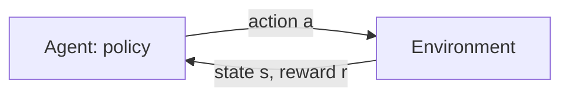

<LessonMeta level="Advanced" time="45 منٹ" prereqs={["A machine learning refresher for robotics", "Probability for robots", "Calculus and optimization"]} />

ایک چار ٹانگوں والے روبوٹ (quadruped robot) سے چلنے کے لیے کہا جاتا ہے۔ کوئی بھی شخص ہر لمحے کے لیے جوڑوں کا درست ٹارک (torque) نہیں لکھ سکتا، اور نہ ہی کوئی انسان ٹھوکر کھانے کے بعد سنبھلنے کے ہزار قدمی عمل کا مظاہرہ کر کے دکھا سکتا ہے۔ لیکن ہم جو چاہتے ہیں اسے بیان کرنا آسان ہے: آگے بڑھو، سیدھے کھڑے رہو، اور توانائی ضائع مت کرو۔ **کمکی تعلیم** یا Reinforcement learning (RL) روبوٹ کو اس قسم کے فیڈ بیک سے اپنا رویہ خود دریافت کرنے کی اجازت دیتی ہے، جس میں وہ مختلف چیزیں آزما کر دیکھتا ہے کہ کن اقدامات سے بہتر اسکور ملتا ہے۔

<Objectives>

- ایک مارکوف ڈیسیژن پروسیس (MDP)، پالیسی، ریٹرن اور ویلیو فنکشن کی تعریف کریں۔
- پالیسی گریڈینٹ اپ ڈیٹ لکھیں اور وضاحت کریں کہ یہ کیسے کام کرتا ہے۔
- Gymnasium کے ساتھ CartPole پر ایک پالیسی گریڈینٹ ایجنٹ چلائیں اور اس کے سیکھنے کے عمل کا منحنی خط (learning curve) پڑھیں۔
- سادہ الفاظ میں بیان کریں کہ PPO میں کیا تبدیلیاں لائی گئی ہیں اور یہ روبوٹس کے لیے کیوں مقبول ہے۔

</Objectives>

## RL سیٹ اپ

ایک RL مسئلے میں ایک **ایجنٹ** (agent) ہوتا ہے جو ایک لوپ میں **ماحول** (environment) کے ساتھ تعامل (interact) کرتا ہے۔ ہر قدم پر ایجنٹ ایک **حالت** (state) $s_t$ دیکھتا ہے، ایک **عمل** (action) $a_t$ منتخب کرتا ہے، اور ماحول ایک **انعام** (reward) $r_{t+1}$ اور ایک نئی حالت $s_{t+1}$ واپس بھیجتا ہے۔ اس کی باقاعدہ ریاضیاتی تشکیل <Term def="مارکوف ڈیسیژن پروسیس: حالتیں، اعمال، منتقلی کے امکانات، ایک ریوارڈ فنکشن اور ڈسکاؤنٹ فیکٹر">مارکوف ڈیسیژن پروسیس</Term> (MDP) کہلاتی ہے۔



ایجنٹ کا طرز عمل اس کی **پالیسی** (policy) $\pi(a \mid s)$ ہے: یعنی حالت $s$ میں عمل $a$ منتخب کرنے کا امکان۔ مقصد ایسی پالیسی حاصل کرنا ہے جو متوقع **ریٹرن** (return) کو زیادہ سے زیادہ بنائے، جو کہ وقت کے ساتھ حاصل ہونے والا کل انعام ہے جس میں بعد میں ملنے والے انعامات کو $\gamma \in [0, 1)$ کے ذریعے ڈسکاؤنٹ کیا جاتا ہے:

$$
G_t = r_{t+1} + \gamma\, r_{t+2} + \gamma^2 r_{t+3} + \dots = \sum_{k=0}^{\infty} \gamma^k \, r_{t+k+1}
$$

ڈسکاؤنٹنگ کا مطلب ہے کہ "ابھی ملنے والا انعام بعد میں ملنے والے اسی انعام سے زیادہ قیمتی ہے" اور یہ اس مجموعے کو محدود (finite) بھی رکھتی ہے۔ عام طور پر 0.99 کے قریب کی قدریں استعمال ہوتی ہیں۔

*مارکوف* کا مطلب یہ ہے کہ حالت میں وہ تمام معلومات موجود ہیں جو اس بات کی پیش گوئی کے لیے درکار ہیں کہ آگے کیا ہوگا، لہٰذا موجودہ حالت کے علاوہ ماضی کی اہمیت نہیں رہتی۔ روبوٹ کے لیے، "حالت" میں صرف پوزیشنز ہی نہیں بلکہ ولاسٹیز (velocities) بھی شامل ہونی چاہئیں، ورنہ مسئلہ مارکوف نوعیت کا نہیں رہے گا۔

## ویلیو فنکشنز

کسی مخصوص حالت میں ہونا کتنا اچھا ہے؟ **اسٹیٹ ویلیو فنکشن** (state-value function) حالت $s$ سے متوقع ریٹرن ہے اگر آپ پالیسی $\pi$ پر عمل کریں:

$$
V^\pi(s) = \mathbb{E}_\pi \left[ G_t \mid s_t = s \right]
$$

**ایکشن ویلیو فنکشن** (action-value function) $Q^\pi(s, a)$ بھی وہی ہے، لیکن پہلے عمل $a$ انجام دینے اور اس کے بعد $\pi$ پر عمل کرنے کی صورت میں۔ ان کا فرق **ایڈوانٹیج** (advantage) کہلاتا ہے:

$$
A^\pi(s, a) = Q^\pi(s, a) - V^\pi(s)
$$

ایڈوانٹیج آپ کو بتاتا ہے کہ آیا کوئی عمل اس حالت میں پالیسی کے اوسط رویے سے بہتر تھا یا بدتر۔ یہ نیچے دیے گئے پالیسی گریڈینٹ طریقہ کار کا سب سے اہم جزو بنے گا۔

ویلیوز مستقل مزاجی کے ایک اصول پر عمل کرتی ہیں، جسے **بیل مین مساوات** (Bellman equation) کہا جاتا ہے: کسی حالت کی ویلیو فوری متوقع انعام اور اگلی حالت کی ڈسکاؤنٹ شدہ ویلیو کا مجموعہ ہوتی ہے۔

$$
V^\pi(s) = \mathbb{E}_{a \sim \pi,\; s' \sim P} \left[ r + \gamma\, V^\pi(s') \right]
$$

ویلیو پر مبنی طریقے جیسے Q-learning اور DQN ویلیوز سیکھنے اور ان پر لالچی انداز میں عمل کرنے کے لیے اسی تکرار کا استعمال کرتے ہیں۔ وہ غیر مسلسل (discrete) اعمال کے لیے اچھے کام کرتے ہیں۔ روبوٹس میں عموماً مسلسل اعمال (continuous actions جیسے کہ موٹر ٹارک) ہوتے ہیں، جہاں **پالیسی گریڈینٹ** (policy-gradient) طریقے عام طور پر ترجیح دیے جاتے ہیں۔

## پالیسی گریڈینٹس

ویلیوز سیکھنے اور ان سے پالیسی اخذ کرنے کے بجائے، ہم نیورل نیٹ ورک کی مدد سے پالیسی $\pi_\theta(a \mid s)$ کی براہ راست پیرامیٹرائزیشن کر سکتے ہیں، اور متوقع ریٹرن $J(\theta)$ پر گریڈینٹ ایسنٹ (gradient ascent) کے ذریعے $\theta$ کو بہتر بنا سکتے ہیں۔ **پالیسی گریڈینٹ تھیوریم** (policy gradient theorem) اس کا حیرت انگیز طور پر ایک سادہ تخمینہ پیش کرتا ہے:

$$
\nabla_\theta J(\theta) = \mathbb{E}_{\pi_\theta} \left[ \sum_t \nabla_\theta \log \pi_\theta(a_t \mid s_t) \; G_t \right]
$$

اسے یوں سمجھیں: *جن اعمال کو آپ نے انجام دیا تھا، ان کے منتخب ہونے کے امکان کو اس ریٹرن کے تناسب سے بڑھائیں جو ان کے بعد حاصل ہوا۔* اچھے نتائج ان اعمال کے امکانات کو بڑھاتے ہیں جو ان کا سبب بنے، اور برے نتائج ان کے امکانات کو کم کرتے ہیں۔ یہ **REINFORCE** الگورتھم ہے۔

<KeyIdea title="کمکی تعلیم دراصل آزمائش، غلطی اور کریڈٹ تفویض کرنے کا نام ہے">
پالیسی گریڈینٹ اس عمل کو تقویت دیتا ہے جو ایجنٹ نے ابھی انجام دیا، اور اس کا وزن اس بات پر ہوتا ہے کہ اس کے بعد نتائج کتنے اچھے رہے۔ سب سے مشکل مرحلہ کریڈٹ تفویض کرنا (credit assignment) ہے: طویل اقساط اور شاذ و نادر ملنے والے انعامات کی وجہ سے یہ واضح نہیں ہوتا کہ ہزاروں اعمال میں سے کس عمل کو کامیابی کا کریڈٹ ملنا چاہیے۔ بیس لائنز، ویلیو فنکشنز اور سوچ سمجھ کر ڈیزائن کیے گئے انعامات سب اس لیے موجود ہیں تاکہ اس سگنل میں موجود شور (noise) کو کم کیا جا سکے۔
</KeyIdea>

خام ریٹرنز میں بہت شور ہوتا ہے: اگر ہر ریٹرن مثبت ہو، تو REINFORCE ہر عمل کے امکان کو تھوڑا بڑھا دیتا ہے۔ ایک **بیس لائن** (baseline) منہا کرنا (جیسے کہ اوسط ریٹرن یا سیکھا ہوا $V(s)$) متوقع گریڈینٹ کو تبدیل کیے بغیر چھوڑ دیتا ہے لیکن متغیرات کے پھیلاؤ (variance) کو کافی حد تک کم کر دیتا ہے۔ ایڈوانٹیج کے تخمینے کے طور پر $G_t - V(s_t)$ کا استعمال کرنے سے **ایکٹر-کریٹک** (actor-critic) طریقہ حاصل ہوتا ہے: یہاں پالیسی *ایکٹر* ہے اور سیکھا ہوا ویلیو فنکشن *کریٹک*۔

## ایک چلانے کے قابل مثال: CartPole

CartPole دراصل RL کی دنیا کا "hello world" ہے: ایک گاڑی جس پر ایک کھمبا (pole) قبضے سے جڑا ہوتا ہے، جہاں ایجنٹ بائیں یا دائیں دھکیلتا ہے اور کھمبا کھڑے رہنے کے ہر قدم پر اسے +1 انعام ملتا ہے۔ `CartPole-v1` میں زیادہ سے زیادہ قسط کی لمبائی 500 قدم ہے۔ اس کے لیے درکار لائبریریز انسٹال کریں:

```bash title="terminal"
pip install gymnasium torch
```

<Tabs>
<TabItem value="pg" label="REINFORCE (شروع سے کوڈ)">

```python title="cartpole_reinforce.py"
import gymnasium as gym
import torch
from torch import nn

torch.manual_seed(0)
env = gym.make("CartPole-v1")

policy = nn.Sequential(nn.Linear(4, 64), nn.Tanh(), nn.Linear(64, 2))   # logits for [left, right]
opt = torch.optim.Adam(policy.parameters(), lr=1e-2)
gamma = 0.99


def run_episode():
    obs, _ = env.reset()
    log_probs, rewards = [], []
    done = False
    while not done:
        logits = policy(torch.as_tensor(obs, dtype=torch.float32))
        dist = torch.distributions.Categorical(logits=logits)
        action = dist.sample()
        obs, reward, terminated, truncated, _ = env.step(action.item())
        log_probs.append(dist.log_prob(action))
        rewards.append(reward)
        done = terminated or truncated
    return log_probs, rewards


def discounted_returns(rewards):
    returns, g = [], 0.0
    for r in reversed(rewards):
        g = r + gamma * g
        returns.append(g)
    returns.reverse()
    return torch.tensor(returns)


for episode in range(1, 301):
    log_probs, rewards = run_episode()
    returns = discounted_returns(rewards)
    returns = (returns - returns.mean()) / (returns.std() + 1e-8)      # baseline and scaling
    loss = -(torch.stack(log_probs) * returns).sum()                   # gradient ascent on expected return
    opt.zero_grad()
    loss.backward()
    opt.step()
    if episode % 50 == 0:
        print(f"episode {episode:3d}  length {len(rewards):3d}")
```

</TabItem>
<TabItem value="sb3" label="PPO بمع stable-baselines3">

```bash title="terminal"
pip install stable-baselines3
```

```python title="cartpole_ppo.py"
from stable_baselines3 import PPO

model = PPO("MlpPolicy", "CartPole-v1", verbose=1)
model.learn(total_timesteps=50_000)

env = model.get_env()
obs = env.reset()
for _ in range(500):
    action, _ = model.predict(obs, deterministic=True)
    obs, reward, done, info = env.step(action)
    if done[0]:
        obs = env.reset()
```

</TabItem>
</Tabs>

دیکھیں کہ شروع سے لکھا گیا ورژن کس طرح ریاضی کے اصولوں پر پورا اترتا ہے۔ `dist.log_prob(action)` دراصل $\log \pi_\theta(a_t \mid s_t)$ ہے۔ `returns` دراصل $G_t$ ہے۔ ریٹرنز کو نارملائز کرنے سے بیس لائن منہا ہو جاتی ہے اور وہ مناسب اسکیل پر آ جاتے ہیں۔ لاس (loss) دراصل پالیسی گریڈینٹ کے مقصد کا منفی ہے، کیونکہ آپٹیمائزرز نقصان کو کم (minimise) کرتے ہیں۔

پہلا اسکرپٹ چلائیں اور اقساط کی لمبائی پر نظر رکھیں۔ پہلی چند اقساط مختصر ہوتی ہیں (کھمبا 10 سے 40 قدموں میں گر جاتا ہے) اور بعد والی اقساط 500 کی طرف بڑھتی ہیں۔ سیکھنے کے عمل میں اتار چڑھاؤ ہوتا ہے اور یہ اچھی اور بری اقساط کے درمیان گھوم سکتا ہے۔ یہ REINFORCE کے لیے معمول کی بات ہے، اور اسی لیے زیادہ مستحکم الگورتھمز موجود ہیں۔ چونکہ ایجنٹ اعمال کا سیمپل لیتا ہے، اس لیے مختلف سیڈز (seeds) مختلف کروز دکھاتی ہیں۔

:::tip[پیشہ ورانہ مشورہ]
کسی بھی RL کے نتیجے پر یقین کرنے سے پہلے ہمیشہ کئی بے ترتیب سیڈز (random seeds) پر لرننگ کرو بنائیں۔ صرف ایک خوش قسمت رن کامیابی لگ سکتی ہے۔ یہ بھی چیک کریں کہ انعام درحقیقت کس چیز کی حوصلہ افزائی کر رہا ہے: RL بالکل وہی بہتر بناتا ہے جو آپ نے کوڈ میں لکھا ہے، وہ نہیں جو آپ کی نیت تھی۔
:::

## PPO: عملی میدان کا سب سے مفید الگورتھم

REINFORCE میں ایک خامی ہے: ایک بڑی اپ ڈیٹ پوری پالیسی کو برباد کر سکتی ہے، اور اس کا ابھی جمع کیا گیا ڈیٹا اگلی اپ ڈیٹ کے لیے بے کار ہو جاتا ہے کیونکہ پالیسی تبدیل ہو چکی ہوتی ہے۔ **Proximal Policy Optimization** (PPO, Schulman et al., 2017) روبوٹکس میں اس لیے مقبول ہے کیونکہ یہ اپ ڈیٹس کو زیادہ محتاط بناتا ہے اور ڈیٹا کو کسی حد تک دوبارہ استعمال کرتا ہے۔

اس کی بنیادی سوچ یہ ہے: موجودہ پالیسی کے ساتھ تجربات کا ایک بیچ جمع کریں۔ پھر اس بیچ پر کئی گریڈینٹ اقدامات کریں، لیکن اس بات کو **کلپ** (clip) کر دیں کہ نئی پالیسی کے ایکشن کے امکانات پرانی پالیسی سے کتنی دور جا سکتے ہیں۔ امکانی تناسب $\rho_t(\theta) = \pi_\theta(a_t \mid s_t) \,/\, \pi_{\theta_{old}}(a_t \mid s_t)$ اور ایڈوانٹیج کے تخمینے $\hat{A}_t$ کے ساتھ، اس کا آبجیکٹو ہے:

$$
L(\theta) = \mathbb{E}_t \left[ \min\!\big( \rho_t \hat{A}_t, \;\; \mathrm{clip}(\rho_t,\, 1-\varepsilon,\, 1+\varepsilon)\, \hat{A}_t \big) \right]
$$

اگر کسی عمل کا ایڈوانٹیج مثبت تھا، تو آبجیکٹو اسے زیادہ ممکن بنانے پر انعام دیتا ہے، لیکن صرف $1+\varepsilon$ (اکثر 0.2) کے تناسب تک۔ اس سے آگے، کلپنگ اس ترغیب کو ختم کر دیتی ہے۔ یہ ایک حفاظتی رکاوٹ کی طرح کام کرتا ہے: یعنی بہتر بنو، لیکن اتنا بڑا قدم نہ اٹھاؤ کہ سب کچھ تباہ ہو جائے۔ PPO ایڈوانٹیجز کے لیے ایک سیکھے ہوئے ویلیو فنکشن کا بھی استعمال کرتا ہے (عام طور پر Generalized Advantage Estimation) اور بیک وقت کئی ماحول متوازی چلاتا ہے۔

PPO آن-پالیسی (on-policy) ہے: ڈیٹا چند ایپوکس (epochs) کے لیے استعمال ہوتا ہے اور پھر ضائع کر دیا جاتا ہے، اس لیے اسے بہت زیادہ تجربے کی ضرورت ہوتی ہے۔ یہ سمولیشن میں تو ٹھیک ہے، جہاں آپ لاکھوں مراحل پیدا کر سکتے ہیں، لیکن ایک حقیقی روبوٹ پر یہ انتہائی تکلیف دہ ہے۔ اگلا سبق بالکل اسی بارے میں ہے۔

:::warning
ریوارڈ ڈیزائن وہ جگہ ہے جہاں اکثر RL پروجیکٹس ناکام ہو جاتے ہیں۔ ایجنٹس خامیوں اور چور راستوں کا فائدہ اٹھاتے ہیں: اگر روبوٹ کو آگے بڑھنے کی رفتار پر انعام دیا جائے تو وہ آگے گر کر پھسلنا سیکھ سکتا ہے۔ جب ٹریننگ عجیب سا برتاؤ کرنے لگے، تو ویڈیو میں اس کے رویے کا معائنہ کریں، نہ کہ صرف انعام کے نمبروں کا۔
:::

## پریکٹیکل لیب

<Steps>

1. Gymnasium اور PyTorch انسٹال کریں۔ `cartpole_reinforce.py` چلائیں اور نوٹ کریں کہ قسط کی لمبائی پہلی بار 500 تک کب پہنچتی ہے۔
2. ریٹرن نارملائزیشن والی لائن ہٹا دیں اور دوبارہ چلائیں۔ سیکھنے کی رفتار اور استحکام پر کیا اثر پڑتا ہے؟
3. `gamma` کو بدل کر 0.5 کر دیں۔ CartPole کا تقاضا ہے کہ ایجنٹ مستقبل کی پروا کرے۔ کیا یہ اب بھی سیکھ پاتا ہے؟
4. stable-baselines3 کے ساتھ `cartpole_ppo.py` چلائیں اور اپنے نفاذ کے مقابلے میں اس کی سیمپل کی کارکردگی اور استحکام کا موازنہ کریں۔
5. کامیابی کی صورت یہ ہے: ایک پلاٹ یا پرنٹ شدہ لاگ جو قسط کی لمبائی کو 500 قدم کی حد تک پہنچتے ہوئے دکھائے، اور ایک جملہ کہ یہ دو مختلف سیڈز میں کیسے مختلف تھا۔

</Steps>

## مشقیں

<Exercise title="ریٹرن کا حساب لگائیں" level="Beginner">

ایک قسط میں 1، 1، 1، 0 کے انعامات ملتے ہیں اور وہ ختم ہو جاتی ہے، جہاں $\gamma = 0.9$ ہے۔ $G_0$ کیا ہے؟

<Solution>

$G_0 = 1 + 0.9 \times 1 + 0.9^2 \times 1 + 0.9^3 \times 0 = 1 + 0.9 + 0.81 + 0 = 2.71$۔

</Solution>
</Exercise>

<Exercise title="بیس لائن کیوں استعمال کی جائے؟" level="Intermediate">

ایک ایسے کام میں جہاں ہر انعام مثبت ہو، سادہ REINFORCE آہستہ کیوں سیکھتا ہے، اور اوسط ریٹرن منہا کرنے سے کیا فرق پڑتا ہے؟

<Solution>

تمام مثبت ریٹرنز کے ساتھ، ہر آزمائے گئے عمل کے امکان کو بڑھا دیا جاتا ہے، بس مختلف مقداروں سے، اس لیے مفید سگنل (کہ کون سے اعمال بہتر تھے) شور میں دب جاتا ہے اور گریڈینٹ کے تخمینوں میں بہت زیادہ ویریئنس آ جاتا ہے۔ ایک بیس لائن منہا کرنے سے ریٹرنز مرکز میں آ جاتے ہیں، اس لیے اوسط سے بہتر اعمال کے امکانات بڑھتے ہیں اور اوسط سے کم تر کے گھٹ جاتے ہیں۔ متوقع گریڈینٹ تبدیل نہیں ہوتا، لیکن ویریئنس بہت کم ہو جاتا ہے۔

</Solution>
</Exercise>

<Exercise title="انعام کی خرابی تلاش کریں" level="Intermediate">

ایک روبوٹک بازو کو ایک بلاک کو ڈبے میں رکھنا چاہیے۔ آپ ہر قدم پر "بلاک اور ڈبے کے درمیان منفی فاصلے" کا انعام دیتے ہیں۔ ایجنٹ بلاک کو ڈبے کے اندر رکھنے کے بجائے اسے میز سے دھکیل کر ڈبے کی سمت گرانا سیکھ لیتا ہے۔ کیا خرابی ہوئی، اور آپ اسے کیسے ٹھیک کر سکتے ہیں؟

<Solution>

انعام صرف فاصلے کی پیمائش کرتا ہے، لہذا کوئی بھی حرکت جو فاصلے کو کم کرتی ہے اچھا اسکور لے آتی ہے، چاہے بلاک آخر میں کسی بے کار جگہ ہی کیوں نہ گرے۔ اصل ہدف کے لیے نئی شرائط شامل کریں (جیسے کہ بلاک کے ڈبے کے اندر ہونے اور ساکن حالت میں ہونے پر بڑا بونس)، ورک اسپیس سے باہر نکلنے پر بلاک کو جرمانہ کریں، اور انعام کو مراحل میں ترتیب دیں (پہنچنا، پکڑنا، اٹھانا، رکھنا)۔ پھر یہ چیک کرنے کے لیے رول آؤٹس دیکھیں کہ رویہ آپ کی اصل نیت کے مطابق ہے۔

</Solution>
</Exercise>

## اپنی سمجھ کی جانچ کریں

<Quiz questions={[
  {q: "ڈسکاؤنٹ فیکٹر گیما (gamma) کیا کرتا ہے؟", options: ["لرننگ ریٹ طے کرتا ہے", "فوری انعامات کے مقابلے میں بعد والے انعامات کو کم وزن دیتا ہے", "عمل کا انتخاب کرتا ہے", "مشاہدات کو نارملائز کرتا ہے"], answer: 1, explain: "ریٹرن دراصل انعامات کا مجموعہ ہے جسے وقت کے فاصلے کے لحاظ سے گیما کی پاور سے اسکیل کیا جاتا ہے، لہٰذا دور کے انعامات کی قدر کم ہوتی ہے۔"},
  {q: "الفاظ میں بتائیں کہ پالیسی گریڈینٹ کیا کرتا ہے؟", options: ["اعمال کے امکان کو اس ریٹرن کے تناسب سے بڑھاتا ہے جو ان کے بعد حاصل ہوا", "پیش گوئی کی غلطی کو کم سے کم کرتا ہے", "کسی ماہر کی نقل کرتا ہے", "سب سے زیادہ ویلیو والے عمل کا انتخاب کرتا ہے"], answer: 0, explain: "یہ انجام دیے گئے اعمال کے لاگ پروببلٹی کو اس بات کے تناسب سے بڑھاتا ہے کہ نتیجہ کتنا اچھا تھا۔"},
  {q: "پالیسی گریڈینٹس میں بیس لائن کیوں منہا کی جاتی ہے؟", options: ["پالیسی کو ڈٹرمِنسٹک بنانے کے لیے", "متوقع گریڈینٹ کو بدلے بغیر ویریئنس کو کم کرنے کے لیے", "ڈسکاؤنٹ بڑھانے کے لیے", "بیک پروپیگیشن کو چھوڑنے کے لیے"], answer: 1, explain: "اوسط ریٹرن یا V(s) جیسی بیس لائن گریڈینٹ کو غیر جانبدار رکھتے ہوئے شور کو کم کرتی ہے۔"},
  {q: "PPO کی کلپنگ کیا کرتی ہے؟", options: ["ایک اپ ڈیٹ میں پالیسی میں ہونے والی تبدیلی کی حد مقرر کرتی ہے", "انعام کو صفر پر کلپ کرتی ہے", "قسط کی لمبائی کو محدود کرتی ہے", "ویلیو فنکشن کی ضرورت ختم کر دیتی ہے"], answer: 0, explain: "امکانی تناسب کو کلپ کرنا پالیسی میں بڑی تبدیلیوں کی ترغیب کو ختم کر دیتا ہے، جس سے ٹریننگ مستحکم ہو جاتی ہے۔"}
]} />

<Takeaways>

- RL ایک ایجنٹ اور ماحول کا لوپ ہے۔ ایک MDP حالتوں، اعمال، تبدیلیوں، انعامات اور ڈسکاؤنٹ کی وضاحت کرتا ہے۔
- ریٹرن دراصل ڈسکاؤنٹ شدہ کل انعام ہے۔ ویلیو فنکشنز $V$ اور $Q$ اس کی پیش گوئی کرتے ہیں، اور ایڈوانٹیج کسی عمل کا اوسط سے موازنہ کرتا ہے۔
- پالیسی گریڈینٹس پالیسی کو اچھے اعمال کے زیادہ امکان کی طرف دھکیلتے ہیں۔ بیس لائنز اور کریٹکس اس کے تغیر (variance) کو کم کرتے ہیں۔
- PPO ٹریننگ کو مستحکم رکھنے کے لیے پالیسی اپ ڈیٹس کو کلپ کرتا ہے اور یہ سمولیشن میں روبوٹ سیکھنے کے لیے ایک عام انتخاب ہے۔
- انعامات ہی آپ کے حاصل کردہ رویے کا تعین کرتے ہیں، لہٰذا رول آؤٹس دیکھ کر ان کی جانچ کریں، اور کئی سیڈز پر نتائج کا فیصلہ کریں۔

</Takeaways>

## مزید گہرائی میں جائیں

- Sutton and Barto، *Reinforcement Learning: An Introduction* (incompleteideas.net/book)، یہ ایک معیاری مفت درسی کتاب ہے۔
- Gymnasium کی دستاویزات gymnasium.farama.org پر دیکھیں۔
- Schulman et al.، "Proximal Policy Optimization Algorithms" (arxiv.org/abs/1707.06347)۔
- Stable-Baselines3 کی دستاویزات stable-baselines3.readthedocs.io پر دیکھیں۔

اگلا: [Isaac Lab کے ساتھ سمولیشن میں RL](./04-rl-in-simulation-isaac-lab.mdx)
