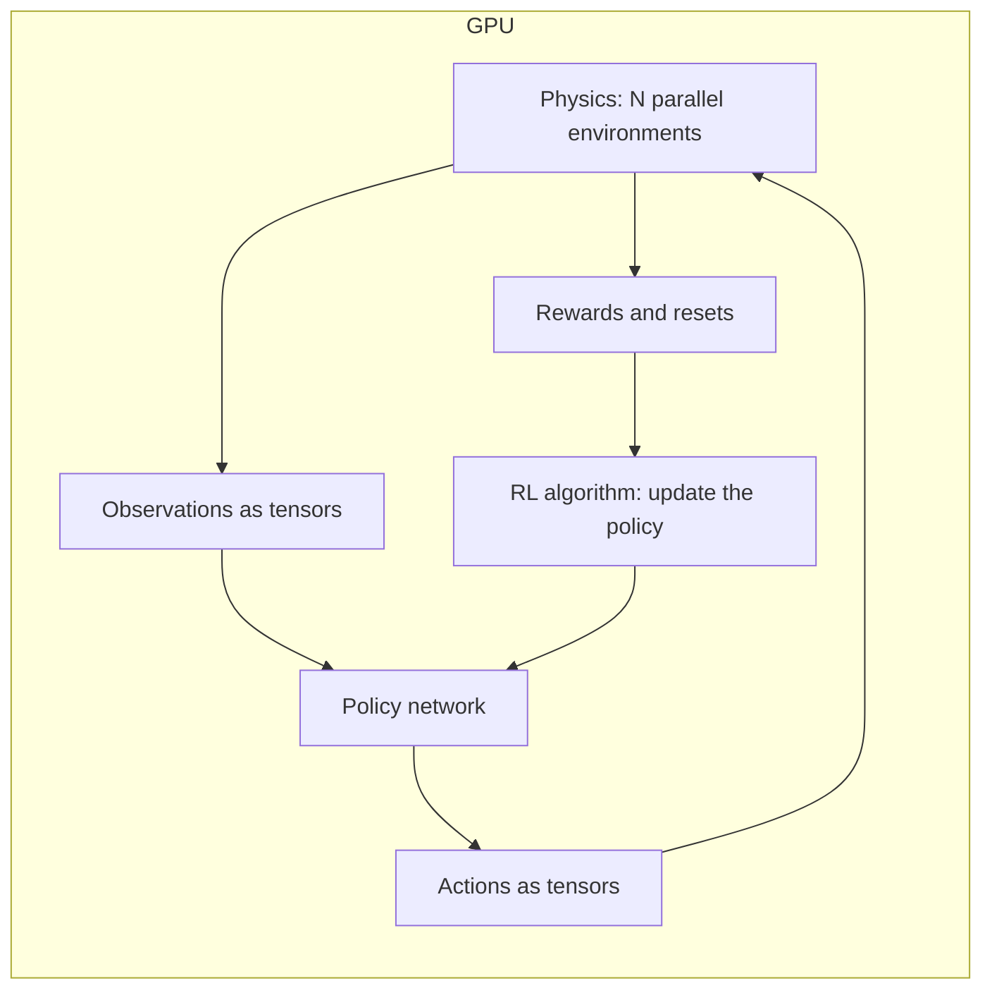

<LessonMeta level="Advanced" time="35 min" prereqs={["Reinforcement learning", "Isaac Sim essentials", "The sim-to-real gap"]} />

ری انفورسمنٹ لرننگ (Reinforcement learning) کو لاکھوں کوششوں کی ضرورت ہوتی ہے۔ ایک حقیقی روبوٹ کچھ ٹوٹنے سے پہلے صرف چند ہزار بار ہی گر سکتا ہے، اور ہر گرنے پر وقت اور پیسہ خرچ ہوتا ہے۔ ایک سیمولیٹر ایک ہی وقت میں، حقیقی وقت سے کہیں زیادہ تیز رفتار کے ساتھ، ہزاروں روبوٹس چلا سکتا ہے، اور روبوٹ کا گرنا بالکل مفت ہوتا ہے۔ یہ سبق دکھاتا ہے کہ جدید روبوٹ لرننگ پائپ لائنز کس طرح اس فائدے کو استعمال کرتی ہیں، جس میں NVIDIA Isaac Lab کو ایک مثال کے طور پر پیش کیا گیا ہے۔

<Objectives>

- وضاحت کریں کہ مساوی طور پر متوازی (massively parallel) GPU سیمولیشن نے روبوٹ ری انفورسمنٹ لرننگ کو کیوں بدل دیا۔
- Isaac Lab ٹاسک کے بنیادی اجزاء کی وضاحت کریں: مشاہدات (observations)، افعال (actions)، انعامات (rewards)، خاتمے (terminations)، واقعات (events) اور نصاب (curricula)۔
- متعدد شرائط کے ساتھ ایک ریوارڈ فنکشن ڈیزائن کریں اور ریوارڈ ڈیزائن کی عام غلطیوں کو پہچانیں۔
- کسی ٹاسک کے لیے ڈومین رینڈمائزیشن (domain randomization) کے پیرامیٹرز اور نصاب منتخب کریں۔

</Objectives>

:::info
Isaac Sim اور Isaac Lab تیزی سے تبدیل ہو رہے ہیں۔ یہ سبق کسی مخصوص ورژن کے کمانڈز کے بجائے ٹاسک کے تصورات اور ساخت کی تعلیم دیتا ہے۔ انسٹالیشن کے مراحل اور اپنے ریلیز کے دقیق API کے لیے isaac-sim.github.io/IsaacLab پر موجودہ Isaac Lab دستاویزات دیکھیں۔
:::

## متوازی سیمولیشن کیوں اہم ہے

روبوٹ پر کلاسیکل RL سی پی یو (CPU) پر ایک سیمولیشن چلاتا تھا اور سیمولیٹر اور نیورل نیٹ ورک کے درمیان ڈیٹا کا تبادلہ کرتا تھا۔ وہی عمل رکاوٹ بن جاتا تھا: نیورل نیٹ ورک کو تربیت دینے والا GPU فارغ بیٹھ کر CPU کا انتظار کرتا تھا جو فزکس کو سیمولیٹ کر رہا ہوتا تھا۔

بنیادی پیشرفت یہ تھی کہ **ایک ہی GPU سیمولیشن کے اندر ایک ساتھ ماحول کی ہزاروں کاپیاں چلائی جائیں**، اور تمام ڈیٹا (حالتیں، مشاہدات، انعامات) کو ٹینسرز (tensors) کی صورت میں GPU پر ہی رکھا جائے۔ پالیسی نیٹ ورک بھی GPU پر ہی چلتا ہے۔ ہر قدم پر CPU کی طرف کچھ منتقل نہیں ہوتا۔ جس کام میں پہلے دنوں کا وقت لگتا تھا وہ اب بہت کم وقت میں مکمل ہو سکتا ہے۔ اس تصور کا ایک معروف مظاہرہ "Learning to Walk in Minutes Using Massively Parallel Deep Reinforcement Learning" (Rudin et al., 2021) ہے، جس نے ایک واحد GPU پر منٹوں میں ٹانگوں والے روبوٹ (legged robot) کو چلنا سکھایا۔

<KeyIdea title="متوازی عمل (Parallelism) RL کو نایاب قسمت کے بجائے معمول کی انجینئرنگ میں بدل دیتا ہے">
ہزاروں روبوٹس کے ایک ساتھ تربیت حاصل کرنے سے، ہر لرننگ سٹیپ تجربے کا ایک بہت بڑا اور متنوع بیچ دیکھتا ہے۔ آپ ایک ہی دن میں متعدد ریوارڈ ڈیزائنز، متعدد رینڈم سیڈز (random seeds) اور بہت سی رینڈمائزیشنز آزما سکتے ہیں۔ محدود کرنے والا عنصر کمپیوٹنگ کے بجائے آپ کے ٹاسک ڈیزائن کی کوالٹی بن جاتا ہے: یعنی انعامات، رینڈمائزیشن اور خاتمے۔
</KeyIdea>

**Isaac Lab** روبوٹ لرننگ کے لیے Isaac Sim کے اوپر NVIDIA کا اوپن سورس فریم ورک ہے۔ یہ NVIDIA کے پہلے والے روبوٹ لرننگ پروجیکٹس سے تیار ہوا ہے اور تیار شدہ روبوٹس، سینسرز، ٹاسکس اور عام RL لائبریریوں کے ساتھ انٹیگریشن فراہم کرتا ہے۔ آپ ٹاسک کی تفصیل لکھتے ہیں، اس کی طرف کسی RL لائبریری کی نشاندہی کرتے ہیں، اور تربیت متوازی طور پر ہزاروں ماحولوں میں چلتی ہے۔

## ایک ٹاسک کی ساخت

Isaac Lab کسی ٹاسک کو کنفیگریشن کے اجزاء کے سیٹ کے طور پر بیان کرتا ہے۔ اس کے **manager-based** اسلوب میں، ہر حصے کا ایک مینیجر ہوتا ہے جسے آپ شرائط کے ساتھ کنفیگر کرتے ہیں۔ (ایک زیادہ عملی **direct** اسلوب بھی ہے جہاں آپ ٹینسر کوڈ کے طور پر قدم بہ قدم لاجک خود لکھتے ہیں۔) معمول کے اجزاء یہ ہیں:

| جزو | یہ کس سوال کا جواب دیتا ہے؟ | مثال |
|---|---|---|
| Scene | کیا موجود ہے؟ | روبوٹ، زمین کا سطح (ground plane)، اشیاء، سینسرز |
| Observations | پالیسی کیا دیکھتی ہے؟ | جوائنٹ پوزیشنز اور ویلاسٹی، بیس کی سمت، آخری ایکشن، حکم دی گئی ویلاسٹی |
| Actions | پالیسی کس چیز کو کنٹرول کرتی ہے؟ | PD کنٹرولر کے لیے ٹارگٹ جوائنٹ پوزیشنز |
| Rewards | کیا چیز اچھی شمار ہوتی ہے؟ | ویلاسٹی کو ٹریک کرنا، سیدھا رہنا، توانائی بچانا |
| Terminations | ایک ایپی سوڈ کب ختم ہوتا ہے؟ | روبوٹ گر جائے، وقت ختم ہو جائے |
| Events | ری سیٹ پر یا ایپی سوڈ کے دوران کیا تبدیل ہوتا ہے؟ | فرکشن (friction)، کمیت (mass) کو رینڈمائز کرنا؛ رینڈم دھکے لگانا |
| Curriculum | دشواری کیسے بڑھتی ہے؟ | روبوٹ کے کامیاب ہونے پر زیادہ مشکل راستے (terrain) |
| Commands | پالیسی کو کیا ہدف دیا گیا ہے؟ | مطلوبہ فارورڈ ویلاسٹی |

ہر چیز ویکٹرائزڈ (vectorised) ہے: ہر ٹرم ایک فنکشن ہے جو فی انوائرنمنٹ ایک رو (row) والے ٹینسرز لیتی ہے اور فی انوائرنمنٹ ایک رو والے ٹینسرز واپس کرتی ہے۔ آپ کو روبوٹس پر لوپ (loop) لکھنے کی ضرورت نہیں ہے۔

### مشاہدات اور افعال (
