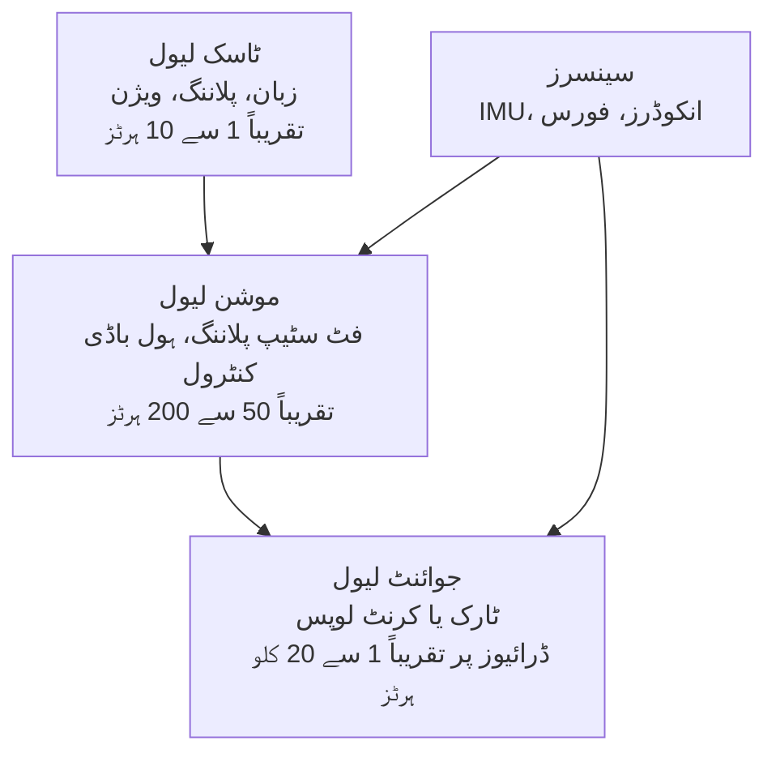

<LessonMeta level="انٹرمیڈیٹ" time="30 منٹ" prereqs={["Anatomy of a robot", "Frames and rigid transforms", "Python basics"]} />

سیڑھیوں پر ایک باکس لے کر جاتے ہوئے ایک ہیومنائیڈ کا تصور کریں۔ ہر قدم پر اس کے گھٹنے کو ٹارک (torque) کی زبردست قوت فراہم کرنی ہوتی ہے، اس کے ٹخنے کو چند ملی سیکنڈز کے اندر فرش کو محسوس کرنا ہوتا ہے، اس کی کولہے کی ہڈی (hip) کو لرز کر الگ نہیں ہونا چاہیے، اور پوری مشین کو اپنی بیٹری اور کمپیوٹر خود اٹھانا ہوتا ہے۔ ان ضروریات میں سے ہر ایک ڈیزائن کا ایک ایسا انتخاب ہے جو مہینوں پہلے کیا گیا تھا، جب کسی نے ایکچوایٹر (actuator)، سینسر یا پروسیسر کا انتخاب کیا تھا۔ یہ سبق ان ہی انتخاب کا ایک دورہ ہے۔

<Objectives>

- ہیومنائیڈ کے ڈگریز آف فریڈم (degrees of freedom) کو گنیں اور وضاحت کریں کہ وہ کہاں جاتے ہیں۔
- کوایسی-ڈائریکٹ-ڈرائیو (quasi-direct-drive)، سیریز ایلاسٹک (series elastic) اور ہائیڈرولک (hydraulic) ایکچوایٹرز کا موازنہ کریں۔
- آؤٹ پٹ ٹارک اور ریفلیکٹڈ انرشیا (reflected inertia) کا حساب لگانے کے لیے گیئر ریشو (gear ratio) کا استعمال کریں۔
- ان سینسرز اور کمپیوٹ لیئرز (compute layers) کی فہرست بنائیں جن کی ایک ہیومنائیڈ کو ضرورت ہوتی ہے، اور بتائیں کہ ہر ایک کا مقصد کیا ہے۔
- انسانی شکل کے حق اور مخالفت میں دیانت داری سے دلائل دیں۔

</Objectives>

## جسم: ڈگریز آف فریڈم

ایک <Term def="کسی جسم کے حرکت کرنے کا ایک آزاد طریقہ۔ ایک ہنج جوڑ (hinge joint) ایک اضافہ کرتا ہے؛ ایک بال جوڑ (ball joint) تین کا اضافہ کرتا ہے۔">degree of freedom</Term> (DoF) حرکت کرنے کا ایک آزاد طریقہ ہے جس سے روبوٹ حرکت کر سکتا ہے۔ ایک ہنج (جیسے آپ کی کہنی) ایک DoF دیتا ہے۔ ایک بال اور ساکٹ جوڑ (جیسے آپ کا کندھا) تین دیتا ہے۔ زیادہ تر ہیومنائیڈز تین ہنج محوروں (hinge axes) کو ایک نقطے پر ملا کر ایک بال جوڑ بناتے ہیں۔

ایک عام ہیومنائیڈ کی ساخت اس طرح دکھائی دیتی ہے:

| حصہ | عام DoF | کیوں |
|---|---|---|
| ہر ٹانگ | 6 | 3 کولہے (hip) پر، 1 گھٹنے (knee) پر، 2 ٹخنے (ankle) پر: کسی بھی سمت میں خلا میں پاؤں رکھنے کے لیے کافی |
| ہر بازو | 6 یا 7 | 3 کندھے (shoulder) پر، 1 کہنی (elbow) پر، 2 یا 3 کلائی (wrist) پر؛ ساتواں کہنی کو گھومنے دیتا ہے جبکہ ہاتھ اپنی جگہ قائم رہتا ہے |
| کمر یا دھڑ | 0 سے 3 | پہنچ کو بڑھاتا ہے اور توازن برقرار رکھنے میں مدد کرتا ہے |
| گردن اور سر | 1 سے 3 | کیمروں کو موڑتا ہے |
| ہر ہاتھ | 1 سے 20 یا اس سے زیادہ | ایک سادہ دو انگلیوں والے گرپر (gripper) سے لے کر ایک ماہر ہاتھ تک |

ان سب کو جمع کریں تو ایک عام مکمل سائز کے ہیومنائیڈ میں 25 سے 50 ایکچوایٹڈ (actuated) جوڑ ہوتے ہیں، علاوہ ہاتھوں کے۔ حتمی تعداد ڈیزائن پر منحصر ہے، لہٰذا اس جدول کو ایک عام اصول سمجھیں، کسی خاص روبوٹ کی تفصیلات (spec) نہیں۔

ایک اور نمبر بھی اہم ہے۔ ایک ہیومنائیڈ ایک <Term def="ایک ایسا روبوٹ جس کا بیس دنیا کے ساتھ بولٹ (bolted) نہیں ہے۔ اس کا جسم آزادانہ طور پر منتقل اور گھوم سکتا ہے، جو 6 غیر ایکچوایٹڈ ڈگریز آف فریڈم کا اضافہ کرتا ہے۔">floating-base</Term> سسٹم ہے: پیلوِس (pelvis) کو دنیا کے ساتھ کوئی چیز طے نہیں کرتی، لہٰذا روبوٹ کے پاس 6 اضافی DoF ہوتے ہیں (جسم کی پوزیشن اور اورینٹیشن) جنہیں کوئی موٹر براہ راست کنٹرول نہیں کرتی۔ روبوٹ انہیں صرف اپنے پاؤں کے ذریعے زمین پر دھکا دے کر بدل سکتا ہے۔ یہی واحد حقیقت ہے کہ توازن (اگلا سبق) مشکل کیوں ہے۔

```python title="joint_budget.py"
from dataclasses import dataclass

@dataclass
class Joint:
    name: str
    dof: int
    peak_torque_nm: float  # round, made-up numbers for practice; not any real robot

leg = [Joint("hip", 3, 150.0), Joint("knee", 1, 200.0), Joint("ankle", 2, 80.0)]
arm = [Joint("shoulder", 3, 60.0), Joint("elbow", 1, 40.0), Joint("wrist", 3, 15.0)]
neck = [Joint("neck", 2, 10.0)]
waist = [Joint("waist", 1, 120.0)]

def dof(chain):
    return sum(j.dof for j in chain)

body = {"left leg": leg, "right leg": leg, "left arm": arm,
        "right arm": arm, "neck": neck, "waist": waist}

total = 0
for name, chain in body.items():
    print(f"{name:10s} {dof(chain)} DoF")
    total += dof(chain)

print("actuated body DoF (no hands):", total)
print("floating-base DoF (unactuated):", 6)
print("configuration size:", total + 6)
```

اسے چلائیں اور آپ کو 6 فی ٹانگ، 7 فی بازو، 2 گردن کے لیے، 1 کمر کے لیے ملتے ہیں: ہاتھوں کے بغیر 29 ایکچوایٹڈ DoF، اور مکمل کنفیگریشن میں 35 نمبر۔ نوٹس کریں کہ ٹانگوں پر سب سے زیادہ ٹارک ہوتا ہے۔ وہ پورا وزن اٹھاتی ہیں اور ہر قدم پر اسے سنبھالتی ہیں۔

## ایکچوایٹرز: مسل (پٹھا) کہاں سے آتا ہے

ایک <Term def="ایک موٹر، گیئر باکس اور ڈرائیو الیکٹرانکس جو مل کر ایک جوڑ کو حرکت دیتے ہیں۔">actuator</Term> صرف ایک موٹر سے زیادہ ہوتا ہے۔ گیئر باکس یہ طے کرتا ہے کہ موٹر باقی روبوٹ کو کیسی محسوس ہوتی ہے۔ تین خاندان غالب ہیں۔

### گیئرڈ الیکٹرک موٹرز

ایک چھوٹی، تیز رفتار موٹر سستی اور ہلکی ہوتی ہے لیکن کمزور ہوتی ہے۔ ریشو $N$ والا گیئر باکس ٹارک کے لیے رفتار کا تبادلہ کرتا ہے:

$$
\tau_{\text{out}} = \eta \, N \, \tau_{\text{motor}}, \qquad J_{\text{reflected}} = N^2 J_{\text{rotor}}
$$

یہاں $\eta$ کارکردگی (efficiency) ہے (ہمیشہ 1 سے کم) اور $J_{\text{rotor}}$ روٹر کا انرشیا (inertia) ہے۔ دوسری مساوات حیران کن ہے۔ ٹارک $N$ کے ساتھ بڑھتا ہے، لیکن جوڑ جس انرشیا کو *محسوس* کرتا ہے وہ $N^2$ کے ساتھ بڑھتا ہے۔ ایک زیادہ گیئر ریشو جوڑ کو مضبوط، تیزی سے ایکسیلریٹ کرنے میں سست، اور ہاتھ سے حرکت دینے میں مشکل بناتا ہے۔ گیئر باکس میں رگڑ (friction) بھی ضرب کھاتی ہے، لہٰذا آپ موٹر کرنٹ کے ذریعے باہر کی دنیا کو محسوس نہیں کر سکتے۔

```python title="actuator_tradeoff.py"
def joint_from_motor(tau_motor, j_rotor, n, efficiency=0.9):
    """Return (output torque in Nm, reflected inertia in kg m^2)."""
    return tau_motor * n * efficiency, j_rotor * n ** 2

print(" N   output torque   reflected inertia")
for n in (6, 9, 30, 100):
    tau, j = joint_from_motor(tau_motor=1.5, j_rotor=2.0e-4, n=n)
    print(f"{n:3d}   {tau:8.1f} Nm   {j:12.4f} kg m^2")
```

$N=9$ سے $N=100$ پر جانے سے ٹارک تقریباً 11 گنا بڑھ جاتا ہے لیکن ریفلیکٹڈ انرشیا (reflected inertia) تقریباً 123 گنا بڑھ جاتا ہے۔ یہی اگلے ڈیزائن کا بنیادی انتخاب ہے۔

### کوایسی-ڈائریکٹ-ڈرائیو (QDD)

<Term def="ایک بڑا، ٹارک ڈینس موٹر اور کم گیئر ریشو (عام طور پر 6 سے 10 کے قریب) والا ایکچوایٹر، تاکہ یہ بیک ڈرائیو ایبل (backdrivable) رہے۔">Quasi-direct-drive</Term> ایکچوایٹرز ایک بڑے قطر، اعلی ٹارک والی موٹر اور ایک چھوٹا گیئر ریشو استعمال کرتے ہیں۔ چونکہ $N$ کم ہوتا ہے، اس لیے جوڑ <Term def="آؤٹ پٹ سائیڈ سے حرکت دینے کے قابل۔ ایک بیک ڈرائیو ایبل جوڑ اس وقت راستہ دیتا ہے جب کوئی چیز اس پر دھکا دیتی ہے۔">backdrivable</Term> ہوتا ہے: ٹانگ پر ایک دھکا موٹر کو گھماتا ہے، اور موٹر کرنٹ آپ کو بتاتا ہے کہ آپ کو کتنی شدت سے دھکیلا گیا تھا۔ یہ مفت <Term def="بغیر کسی فورس سینسر کے صرف موٹر کرنٹ سے ایک جوڑ کی طرف سے لگائی جانے والی یا محسوس کی جانے والی فورس کا اندازہ لگانا۔">proprioceptive force sensing</Term> فراہم کرتا ہے اور اثرات (پاؤں کا فرش سے ٹکرانا) کو گیئر باکس کے لیے بہت نرم بنا دیتا ہے۔ اس کی قیمت اسی ٹارک کے لیے ایک بڑی، بھاری اور زیادہ گرم ہونے والی موٹر ہے۔ یہ ڈیزائن پچھلی دہائی میں ٹانگوں والے روبوٹس میں مقبول ہوا ہے۔

### سیریز ایلاسٹک ایکچوایٹرز (SEA)

ایک <Term def="موٹر اور لوڈ کے درمیان اسپرنگ والا ایکچوایٹر۔ اسپرنگ کے کھینچاؤ کو ماپنے سے فورس کی پیمائش ہوتی ہے۔">series elastic actuator</Term> گیئر باکس اور لنک کے درمیان ایک جان بوجھ کر اسپرنگ رکھتا ہے۔ یہ ناپیں کہ اسپرنگ کتنا کھنچتا ہے اور آپ کو سستے انکوڈر اور بہترین درستگی کے ساتھ ٹارک کا پتہ چل جائے گا۔ اسپرنگ جھٹکوں کو بھی جذب کرتا ہے اور قدموں کے درمیان توانائی ذخیرہ کر سکتا ہے۔ اس کی قیمت بینڈوڈتھ (bandwidth) ہے: اسپرنگ اس بات کو محدود کرتا ہے کہ فورس کتنی تیزی سے بدل سکتی ہے، اور کنٹرول لوپ کو ایک اور ریزونینس (resonance) کو سنبھالنا پڑتا ہے۔

### ہائیڈرولک اور الیکٹرک

ہائیڈرولک ایکچوایٹرز سلنڈروں کے ذریعے سیال (fluid) کو دھکیلتے ہیں۔ ان کی پاور ڈینسٹی (power density) بہت زیادہ ہوتی ہے اور یہ ایک چھوٹے پیکج سے بہت زیادہ فورس فراہم کر سکتے ہیں، یہی وجہ ہے کہ کچھ بانی ہیومنائیڈز نے چھلانگ لگانے اور فلپس کے لیے ان کا استعمال کیا۔ انہیں ایک پمپ، ہوزز، ایک ذخیرہ (reservoir) اور محتاط سیلنگ کی بھی ضرورت ہوتی ہے، یہ گرم اور شور والے ہوتے ہیں، اور لیک ہو سکتے ہیں۔ الیکٹرک ایکچوایٹرز زیادہ خاموش، صاف ستھرے، زیادہ موثر اور کنٹرول کرنے میں آسان ہوتے ہیں، اور جیسے جیسے موٹرز اور بیٹریاں بہتر ہوئی ہیں، زیادہ تر نئے ہیومنائیڈز الیکٹرک پر منتقل ہو گئے ہیں۔ ایک مشہور ہائیڈرولک ریسرچ ہیومنائیڈ کے بعد اسی بنانے والے کی طرف سے ایک الیکٹرک ورژن متعارف کرایا گیا تھا۔

:::note[لینیئر ایکچوایٹرز]
ٹانگیں لینیئر ایکچوایٹرز (جیسے رولر سکرو ڈیزائن) کا بھی استعمال کرتی ہیں جو مختصر لنکج کے ذریعے گھٹنے یا ٹخنے کو دھکیلتے ہیں۔ وہ ایک متناسب لائن میں اعلی فورس دیتے ہیں اور بڑے روبوٹس کے گھٹنے اور ٹخنے پر عام ہیں۔
:::

<KeyIdea title="گیئر ریشو ایک معاوضہ ہے، مفت تحفہ نہیں">

زیادہ گیئرنگ سے ٹارک حاصل ہوتا ہے اور رفتار، بیک ڈرائیو ایبلٹی اور فورس سینسنگ کی قیمت چکانی پڑتی ہے۔ وہ ٹانگوں والے روبوٹس جو اثرات کو جذب کرنا چاہتے ہیں اور دھکوں کا جواب دینا چاہتے ہیں، عام طور پر کم گیئر ریشو (QDD) یا اسپرنگ (SEA) چاہتے ہیں۔ سست، مضبوط، درست جوڑ زیادہ گیئرنگ برداشت کر سکتے ہیں۔

</KeyIdea>

## سینسرز: روبوٹ اپنے آپ کو کیسے جانتا ہے

لفظ *proprioception* کا مطلب ہے اپنے جسم کو محسوس کرنا۔ ایک ہیومنائیڈ کو اس کی پرتوں میں ضرورت ہوتی ہے:

- **جوائنٹ انکوڈرز (Joint encoders)** ہر جوڑ کے زاویے کو ناپتے ہیں، عام طور پر موٹر پر اور اکثر آؤٹ پٹ پر دوبارہ۔ رفتار تفریق سے حاصل ہوتی ہے۔
- **ایک IMU** (انرشیل میژرمنٹ یونٹ: گائروسکوپ پلس ایکسیلرومیٹر) پیلوِس یا دھڑ میں بیٹھتا ہے اور جسم کی اورینٹیشن اور اینگولر ویلوسٹی کی اطلاع دیتا ہے۔ یہ توازن کا سب سے اہم سینسر ہے۔
- ٹخنے میں **فورس/ٹارک سینسرز** (اور کبھی کبھی کلائیوں میں) زمین کے ردعمل کو ناپتے ہیں۔ وہ کنٹرولر کو بتاتے ہیں کہ پاؤں کے نیچے دباؤ کہاں ہے، جو بالکل وہی مقدار ہے جس کی اگلے سبق کو ضرورت ہے۔
- سر میں **کیمرے، ڈیپتھ سینسرز اور LiDAR** دنیا کو دیکھتے ہیں: سیڑھیاں، دروازے، اشیاء۔
- انگلیوں کے پوروں میں **ٹیکٹائل سینسرز (Tactile sensors)** چھونے کو محسوس کرتے ہیں؛ دیکھیں [Hands and dexterity](./05-hands-and-dexterity.mdx)۔

اسٹیٹ ایسٹیمیشن (State estimation) ان سب کو ایک جگہ ملا کر اس بات کا اندازہ لگاتی ہے کہ جسم کہاں ہے اور کتنی تیزی سے حرکت کر رہا ہے۔ یہ [State estimation and Kalman filters](../05-perception/04-state-estimation-and-kalman-filters.mdx) کے فلٹرز کا استعمال کرتا ہے۔

## کمپیوٹ: تین رفتاریں

پرتوں میں سوچیں، ہر ایک اپنی رفتار سے چل رہی ہے:



جوائنٹ لیول لوپس موٹر ڈرائیوز میں ہوتے ہیں اور EtherCAT یا CAN جیسے رئیل ٹائم بس کے ذریعے بات چیت کرتے ہیں۔ ایک کنٹرول کمپیوٹر سخت رئیل ٹائم میعاد (deadlines) کے ساتھ موشن لیول کو چلاتا ہے۔ ایک الگ، زیادہ طاقتور کمپیوٹر (عام طور پر GPU یا AI ایکسیلیریٹر کے ساتھ) پرسیپشن اور لرن شدہ ماڈلز چلاتا ہے، کیونکہ ان میں درجنوں ملی سیکنڈز لگ سکتے ہیں اور انہیں کبھی بھی توازن کی لوپ کو نہیں روکنا چاہیے۔ پرتوں کو الگ رکھنا ہی اس کی وجہ ہے کہ روبوٹ سست سوچ سکتا ہے اور پھر بھی نیچے نہیں گرتا۔

## انسانی شکل ہی کیوں؟

ہیومنائیڈ روبوٹس ہر کام کے لیے بہترین شکل نہیں ہیں۔ دو بازوؤں والا ایک پہیوں والا بیس سستا، زیادہ مستحکم اور اکثر ٹھیک ہوتا ہے۔ دو ٹانگوں اور دو بازوؤں کی دلیل عملی ہے:

- دنیا انسانوں کے لیے بنائی گئی ہے: سیڑھیاں، دروازے کے ہینڈل، الماریاں، اوزار، گاڑیاں۔ ایک ہیومنائیڈ عمارت کو تبدیل کیے بغیر فٹ بیٹھتا ہے۔
- انسانی مظاہرے کی نقل منتقل ہوتی ہے: ایک شخص روبوٹ کو ٹیلی آپریٹ کر سکتا ہے، اور کام کرنے والے لوگوں کی ویڈیو قدرتی طور پر ایک ہی شکل کے جسم پر نقش ہوتی ہے۔
- ایک عام جسم، بہت سے کام، جو بڑے ڈیٹا اکٹھا کرنے اور بڑے ماڈلز کو قابل بناتا ہے۔

مخالفت کی دلیلیں اتنی ہی سچی ہیں۔ دو ٹانگیں غیر مستحکم، مہنگی، توانائی کی بھوکی اور تجارتی بنانے میں سست ہوتی ہیں۔ ہر جوڑ ایک ممکنہ ناکامی ہے۔ ان دعووں پر شک کریں کہ ہیومنائیڈ ہمیشہ درست جواب ہے؛ وہ جسم منتخب کریں جو کام کے مطابق ہو۔

:::warning[اسپیک شیٹس پر اندھا دھند بھروسہ نہ کریں]
تجارتی ہیومنائیڈز کے لیے پے لوڈ، رن ٹائم اور رفتار کے اعداد و شمار تیزی سے بدلتے ہیں اور اکثر بہترین صورت حال کے نمبر ہوتے ہیں۔ کسی بھی نمبر پر اس وقت تک مارکیٹنگ کا شک کریں جب تک کہ آپ کو ٹیسٹ کے حالات نہ مل جائیں۔
:::

## عملی لیب

<Steps>

1. `joint_budget.py` کو محفوظ کریں اور اسے چلائیں۔ تصدیق کریں کہ آپ کو 29 ایکچوایٹڈ DoF اور 35 سائز کی کنفیگریشن ملتی ہے۔
2. ہر بازو میں اپنی پسند کی `hand` چین (مثال کے طور پر 6 DoF) شامل کریں اور دوبارہ چلائیں۔ گنتی کیسے بدلتی ہے؟
3. `actuator_tradeoff.py` کو محفوظ کریں، اسے چلائیں، پھر `j_rotor` کو دگنا کریں۔ کون سا کالم بدلتا ہے، اور کتنا؟
4. 0.5 kg m^2 کے لوڈ انرشیا پلس ریفلیکٹڈ انرشیا کو فرض کرتے ہوئے، ٹارگٹ اینگولر ایکسیلریشن تک پہنچنے کے وقت کے لیے ایک کالم شامل کریں۔ اب کون سا گیئر ریشو بہترین ہے؟
5. آپ اس وقت فارغ ہیں جب آپ دو جملوں میں وضاحت کر سکیں کہ 100:1 کا جوڑ پاؤں کی ہٹ (footstrike) کو جذب کرنے میں کیوں خراب ہے۔

</Steps>

## مشقیں

<Exercise title="جوڑوں کو گنیں" level="Beginner">

ایک ہیومنائیڈ میں 6-DoF ٹانگیں، 7-DoF بازو، 3-DoF کمر اور 2-DoF گردن ہے۔ اس میں کتنے ایکچوایٹڈ DoF ہیں، اور اس کا مکمل کنفیگریشن ویکٹر کتنا بڑا ہے؟

<Solution>

ٹانگیں: 2 × 6 = 12۔ بازو: 2 × 7 = 14۔ کمر 3، گردن 2۔ کل ایکچوایٹڈ: 12 + 14 + 3 + 2 = 31۔ فلوٹنگ بیس کے لیے 6 شامل کریں: کنفیگریشن میں 37 کیلیوز ہیں۔

</Solution>

</Exercise>

<Exercise title="گیئر ریشو کا انتخاب کریں" level="Intermediate">

ایک موٹر 2 N·m دیتی ہے اور اس کا روٹر انرشیا $3\times10^{-4}$ kg m² ہے۔ 0.9 کارکردگی کے ساتھ، $N = 8$ اور $N = 50$ کے لیے آؤٹ پٹ ٹارک اور ریفلیکٹڈ انرشیا کا حساب لگائیں۔ آپ ایک ایسے کولہے کے لیے کون سا منتخب کریں گے جس کو دھکوں کا جواب دینا پڑے، اور کیوں؟

<Solution>

$N=8$ کے لیے: ٹارک $= 0.9 \times 8 \times 2 = 14.4$ N·m؛ ریفلیکٹڈ انرشیا $= 3\times10^{-4} \times 64 = 0.0192$ kg m²۔ $N=50$ کے لیے: ٹارک $= 90$ N·m؛ انرشیا $= 3\times10^{-4} \times 2500 = 0.75$ kg m²۔ دھکوں کا جواب دینے والے کولہے کو $N=8$ کو ترجیح دینی چاہیے (بیک ڈرائیو ایبل، کم ریفلیکٹڈ انرشیا، کرنٹ کے ذریعے فورس محسوس کر سکتا ہے)، بشراطیکہ موٹر کو کافی مضبوط بنایا جا سکے۔ $N=50$ زیادہ ٹارک دیتا ہے لیکن جوڑ سخت ہوتا ہے اور جواب دینے میں سست ہوتا ہے۔

</Solution>

</Exercise>

<Exercise title="کمپیوٹ کی پرتیں" level="Intermediate">

ایک بڑا ویژن ماڈل توازن کنٹرولر کی لوپ میں کیوں نہیں چلنا چاہیے؟

<Solution>

توازن کے لیے ہر سائیکل میں، چند ملی سیکنڈز کے اندر میعاد (deadline) کو پورا کرنے کی ضرورت ہوتی ہے۔ ایک بڑے ماڈل میں متغیر اور بہت زیادہ تاخیر ہوتی ہے اور وہ کبھی کبھی اپنی میعاد سے محروم ہو سکتا ہے، جس سے روبوٹ غیر مستحکم ہونے کی صورت میں بغیر کسی کمانڈ کے رہ جاتا ہے۔ پرسیپشن کو ایک الگ کمپیوٹر یا عمل پر چلانا، اور کنٹرولر کو اس کا تازہ ترین نتیجہ غیر متضاد طور پر (asynchronously) دینا، توازن کو محفوظ رکھتا ہے۔

</Solution>

</Exercise>

## اپنی سمجھ کی جانچ کریں

<Quiz questions={[
  {q: "کیا چیز ہیومنائیڈ کو فلوٹنگ بیس (floating-base) سسٹم بناتی ہے؟", options: ["اس کی ٹانگیں نہیں ہیں", "اس کا جسم دنیا سے منسلک نہیں ہے، لہٰذا 6 باڈی ڈگریز آف فریڈم براہ راست ایکچوایٹڈ نہیں ہیں", "یہ پانی میں تیرتا ہے", "یہ ہر جوڑ میں اسپرنگ کا استعمال کرتا ہے"], answer: 1, explain: "پیلوِس کو زمین سے کوئی چیز بولٹ نہیں کرتی، لہٰذا روبوٹ اپنے جسم کے پوز کو صرف غیر براہ راست، پاؤں کے ذریعے زمین پر دھکا دے کر کنٹرول کرتا ہے۔"},
  {q: "اگر آپ جوڑ کا گیئر ریشو دگنا کر دیں، تو ریفلیکٹڈ انرشیا کا کیا ہوتا ہے؟", options: ["یہ دگنا ہو جاتا ہے", "یہ آدھا ہو جاتا ہے", "یہ چار گنا بڑھ جاتا ہے", "یہ وہی رہتا ہے"], answer: 2, explain: "ریفلیکٹڈ انرشیا گیئر ریشو کے مربع کے ساتھ بڑھتا ہے۔"},
  {q: "بہت سے ٹانگوں والے روبوٹس کم گیئر ریشو والے ایکچوایٹرز کو کیوں ترجیح دیتے ہیں؟", options: ["وہ ہر حالت میں سستے ہوتے ہیں", "وہ بیک ڈرائیو ایبل ہوتے ہیں، اثرات کو بہتر طور پر جذب کرتے ہیں اور موٹر کرنٹ سے فورس سینسنگ کی اجازت دیتے ہیں", "وہ کبھی گرم نہیں ہوتے", "وہ بغیر بیٹریوں کے چلتے ہیں"], answer: 1, explain: "بیک ڈرائیو ایبلٹی لچک اور پروپریوسیپٹیو فورس سینسنگ دیتی ہے، جو اثرات اور دھکوں میں مدد کرتی ہے۔"},
  {q: "توازن کے لیے کون سا سینسر سب سے اہم ہے؟", options: ["پیلوِس یا دھڑ میں IMU", "ایک مائیکروفون", "ایک تھرمامیٹر", "ایک GPS ریسیوور"], answer: 0, explain: "IMU باڈی اورینٹیشن اور اینگولر ویلوسٹی کا بتاتا ہے، جس کی توازن کنٹرولر کو زیادہ رفتار سے ضرورت ہوتی ہے۔"}
]} />

<Takeaways>

- ایک عام ہیومنائیڈ میں تقریباً 25 سے 50 ایکچوایٹڈ جوڑ اور 6 غیر ایکچوایٹڈ فلوٹنگ بیس DoF ہوتے ہیں۔
- گیئر ریشو رفتار اور بیک ڈرائیو ایبلٹی کے بدلے ٹارک دیتا ہے؛ ریفلیکٹڈ انرشیا ریشو کے مربع کے ساتھ بڑھتا ہے۔
- QDD ایکچوایٹرز اثر برداشت کرنے اور فورس سینسنگ کو ترجیح دیتے ہیں؛ SEAs اسپرنگ سے فورس ناپتے ہیں؛ ہائیڈرولکس پیچیدگی کی قیمت پر پاور ڈینسٹی پیش کرتے ہیں۔
- سینسنگ پرتوں میں آتی ہے: انکوڈرز، IMU، پاؤں کی فورس، ویژن، ٹچ۔
- کمپیوٹ کو رفتار کے لحاظ سے طبقات میں تقسیم کیا جاتا ہے، لہٰذا سست AI کبھی بھی تیز رفتار توازن میں رکاوٹ نہیں بنتا۔
- انسانی شکل ماحول اور ڈیٹا کے بارے میں ایک عملی شرط ہے، قدرت کا قانون نہیں۔

</Takeaways>

## مزید گہرائی میں جائیں

- [MuJoCo documentation](https://mujoco.readthedocs.io/) for simulating articulated bodies, including humanoids.
- [Pinocchio rigid-body dynamics library](https://stack-of-tasks.github.io/pinocchio/) for kinematics and dynamics of floating-base robots.
- [Isaac Lab documentation](https://isaac-sim.github.io/IsaacLab/): check the current release for humanoid assets and tasks.

Next: [Balance and the ZMP](./02-balance-and-zmp.mdx)
