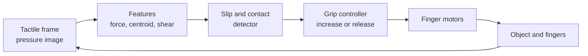
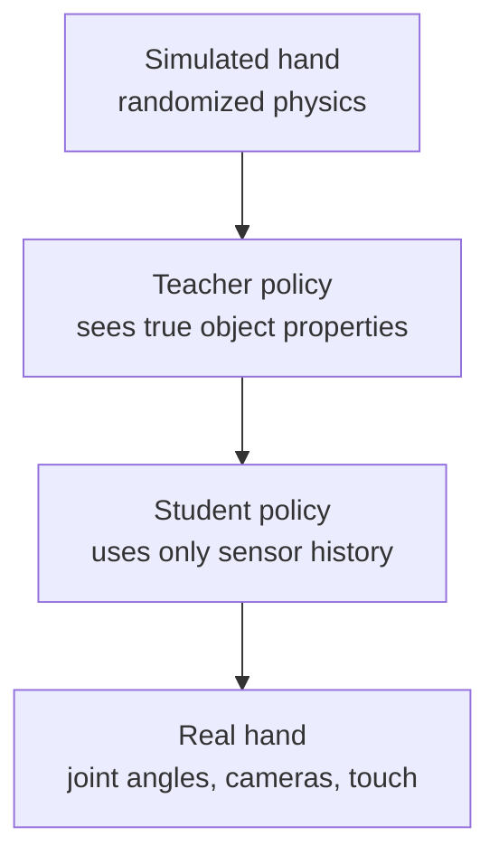

<LessonMeta level="Advanced" time="35 min" prereqs={["Grasping", "Reinforcement learning basics", "Python basics"]} />

ایک انسان نما روبوٹ (Humanoid) میز تک چل کر جا سکتا ہے، ہاتھ آگے بڑھا سکتا ہے، اور پھر پیالہ گرایا جا سکتا ہے۔ بازو بالکل ٹھیک تھا؛ مسئلہ ہاتھ میں تھا۔ ایک ہاتھ کو انڈے کے ساتھ نرم، ہتھوڑے کے ساتھ مضبوط، اور اتنی تیزی سے کام کرنے والا ہونا چاہیے کہ اگر پنسل پھسلنے لگے تو اسے فوراً پکڑ سکے۔ زیادہ تر روبوٹس کے لیے، ہاتھ اب بھی جسم کا سب سے کمزور حصہ ہے، اور ترقی کا سب سے بڑا موقع بھی۔

<Objectives>

- متوازی گرپرز (Parallel grippers)، انڈر ایکچوئیٹڈ ہاتھوں (Underactuated hands) اور مکمل طور پر متحرک ماہر ہاتھوں (Fully actuated dexterous hands) کا موازنہ کریں۔
- وضاحت کریں کہ رزسٹو (Resistive)، کپیسیٹو (Capacitive)، مقناطیسی (Magnetic) اور آپٹیکل (Optical) لمسی سینسر کیسے کام کرتے ہیں۔
- پھسلن کا پتہ لگانے والا ایک سادہ الگورتھم (Slip detector) اور گرپ فورس ریفلیکس (Grip-force reflex) لکھیں۔
- بیان کریں کہ RL نے ہاتھ کے اندر اشیاء کو سنبھالنے کی صلاحیت کیسے پیدا کی، اور چھونے کے احساس کے لیے sim-to-real کیوں مشکل ہے۔

</Objectives>

## ہاتھوں کے ڈیزائن (Hand designs)

انسان کے ہاتھ میں تقریباً بیس درجاتِ آزادی (Degrees of freedom) ہوتے ہیں، جو زیادہ تر کلائی اور بازو میں موجود عضلات کے ذریعے ٹینڈنز (Tendons) کی مدد سے چلتے ہیں۔ اس تمام نظام کی بالکل نقل تیار کرنا بہت مہنگا ہے، اس لیے روبوٹ کے ہاتھ مختلف ڈیزائنوں کے درمیان توازن قائم کرتے ہیں۔

| ڈیزائن | بنیادی خیال | خوبیاں | خامیاں |
|---|---|---|---|
| Parallel-jaw gripper | دو انگلیاں جو ایک دوسرے پر بند ہوتی ہیں | سستا، مضبوط، کنٹرول میں آسان؛ ڈبوں اور کنٹینرز کے لیے بہترین | اشیاء کا رخ تبدیل نہیں کر سکتا، شکل کے مطابق ڈھلنے کی صلاحیت کم ہے |
| Underactuated adaptive hand | جوڑوں کے مقابلے میں کم موٹریں؛ لنکجز یا ٹینڈنز انگلیوں کو شے کے گرد لپیٹنے کی اجازت دیتے ہیں | بغیر سینسنگ کے شکل کے مطابق ڈھل جاتا ہے، سادہ کنٹرول | محدود باریک کنٹرول، ہاتھ کے اندر ہی حرکت دینا مشکل |
| Fully actuated dexterous hand | تقریباً ہر جوڑ کے لیے ایک ایکچوایٹر، اور ایک بالمقابل انگوٹھا (Opposable thumb) | اشیاء کا رخ بدل سکتا ہے اور اوزار استعمال کر سکتا ہے | بہت سے ایکچوایٹرز اور تاریں، مہنگا، نازک، کنٹرول کرنا مشکل |
| Soft or compliant hand | لچکدار انگلیاں، نیومیٹک (Pneumatic) یا لچکدار باڈیز | محفوظ، نرم، غلطی کو برداشت کرنے والا | غیر دقیق (Imprecise)، ماڈل بنانا مشکل، محدود طاقت |

ایک <Term def="ایک ایسا طریقہ کار جس میں جوڑوں سے کم ایکچوایٹرز ہوتے ہیں، لہذا کچھ جوڑ رابطے اور اسپرنگس کی وجہ سے غیر فعال طور پر حرکت کرتے ہیں۔">underactuated</Term> انگلی ایک ہوشیار ترکیب ہے: ایک موٹر ٹینڈن کو کھینچتی ہے، اور اسپرنگس اور جامیٹری (Geometry) انگلی کو راستے میں آنے والی کسی بھی شے کے گرد لپیٹ دیتی ہیں۔ یہی وجہ ہے کہ بہت سے تجارتی بازو سادہ گرپرز کے ساتھ آتے ہیں: وہ مؤثر انداز میں کام کرتے ہیں۔

بالمقابل انگوٹھا (Opposable thumb) سب سے زیادہ اہم ہے۔ انگوٹھے کے بغیر ایک ہاتھ جو دوسری انگلیوں کا مقابلہ نہ کر سکے، باریک گرفت (Precision pinch) یا مستحکم طاقتور گرفت (Power grasp) نہیں بنا سکتا، یہی وجہ ہے کہ ماہر ہاتھوں کے ڈیزائن میں انگوٹھے کی ساخت پر زیادہ توجہ دی جاتی ہے۔

موٹریں کہاں رکھی گئی ہیں، یہ ایک اور اہم ڈیزائن کا انتخاب ہے۔ ہتھیلی اور انگلیوں میں موجود موٹریں محدود ٹارک کے ساتھ سائز میں چھوٹے اور تیز ہاتھ بناتی ہیں۔ بازو میں موجود موٹریں جو ٹینڈنز کو نیچے انگلیوں کی طرف کھینچتی ہیں، ٹینڈن کی رگڑ، کھینچاؤ اور دیکھ بھال کی قیمت پر زیادہ طاقت اور انگلیوں کو ہلکا وزن فراہم کرتی ہیں۔ انسان نما روبوٹس کے ڈیزائن اکثر دونوں کے امتزاج کا استعمال کرتے ہیں۔

:::note
ہاتھ کا انتخاب دراصل کام کا انتخاب ہے۔ ایک گودام کا انسان نما روبوٹ جو ٹوکریاں منتقل کرتا ہے، اسے دو مضبوط پیڈز کی ضرورت ہوتی ہے۔ الیکٹرونکس جوڑنے والے روبوٹ کو باریک انگلیوں کی ضرورت ہوتی ہے۔ وہ مہارت نہ خریدیں جسے آپ کنٹرول نہیں کر سکتے۔
:::

## لمسی حساسیت (Tactile sensing)

بصارت (Vision) آپ کو بتاتی ہے کہ شے کیسی دکھائی دیتی ہے۔ یہ آپ کو یہ نہیں بتا سکتی کہ آپ اسے کتنا سخت دبا رہے ہیں، کیا شے پھسل رہی ہے، یا آپ کی اپنی انگلیاں کیمرے سے اسے چھپا لیں تو رابطہ کی جگہ کہاں ہے۔ یہ چھونے کے احساس کا کام ہے۔

عام <Term def="ایک ایسا سینسر جو رابطے کو ناپتا ہے: کہاں، کتنا سخت، اور کبھی کبھی سائیڈ پر پھسلنے کی سمت۔">tactile sensor</Term> ٹیکنالوجیز:

- **Resistive اور capacitive arrays۔** چھوٹے پیڈز (taxels) کا ایک گرڈ، جن میں سے ہر ایک دبائے جانے پر مزاحمت (Resistance) یا کپیسیٹینس (Capacitance) کو تبدیل کرتا ہے۔ پتلا، سستا اور انگلیوں کے پوروں پر لگانا آسان، لیکن محدود رینج اور وقت کے ساتھ کارکردگی میں کمی کے ساتھ۔
- **Piezoelectric sensors۔** یہ قوت میں *تبدیلی* آنے پر وولٹیج پیدا کرتے ہیں، اس لیے یہ پھسلن کے آغاز میں پیدا ہونے والے تھرتھراہٹ (Vibration) کا پتہ لگانے میں بہترین ہیں، اور مستقل قوت کو ناپنے میں کمزور ہیں۔
- **Magnetic sensors۔** نرم ربڑ میں داخل کیا گیا ایک چھوٹا مقناطیس ربڑ کے دبنے یا سرکنے پر اپنی جگہ بدلتا ہے، اور ہال-ایفیکٹ (Hall-effect) چپس اس کے مقناطیسی میدان کو ناپتی ہیں۔ مختلف سمتوں میں قوت کو ناپنے کی صلاحیت کے ساتھ جامع اور مضبوط۔
- **Optical, vision-based sensors۔** ایک چھوٹا کیمرہ نرم جیل پیڈ کے پچھلے حصے کو دیکھتا ہے۔ جیل رابطے کے گرد اپنی شکل بدلتی ہے، اور کیمرہ اس شکل، اور یہاں تک کہ باریک ساخت (Texture) کو بھی دیکھتا ہے۔ اس فیملی کے سینسر (GelSight سب سے مشہور نام ہے) بہت اعلی ریزولوشن کے لمسی امیجز دیتے ہیں، اور جیل پر پرنٹ کیے گئے نقطوں کی حرکت سے سرکنے کا اندازہ لگا سکتے ہیں۔ یہ سائز میں بڑے ہوتے ہیں اور انہیں ڈیٹا پروسیسنگ کی ضرورت ہوتی ہے، لیکن معلومات سے بھرپور ہیں۔

آپ کن چیزوں کا اندازہ لگا سکتے ہیں: کیا رابطہ موجود ہے، کہاں ہے، کتنا سخت ہے، قوت کس سمت میں ہے، کیا شے سرک رہی ہے، اور کبھی کبھی شے کی شکل اور بناوٹ کیا ہے۔

<KeyIdea title="چھونے کا احساس وہاں لوپ مکمل کرتا ہے جہاں بصارت ناکام ہو جاتی ہے">

گرپ کے دوران، آپ کا ہاتھ کیمرے کا راستہ روک دیتا ہے۔ لمسی حساسیت اسی وقت ٹھیک کام کرتی رہتی ہے۔ یہ روبوٹ کو پھسلن یا بوجھ کی تبدیلی پر ملی سیکنڈز میں ردِعمل دینے کی اجازت دیتی ہے، جو بصارت پر مبنی کسی بھی نظام سے کہیں زیادہ تیز ہے۔

</KeyIdea>

## پھسلن سے بچاؤ کی خودکار ردِعمل (A slip reflex)

جب کوئی شے پھسلنا شروع ہوتی ہے، تو سینسر پر رابطے کا پیچ (Contact patch) منتقل ہوتا ہے، جبکہ مجموعی قوت تقریباً ایک جیسی رہتی ہے۔ ایک بہت ہی سادہ ڈیبگر اسی چیز پر نظر رکھتا ہے۔ نیچے دیے گئے نمونے میں، ایک مصنوعی 8 بائے 8 سینسر ایک شے کو ہولڈ کرتا ہے جو گرفت کی کمزوری کی وجہ سے پھسلنا شروع ہو جاتی ہے۔ ہر بار جب پھسلن کا پتہ چلتا ہے، کنٹرولر 30 فیصد زیادہ سختی سے دباتا ہے، جو کہ ایک محفوظ حد تک محدود رہتا ہے۔

```python title="tactile_slip.py"
import numpy as np

def make_frame(cx, cy, force, size=8, width=1.5):
    """Synthetic 8x8 taxel pressure image: a Gaussian blob centred at (cx, cy)."""
    ys, xs = np.indices((size, size))
    blob = np.exp(-((xs - cx) ** 2 + (ys - cy) ** 2) / (2 * width ** 2))
    return force * blob / blob.sum()

def centroid(frame):
    total = frame.sum()
    ys, xs = np.indices(frame.shape)
    return np.array([(xs * frame).sum() / total, (ys * frame).sum() / total])

def slipping(prev, curr, max_shift=0.25, force_tol=0.35):
    """Slip if the contact patch moves although the total force barely changed."""
    shift = np.linalg.norm(centroid(curr) - centroid(prev))
    steady = abs(curr.sum() - prev.sum()) <= force_tol * prev.sum()
    return bool(shift > max_shift and steady)

grip, grip_max = 2.0, 10.0   # commanded grip force in newtons
needed = 5.0                 # grip the object really needs so it does not slide
cx = 3.5                     # where the contact patch sits, in taxel units
prev = make_frame(cx, 3.5, grip)

for t in range(12):
    if grip < needed:
        cx += 0.4            # too little grip: the object slides and drags the patch
    curr = make_frame(cx, 3.5, grip)
    slip = slipping(prev, curr)
    if slip:
        grip = min(grip * 1.3, grip_max)   # squeeze a little harder
    print(f"t={t:2d}  grip={grip:5.2f} N  patch x={cx:4.1f}  slip={slip}")
    prev = curr
```

اسے چلا کر دیکھیں۔ لگاتار چار بار پھسلن کا پتہ چلتا ہے، گرفت 2 N سے بڑھ کر تقریباً 5.7 N ہو جاتی ہے، جو شے کی ضرورت سے زیادہ ہے، پھر پھسلنا بند ہو جاتا ہے اور ریفلیکس خاموش ہو جاتا ہے۔ حقیقی ہاتھ بھی زیادہ تیز رفتاری والے سگنلز اور زیادہ محتاط فلٹرز کے ساتھ یہی کام کرتے ہیں، اور بوجھ محفوظ ہونے پر گرفت کو دوبارہ ڈھیلا بھی کر دیتے ہیں تاکہ جو چیز انہوں نے پکڑی ہے وہ ٹوٹ نہ جائے۔



## ہاتھ کے اندر اشیاء کو سنبھالنا (In-hand manipulation)

*In-hand manipulation* کا مطلب ہے کسی شے کو نیچے رکھے بغیر ہاتھ کے اندر ہی گھمانا یا منتقل کرنا: پنسل کو گھمانا، مکعب (Cube) کا رخ موڑ کر دوسرا رخ دکھانا، پیچ کس کو اٹھانے والی گرفت سے موڑنے والی گرفت میں بدلنا۔ یہ مشکل ہے کیونکہ انگلیوں کو شے کو گرائے بغیر بالکل درست ترتیب میں رابطہ بنانا اور توڑنا ہوتا ہے۔ ہاتھ سے کنٹیکٹ ماڈل اور پلانر لکھنا مشکل ہے، اور رینج یا رگڑ کی معمولی غلطیاں شے کے گرنے کا سبب بنتی ہیں۔

کمک کے علم (Reinforcement learning) نے اس میں انقلاب برپا کر دیا۔ ایک مشہور پروجیکٹ میں، OpenAI نے ایک انسانی ساخت کے ریسرچ ہینڈ سے بلاک کا رخ موڑنے کی پالیسی کو مکمل طور پر سمیولیشن (Simulation) میں تربیت دی، پھر اسے حقیقی ہاتھ پر چلایا، اور بعد میں اسی ہاتھ سے روبکس کیوب (Rubik's cube) حل کیا۔ اس کے اہم اجزاء کو یاد رکھنا ضروری ہے کیونکہ وہ بار بار سامنے آتے ہیں:

1. **کئی متوازی کاپیوں والا ایک سمیولیٹر (Simulator)۔** پالیسی سمیولیشن میں سالوں کے مساوی وقت تک پریکٹس کرتی ہے۔
2. **مطلوبہ رخ حاصل کرنے کے لیے انعام (Reward)،** اور گرانے پر جرمانہ۔
3. **شدید ڈومین رینڈمائزیشن (Domain randomization)۔** رگڑ، شے کا سائز اور کمیت، انگلیوں کی طاقت، تاخیر اور سینسر کا شور، سب کچھ ہر نئے دور (Episode) میں بدلتا ہے۔ بعد کے ورژن میں پالیسی کے بہتر ہونے کے ساتھ ساتھ اس ترامیم کو خود بخود بڑھایا گیا۔
4. **حقیقی روبوٹ میں موجود سینسرز کے مشاہدات (Observations)۔** جوڑوں کے زاویے، نیز کیمروں (یا جدید کاموں میں ٹچ کے ذریعے) کا تخمینہ کردہ شے کا پوز (Pose)۔
5. **کرٹک (Critic) کے لیے ترجیحی معلومات (Privileged information)،** اور کبھی کبھی ٹیچر-اسٹوڈنٹ سیٹ اپ: ایک ٹیچر پالیسی جو حقیقی رگڑ اور کمیت کو جانتی ہے، ایک اسٹوڈنٹ میں منتقل کی جاتی ہے جسے اپنی حالیہ ہسٹری سے ان کا اندازہ لگانا ہوتا ہے۔



بقیہ خلا لمس کا ہے۔ بصارت پر مبنی لمسی سینسر بھرپور ڈیٹا دیتے ہیں لیکن ان کی درست سمیولیشن کرنا مہنگا ہے، اس لیے کئی سیکھی ہوئی پالیسیاں ابھی بھی رابطے کے احساس سے محروم چلتی ہیں، یا سادہ فورس تخمینوں کا استعمال کرتی ہیں۔ دستانے یا کیمرے سے ٹریک کیے گئے ہاتھ سے ٹیلی آپریشن (Teleoperation)، [تقلیدی علم (Imitation learning)](../07-robot-learning/02-imitation-learning.mdx) کے ساتھ مل کر، مہارت کا ڈیٹا اکٹھا کرنے کے لیے ایک عملی متبادل ہے، اور یہ ایک انتہائی سرگرم شعبہ ہے۔ یہ میدان تیزی سے آگے بڑھ رہا ہے؛ جدید ترین ہارڈ ویئر اور سیکھی گئی مہارتوں کے لیے موجودہ سائنسی مقالے دیکھیں۔

:::warning[انگلیوں کے قریب حفاظت]
ماہر ہاتھ اپنے سائز کے حساب سے تیز اور مضبوط ہوتے ہیں۔ ڈویلپمنٹ کے دوران ہر انگلی پر کرنٹ اور ٹارک کی حدود مقرر کریں، اور کبھی بھی اپنے ہاتھ کے قریب روبوٹ ہینڈ کا تجربہ نہ کریں۔
:::

## عملی تجربہ (Hands-on lab)

<Steps>

1. `tactile_slip.py` کو محفوظ کریں اور اسے چلا کر دیکھیں۔ تصدیق کریں کہ پہلے کچھ مراحل میں پھسلن کا پتہ چلتا ہے اور پھر یہ رک جاتا ہے۔
2. `max_shift` کو کم کر کے 0.1 اور بڑھا کر 0.6 کریں۔ پتہ چلنے والے سلپس کی تعداد اور حتمی گرفت پر کیا اثر پڑتا ہے؟ یہ آپ کو حساسیت بمقابلہ غلط الارمز (Sensitvity vs False alarms) کے بارے میں کیا بتاتا ہے؟
3. ایک ریلیز کا قانون شامل کریں: جب 5 مراحل تک کوئی سلپ نہ ہو، تو `grip` کو ہر مرحلے پر 5 فیصد کم کریں، لیکن اسے آخری قدر سے نیچے نہ لے جائیں جس نے سلپ کو روکا تھا۔
4. ہر فریم میں بے ترتیب شور (مثال کے طور پر `np.random.normal(0, 0.01, frame.shape)`) شامل کریں۔ کیا ڈیبگر ابھی بھی کام کرتا ہے؟ اسے سنبھالنے کے لیے آپ کیا شامل کریں گے؟
5. کامیابی سے مکمل تب ہوگا جب آپ تیزی سے ردِعمل دینے اور شور پر غلط ردِعمل دینے کے درمیان توازن بیان کر سکیں۔

</Steps>

## مشقیں

<Exercise title="ایک ہاتھ کا انتخاب کریں" level="Beginner">

ایک روبوٹ کو پورا دن کنویئر بیلٹس کے درمیان ڈبوں اور پلاسٹک کی ٹوکریوں کو منتقل کرنا ہوتا ہے۔ آپ کس ہاتھ کا ڈیزائن منتخب کریں گے، اور کیوں؟

<Solution>

ایک متوازی گرپر (Parallel-jaw gripper) یا ایک سادہ سکشن/پیڈ گرپر۔ اشیاء کا سائز باقاعدہ ہے، مہارت کے مقابلے میں طاقت اور رفتار زیادہ اہمیت رکھتی ہے، اور ایک سادہ ہاتھ سستا، مضبوط اور کنٹرول میں آسان ہوتا ہے۔ ایک ڈیکسٹیریٹی والا ہاتھ یہاں کسی فائدے کے بغیر لاگت اور خرابی کے امکانات کو بڑھاتا ہے۔

</Solution>

</Exercise>

<Exercise title="پھسلن کیوں واضح ہوتی ہے" level="Intermediate">

وضاحت کریں کہ پھسلن تقریباً مستقل کل قوت کے ساتھ ایک منتقل ہوتے ہوئے رابطے کے پیچ کی صورت میں کیوں ظاہر ہوتی ہے، اور کیوں صرف کل قوت کو ناپنے والا سینسر اسے محسوس نہیں کر سکتا۔

<Solution>

جب کوئی شے سرکتی ہے، تو انگلی کا پور تقریباً اتنی ہی سختی سے دباتا رہتا ہے (نارمل فورس تقریباً غیر تبدیل شدہ رہتی ہے)، لیکن رابطے کا مقام پیڈ پر منتقل ہوتا ہے۔ ایک سینسر جو صرف ایک کل قوت رپورٹ کرتا ہے، وہ کوئی تبدیلی نہیں دیکھتا، اس لیے وہ ہولڈ کرنے اور سرکنے کے درمیان فرق نہیں بتا سکتا۔ پیڈ کا ایک گرڈ یا کیمرہ جو یہ دیکھ سکتا ہے کہ دباؤ کہاں ہے، پیچ کو منتقل ہوتے دیکھ سکتا ہے۔

</Solution>

</Exercise>

<Exercise title="رینڈمائزیشن ڈیزائن کریں" level="Advanced">

آپ سمیولیشن میں ہاتھ کے اندر کیوب کی روٹیشن پالیسی کو تربیت دے رہے ہیں۔ چار طبعی پیرامیٹرز کی فہرست بنائیں جنہیں آپ رینڈمائز کریں گے اور بتائیں کہ حقیقی ہاتھ پر ہر ایک کس ناکامی سے بچاتا ہے۔

<Solution>

انگلی اور شے کے درمیان رگڑ کا ضریب (Friction coefficient): ایسی پالیسی سے بچاتا ہے جو صرف مکمل طور پر گرپ والی سطح پر کام کرتی ہے۔ شے کی کمیت اور سائز: ایک ہی مکعب کے مطابق اوور فٹنگ (Overfitting) سے بچاتا ہے۔ جوڑوں کے کنٹرولر گین یا موٹر کی طاقت: سمیولیٹڈ اور حقیقی ایکچوایٹرز کے درمیان ڈفرنس کو کور کرتا ہے۔ مشاہداتی شور اور تاخیر (Observation noise and delay): نامکمل سینسنگ کو کور کرتا ہے، تاکہ پالیسی بالکل درست، فوری پیمائشوں پر منحصر نہ ہو۔ (دیگر اچھے جوابات: کشش ثقل کی سمت کے فرق، انگلیوں کا وزن، کیمرے کے پوز کی غلطی۔)

</Solution>

</Exercise>

## اپنی سمجھ کی جانچ کریں

<Quiz questions={[
  {q: "انڈر ایکچوئیٹڈ (Underactuated) ہاتھ کیا ہے؟", options: ["بغیر کسی موٹر کا ہاتھ", "جوڑوں کے مقابلے میں کم ایکچوایٹرز والا ہاتھ، جو شے کے مطابق ڈھلنے کے لیے پیسو مانیٹرنگ اور مکینکس کا استعمال کرتا ہے", "ایک ایسا ہاتھ جو ٹوٹا ہوا ہے", "اضافی ایکچوایٹرز والا ہاتھ"], answer: 1, explain: "انڈر ایکچوئیٹڈ ہاتھ لنکیجز، ٹینڈنز اور اسپرنگس کا استعمال کرتے ہیں تاکہ انگلیاں کم موٹروں کے ساتھ اشیاء کو لپیٹ سکیں۔"},
  {q: "جب بصارت کام نہ کرے تو لمس کا احساس کیوں مدد کر سکتا ہے؟", options: ["یہ صرف اندھیرے میں کام کرتا ہے", "گرپ کے دوران روبوٹ کا اپنا ہاتھ کیمرے کو بلاک کر دیتا ہے، لیکن لمس کا احساس پھر بھی کام کرتا ہے اور تیز ہے", "یہ کیمرے سے سستا ہے", "اسے کسی پروسیسنگ کی ضرورت نہیں ہے"], answer: 1, explain: "گرپ کے دوران ہاتھ شے کو چھپا لیتا ہے، جبکہ لمسی احساس تیز رفتاری سے براہ راست رابطے کو ناپتا ہے۔"},
  {q: "GelSight قسم کے آپٹیکل لمسی سینسرز میں، کیمرہ کس چیز کو دیکھتا ہے؟", options: ["باہر کی دنیا کو", "ایک نرم جیل کے پچھلے حصے کو جو رابطے کے گرد اپنی شکل بدلتی ہے", "روبوٹ کے چہرے کو", "فرش پر موجود لیزر گرڈ کو"], answer: 1, explain: "سینسر کے اندر موجود کیمرہ یہ دیکھتا ہے کہ جیل کیسے شکل بدلتی ہے، جس سے رابطے کی تفصیلی تصویر ملتی ہے۔"},
  {q: "ہاتھ سے اشیاء کو منتقل کرنا سیکھنے کے لیے ڈومین رینڈمائزیشن کیوں مرکزی حیثیت رکھتی ہے؟", options: ["یہ سمیولیٹر کو تیز تر بناتی ہے", "یہ پالیسی کو سمیولیٹڈ اور حقیقی رگڑ، ماس، تاخیر اور شور کے درمیان فرق کے لیے تیار کرتی ہے", "یہ انعام (Reward) کی ضرورت کو ختم کرتی ہے", "یہ ہاتھ کو جوڑوں کے بغیر کام کرنے دیتی ہے"], answer: 1, explain: "حقیقی ہاتھ کئی چھوٹے طریقوں سے سمیولیشن سے مختلف ہوتا ہے۔ ان پیرامیٹرز کو رینڈمائز کرنا پالیسی کو مضبوط بناتا ہے۔"}
]} />

<Takeaways>

- ہاتھ کے ڈیزائن سادگی اور مضبوطی کا مہارت کے ساتھ تبادلہ کرتے ہیں: متوازی گرپرز، انڈر ایکچوئیٹڈ، مکمل طور پر ایکچوئیٹڈ اور نرم ہاتھ۔
- بالمقابل انگوٹھا (Opposable thumb) باریک گرفت کی کلید ہے۔
- چھونے کا احساس وہاں کام کرتا ہے جہاں بصارت ناکام ہو جاتی ہے، اور تیز رفتار ریفلیکس جیسے سلپ رسپانس کو ممکن بناتا ہے۔
- سینسر ٹیکنالوجیز میں رزسٹو اور کپیسیٹو اریز، پیزو الیکٹرک، مقناطیسی اور آپٹیکل جیل سینسر شامل ہیں۔
- RL سمیولیشن میں بہت بڑے متوازی عمل، ڈومین رینڈمائزیشن اور ترجیحی ٹیچر معلومات کا استعمال کرتے ہوئے ہاتھ کے اندر اشیاء کی ہیرا پھیری سیکھتا ہے۔
- لمس کا درست سمیولیشن بنانا ابھی بھی ایک غیر حل شدہ مسئلہ ہے، لہذا پیشرفت کے لیے موجودہ مقالے دیکھیں۔

</Takeaways>

## مزید گہرائی میں جائیں

- [Learning Dexterous In-Hand Manipulation](https://arxiv.org/abs/1808.00177), OpenAI کا بلاک کی سمت کی تبدیلی پر RL اور ڈومین رینڈمائزیشن کے ساتھ مقالہ۔
- [Solving Rubik’s Cube with a Robot Hand](https://arxiv.org/abs/1910.07113), جو آٹومیٹک ڈومین رینڈمائزیشن کو شامل کرتا ہے۔
- [Isaac Lab documentation](https://isaac-sim.github.io/IsaacLab/): ہاتھ سے اشیاء کی ہیرا پھیری کی کارکردگی کے ماحول کے لیے موجودہ ریلیز دیکھیں۔

اگلا: [LLMs بطور روبوٹ پلانرز (LLMs as robot planners)](../09-foundation-models/01-llms-as-robot-planners.mdx)
