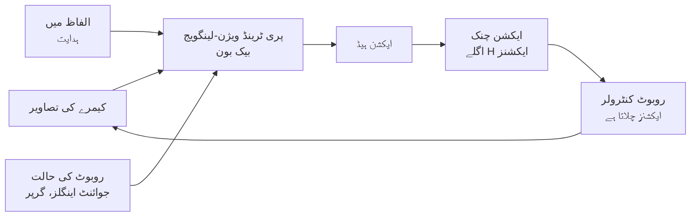

<LessonMeta level="Advanced" time="40 min" prereqs={["Imitation learning", "Vision-language grounding", "Python basics"]} />

ابھی تک ہم نے ایک پائپ لائن بنائی: ایک لینگویج ماڈل منصوبہ بندی کرتا ہے، ایک ویژن ماڈل اشیاء کو تلاش کرتا ہے، اور ہاتھ سے لکھے ہوئے سکلز (skills) عمل کرتے ہیں۔ یہ طریقہ کام کرتا ہے، لیکن ہر سکل اپنے طور پر ایک انجینئرنگ پروجیکٹ ہے، اور "تولیہ موڑنا" یا "دائرے کی شکل میں میز صاف کرنا" شاید لائبریری میں موجود نہ ہو۔ ایک اور طریقہ یہ ہے کہ پوری میپنگ کو ایک ساتھ سیکھا جائے: کیمرے کی طرف دیکھیں، ہدایت پڑھیں، اور اگلی حرکت پیش کریں۔ ایسا کرنے والے ماڈلز کو **ویژن-لینگویج-ایکشن (VLA)** ماڈلز کہا جاتا ہے۔ یہ سبق بتاتا ہے کہ وہ کس طرح کام کرتے ہیں۔

<Objectives>

- ایک VLA کی ساخت کی وضاحت کریں: بیک بون (backbone)، ایکشن ہیڈ (action head)، اور ایکشن چنکس (action chunks)۔
- ٹوکنائزڈ ایکشنز اور مسلسل ریگریشن (continuous regression) سے ان کے فرق کو بیان کریں۔
- وضاحت کریں کہ ڈیفیوژن اور فلو-میچنگ (flow-matching) ہیڈز ملٹی موڈل (multi-modal) مظاہروں کو بہتر طریقے سے کیوں سنبھالتے ہیں۔
- اپنے روبوٹ پر VLA کا ڈیٹا جمع کرنے اور اسے fine-tune کرنے کے طریقہ کار کا خاکہ بنائیں۔
- بتائیں کہ VLA کس چیز کی ضمانت نہیں دے سکتا، اور پلینرز اور سیفٹی لیئرز کے ساتھ اس کا کیا تعلق ہے۔

</Objectives>

## VLA کیا ہے؟

ایک <Term def="Vision-language-action model: ایک نیورل نیٹ ورک جو کیمرے کی تصاویر، متنی ہدایت اور اکثر روبوٹ کی اپنی حالت حاصل کرتا ہے، اور روبوٹ کے اقدامات (actions) آؤٹ پٹ کرتا ہے۔">VLA ماڈل</Term> ایک پری ٹرینڈ (pretrained) ویژن-لینگویج ماڈل سے شروع ہوتا ہے۔ وہ بیک بون انٹرنیٹ کی سطح کے ڈیٹا پر تربیت کی وجہ سے تصاویر اور الفاظ کو پہلے سے سمجھتا ہے۔ اس کے بعد ہم *اقدامات (actions)* آؤٹ پٹ کرنے کی صلاحیت شامل کرتے ہیں اور روبوٹ کے مظاہروں (demonstrations) پر تربیت دیتے ہیں: یعنی (کیمرے کی تصاویر، ہدایت، روبوٹ کی حالت، ایکشن) کے سلسلے جو انسان کے ذریعہ روبوٹ کو ٹیلی آپریٹ (teleoperate) کرتے وقت ریکارڈ کیے گئے تھے۔



صفر سے شروع کرنے کے بجائے ویژن-لینگویج ماڈل سے شروعات کیوں کی جائے؟ ویب سائز کی پری ٹریننگ ماڈل کو ایسا علم دیتی ہے جو روبوٹ کے کسی ڈیٹا سیٹ میں نہیں ہوتا: جیسے "کھلونا ڈائناسور" کیا ہے، یا "پینے کی چیز" سے مراد مگ ہے۔ کچھ VLAs نے ایسی ہدایات پر عمل کیا ہے اور ایسی اشیاء کو سنبھالا ہے جو ان کے روبوٹ ڈیٹا میں کبھی ظاہر نہیں ہوئی تھیں، کیونکہ بیک بون نے انہیں پہچان لیا تھا۔

بنیادی ڈیزائن کا سوال **ایکشن ہیڈ** ہے: ماڈل ایکشنز کیسے بناتا ہے۔ اس کے تین عام جوابات ہیں۔

## ہیڈ 1: ٹوکنز کے طور پر ایکشنز

ایک لینگویج ماڈل ٹوکنز تیار کرتا ہے۔ لہذا ایکشنز کو بھی ٹوکنز بنائیں۔ ہر ایکشن ڈائمینشن (مثلاً x, y, z میں تبدیلی، روٹیشن، گرپر) لیں، اس کی رینج کو خانے (bins) میں تقسیم کریں (مثال کے طور پر 256)، اور ماڈل کو الفاظ کی طرح ہر ڈائمینشن کے لیے ایک ٹوکن آؤٹ پٹ کرنے دیں۔ یہ مفہوم گوگل ڈیپ مائنڈ کے RT-2 ماڈل میں استعمال ہوا تھا، اور OpenVLA جیسے اوپن ماڈلز بھی اسی طریقے پر عمل کرتے ہیں۔

```python title="action_tokens.py"
import numpy as np

# Action = [dx, dy, dz, droll, dpitch, dyaw, gripper]: small end-effector motions plus gripper opening.
LOW = np.array([-0.05, -0.05, -0.05, -0.3, -0.3, -0.3, 0.0])
HIGH = np.array([0.05, 0.05, 0.05, 0.3, 0.3, 0.3, 1.0])
N_BINS = 256

def tokenize(action):
    """Continuous action -> one integer token (0..255) per dimension."""
    unit = np.clip((np.asarray(action) - LOW) / (HIGH - LOW), 0.0, 1.0)
    return np.minimum((unit * N_BINS).astype(int), N_BINS - 1)

def detokenize(tokens):
    """Tokens -> the centre of each bin."""
    return LOW + (np.asarray(tokens) + 0.5) / N_BINS * (HIGH - LOW)

action = np.array([0.012, -0.031, 0.004, 0.10, 0.0, -0.2, 1.0])
tokens = tokenize(action)
back = detokenize(tokens)
print("tokens :", tokens.tolist())
print("as text:", " ".join(f"<a{t}>" for t in tokens))
print("round-trip error:", np.abs(back - action).round(5).tolist())
print("worst possible error per dimension:", ((HIGH - LOW) / N_BINS / 2).round(5).tolist())

# Chunking: the model predicts H future actions at once; we run only the first K, then predict again.
H, K = 8, 4
rng = np.random.default_rng(0)
def fake_policy(step):
    """Stand-in for a model call: returns an H x 7 chunk starting at this step."""
    base = np.array([0.01, 0.0, 0.0, 0.0, 0.0, 0.0, 1.0])
    return base + 0.001 * rng.standard_normal((H, 7))

executed = []
for step in range(0, 16, K):
    chunk = fake_policy(step)
    executed.extend(chunk[:K])
print("model calls for 16 control steps:", 16 // K, "(instead of 16)")
```

راؤنڈ ٹرپ کی غلطی (round-trip error) کبھی بھی بن (bin) کی آدھی چوڑائی سے زیادہ نہیں ہوتی، لہذا 256 bins چھوٹی حرکات کے لیے کافی ہیں۔ ٹوکنائزنگ آپ کو لینگویج ماڈل کی تمام خصوصیات کو دوبارہ استعمال کرنے کی اجازت دیتی ہے۔ اس کا نقصان یہ ہے کہ ایک سے زیادہ ایکشنز کی پیش گوئی کا مطلب ایک کے بعد ایک کئی ٹوکنز بنانا ہے (جو سست ہے)، اور ہر ڈائمینشن کے ساتھ الگ الگ سلوک کیا جاتا ہے۔

## ہیڈ 2: براہ راست ریگریشن (Direct regression)

سب سے سادہ ہیڈ ایک چھوٹا نیورل نیٹ ورک ہے جو ایکشن کے نمبرز کو براہ راست آؤٹ پٹ کرتا ہے اور اسکوائرڈ-ایرر لاس (squared-error loss) کے ساتھ مظاہروں سے مماثلت کی تربیت حاصل کرتا ہے۔ یہ تیز اور آسان ہے۔ لیکن اس میں ایک مسئلہ ہے، اور اسی وجہ سے زیادہ پیچیدہ ہیڈز موجود ہیں۔ انسانی مظاہرے **ملٹی موڈل (multi-modal)** ہوتے ہیں: کسی رکاوٹ کے گرد جانے کے لیے، ایک شخص بائیں طرف جاتا ہے اور دوسرا دائیں طرف۔ اسکوائرڈ ایرر کے ساتھ تربیت یافتہ ریگریشن ماڈل *اوسط (average)* کی پیش گوئی کرتا ہے، جو روبوٹ کو سیدھا رکاوٹ میں چلا دیتا ہے۔

## ہیڈ 3: ڈیفیوژن اور فلو میچنگ (Diffusion and flow matching)

ایک جینیریٹو (generative) ہیڈ ایکشنز کی پوری تقسیم کی ماڈلنگ کرتا ہے، اور پھر اس میں سے ایک نمونہ (sample) لیتا ہے۔ ایک <Term def="ایک جینیریٹو طریقہ جو بے ترتیب شور (random noise) سے شروع ہوتا ہے اور ایکشن تیار کرنے کے لیے مشاہدات کی رہنمائی میں اسے قدم بہ قدم ہٹاتا ہے۔">ڈیفیوژن (diffusion)</Term> ہیڈ میں، ایک حقیقت پسندانہ ایکشن حاصل ہونے تک بے ترتیب شور کو آہستہ آہستہ ختم کیا جاتا ہے۔ **فلو میچنگ (Flow matching)** ایک سادہ ٹریننگ اصول کے ساتھ اس سے ملتا جلتا طریقہ ہے: ایک شور کا نمونہ $x_0$ اور ایک حقیقی ایکشن $a$ لیں، ایک بے ترتیب وقت $t \in [0,1]$ منتخب کریں، ان کے درمیان سیدھی لکیر پر نقطہ بنائیں، اور ایک نیٹ ورک $v_\theta$ کو اس لکیر کی سمت بتانے کی تربیت دیں:

$$
x_t = (1 - t)\,x_0 + t\,a, \qquad \mathcal{L}(\theta) = \mathbb{E}\,\big\| v_\theta(x_t, t, \text{obs}) - (a - x_0) \big\|^2
$$

ایکشن بنانے کے لیے، $t = 0$ پر شور سے شروعات کریں اور چند چھوٹے Euler قدموں کے ساتھ سیکھی ہوئی رفتار (velocity field) پر عمل کرتے ہوئے $t = 1$ تک پہنچیں:

$$
x_{t + \Delta t} = x_t + \Delta t \; v_\theta(x_t, t, \text{obs})
$$

چونکہ نمونہ بے ترتیب شور سے شروع ہوتا ہے، مختلف رنز مختلف درست طریقوں (modes) پر ختم ہو سکتے ہیں، لہذا ماڈل بائیں *یا* دائیں جا سکتا ہے لیکن درمیان (رکاوٹ) میں نہیں۔ چند قدم (اکثر دس کے قریب) کافی ہوتے ہیں، جو اسے تیز رکھتے ہیں۔

```python title="flow_matching_toy.py"
import numpy as np

rng = np.random.default_rng(0)
expert = np.array([0.02, -0.01, 0.0, 0.1, 0.0, 0.0, 1.0])   # pretend demonstration action

def training_pair(a1):
    """One flow-matching training example: a point on the straight path from noise to the action."""
    x0 = rng.standard_normal(a1.shape)       # noise
    t = rng.uniform()                        # random time in [0, 1]
    xt = (1.0 - t) * x0 + t * a1             # noisy action at time t
    target_v = a1 - x0                       # the velocity the network must predict
    return xt, t, target_v

def sample(velocity_fn, obs, dim=7, steps=10):
    """Generate an action by integrating the learned velocity field from noise (Euler method)."""
    x = rng.standard_normal(dim)
    for k in range(steps):
        t = k / steps
        x = x + (1.0 / steps) * velocity_fn(x, t, obs)
    return x

def good_net(x, t, obs):
    """Pretend trained network: the exact velocity toward the expert action."""
    return (expert - x) / max(1.0 - t, 1e-3)

def bad_net(x, t, obs):
    return np.zeros_like(x)                  # predicts "do not move"

for name, net in [("good_net", good_net), ("bad_net", bad_net)]:
    errs = []
    for _ in range(2000):
        xt, t, v = training_pair(expert)
        errs.append(np.mean((net(xt, t, None) - v) ** 2))
    print(f"{name}: flow-matching loss = {np.mean(errs):.4f}")

a = sample(good_net, obs=None)
print("sampled action:", a.round(3).tolist())
print("expert action :", expert.tolist())
```

یہاں "نیٹ ورکس" صرف دکھانے کے لیے ہیں، کیونکہ ایک حقیقی نیٹ ورک کو ٹرین کرنا مختصر کوڈ میں ممکن نہیں۔ کوڈ وہ حصہ دکھاتا ہے جو واقعی سسٹمز میں یکساں ہوتا ہے: ٹریننگ کی مثال کیسے بنتی ہے، لاس کا موازنہ کیا کرتا ہے، اور سیپملنگ شور سے ایکشن میں کیسے تبدیل ہوتی ہے۔ ایک اچھا نیٹ ورک صفر کے قریب لاس حاصل کرتا ہے۔ ہیڈز کی یہ فیملی Physical Intelligence کے π0 ماڈلز اور ڈیفیوژن پر مبنی پالیسیوں میں ظاہر ہوتی ہے؛ NVIDIA کے GR00T والے ماڈلز بھی اس سے ملتا جلتا دو حصوں پر مشتمل ڈیزائن استعمال کرتے ہیں۔ آرکیٹیکچر اور ریلیز کی تفصیلات اکثر بدلتی رہتی ہیں، لہذا کام کرنے سے پہلے کسی بھی ماڈل کی **موجودہ ریلیز دیکھ لیں**۔

<KeyIdea title="آگے کیا کرنا ہے، یہ بتانے کے تین طریقے">

ٹوکنز ایکشنز کو الفاظ کی طرح سمجھتے ہیں (سادہ، لینگویج ماڈلز کو دوبارہ استعمال کرتا ہے، لیکن سست ہے)۔ ریگریشن ہر ڈائمینشن کے لیے ایک نمبر آؤٹ پٹ کرتا ہے (تیز، لیکن مختلف حکمت عملیوں کی اوسط نکالتا ہے)۔ ڈیفیوژن اور فلو ہیڈز ایکشنز کی مکمل تقسیم سے نمونے لیتے ہیں (ایک سے زیادہ درست حکمت عملیوں کو سنبھالتے ہیں، اور ہموار، دقیق حرکت میں اچھے ہیں)۔

</KeyIdea>

## ایکشن چنکس (Action chunks)

زیادہ تر جدید VLAs ایک قدم کے بجائے مستقبل کے ایکشنز کا ایک چھوٹا **چنک (chunk)** پشین گوئی کرتے ہیں، جو شاید ایک سیکنڈ کی حرکت کے برابر ہو۔ `action_tokens.py` کا آخری حصہ یہ مفہوم دکھاتا ہے: $H = 8$ اور $K = 4$ کے ساتھ، روبوٹ ہر چنک کا آدھا حصہ چلاتا ہے، پھر ماڈل سے دوبارہ پوچھتا ہے، اس طرح وہ جتنی بار حرکت کرتا ہے اس کے مقابلے میں چوتھائی بار ماڈل کو کال کرتا ہے۔

چنکنگ کے تین فائدے ہیں: ہموار حرکت، سست انفرینس (inference) کو برداشت کرنا، اور کم *کمپاؤنڈنگ ایرر (compounding error)*۔ اس کا نقصان ایک چنک کے دوران ردعمل کی رفتار کا قدرے کم ہونا ہے۔ ایک عام طریقہ، *ٹیمپورل انسمبلنگ (temporal ensembling)*، ہر قدم پر ماڈل کو چلاتا ہے اور موجودہ لمحے کے لیے اوورلیپنگ پیشگوئیوں کی اوسط نکالتا ہے۔

## ڈیٹا جمع کرنا اور fine-tuning

آپ شاذ و نادر ہی صفر سے VLA ٹرین کرتے ہیں۔ آپ جاری کردہ چیک پوائنٹ سے شروعات کرتے ہیں اور اسے اپنے روبوٹ اور کاموں کے مطابق ڈھالتے ہیں۔ ایک عام منصوبہ:

1. **اپنا ایکشن سپیس طے کریں۔** منتخب کریں کہ ماڈل کیا آؤٹ پٹ کرتا ہے: end-effector deltas، absolute poses یا joint targets۔ منتخب کریں کہ چیک پوائنٹ کو کس پر ٹرین کیا گیا تھا، یا ہیڈ کو دوبارہ ٹرین کرنے کا منصوبہ بنائیں۔ کنٹرول ریٹ کا تعین کریں۔
2. **مظاہرے (Demonstrations) جمع کریں۔** ہر کام کو کئی بار کرنے کے لیے اپنے روبوٹ کو ٹیلی آپریٹ کریں (محدود کاموں کے لیے دسیوں سے لے کر سینکڑوں مظاہرے ایک عام رینج ہے)۔ اشیاء کی جگہ، روشنی اور ماحول کو تبدیل کریں تاکہ ماڈل ایک ہی سیٹ اپ کو حفظ نہ کرے۔ کیمرے کی تصاویر، روبوٹ کی حالت، ایکشن اور ہدایت کو ریکارڈ کریں۔
3. **ڈیٹا صاف اور نارملائز کریں۔** ناکام یا بیکار قسطوں کو ہٹا دیں، ٹائم اسٹیمپ سیدھے کریں، اور نارملائزیشن کے لیے اعداد و شمار کا حساب لگائیں۔
4. **Fine-tune کریں۔** مکمل fine-tuning کے لیے ایک بڑے GPU کی ضرورت ہوتی ہے؛ LoRA جیسے پیرامیٹر-ایفیشنٹ طریقے میموری کو بہت کم کر دیتے ہیں۔
5. **روبوٹ پر اندازہ لگائیں (Evaluate)،** صرف لاس کرو (loss curves) پر نہیں۔ کم ٹریننگ لاس کام کرنے والی پالیسی کی ضمانت نہیں دیتا۔ [Evaluation and safety lesson](./05-evaluation-and-safety.mdx) دکھاتا ہے کہ اس کی درست پیمائش کیسے کی جائے۔
6. **ڈیٹا کو بہتر بنائیں۔** ناکامیاں عام طور پر ڈیٹا میں موجود کمی کی نشاندہی کرتی ہیں، لہذا ان حالات کے مزید مظاہرے جمع کریں۔

حد سے زیادہ محدود کام کے لیے، صفر سے ٹرین کی گئی ایک چھوٹی پالیسی (جیسے ACT-style یا diffusion policy) ایک بڑے VLA کے برابر یا اس سے بہتر کام کر سکتی ہے اور معمولی ہارڈویئر پر چلتی ہے۔ VLA کا استعمال تب کریں جب آپ کو متنی ہدایات، بہت سے کاموں، یا نئی اشیاء تک تعمیم (generalization) کی ضرورت ہو۔

روبوٹکس کے کھلے ڈیٹا سیٹس (Open X-Embodiment کلیکشن سب سے زیادہ مشہور ہے) ماڈل کو بہت سے روبوٹس دیکھنے کا موقع دیتے ہیں، اور بہت سے جاری کردہ VLAs انہی سے شروع ہوتے ہیں۔

## VLA آپ کو کیا فراہم نہیں کرتا

- **کوئی ضمانت نہیں۔** یہ ایک سیکھا ہوا فنکشن ہے اور غیر معروف ان پٹ پر حیران کن طریقوں سے ناکام ہو سکتا ہے۔ اسے سیفٹی لیئر میں لپیٹیں: جوائنٹ، سپیڈ اور فورس کی حدیں، ورک سپیس کی حدود، اور ایمرجنسی اسٹاپ۔ دیکھئیے [Evaluation and safety](./05-evaluation-and-safety.mdx)۔
- **کمپیوٹ اور لیٹنسی (latency)۔** بڑے ماڈلز کو مضبوط GPU کی ضرورت ہوتی ہے۔ بہت سے سسٹمز ماڈل کو قریبی سرور پر چلاتے ہیں اور ایک تیز لو-لیول کنٹرولر کو ایکشنز بھیجتے ہیں۔
- **طویل کاموں میں محدود استدلال (reasoning)۔** طویل ملٹی-سٹیپ کاموں کے لیے، کام کو چھوٹی ہدایات میں توڑنے کے لیے LLM پلینر (سبق 1) کا استعمال کریں، اور VLA کو ہر ایک پر عمل کرنے دیں۔
- **تیز تبدیلی۔** نام، سائز، لائسنس اور بینچ مارک نمبرز ہر چند ماہ بعد بدلتے ہیں۔ استعمال سے پہلے موجودہ ماڈل کارڈ اور ریپوزیٹری کو پڑھیں۔

:::tip[پرو ٹپ]
ہمیشہ ان مشاہدات، ہدایات اور ایکشن چنکس کو لاگ کریں جو آپ کی پالیسی دیکھتی اور آؤٹ پٹ کرتی ہے۔ جب کوئی ناکامی ہوتی ہے، تو لاگ ہی کے ذریعے آپ کو معلوم ہوتا ہے کہ غلطی ماڈل، ڈیٹا یا کیمرے میں تھی۔
:::

## عملی لیب

<Steps>

1. `action_tokens.py` چلائیں۔ تصدیق کریں کہ راؤنڈ ٹرپ کی غلطی ہر ڈائمینشن کے لیے "worst possible" سطر سے کم ہے۔
2. `N_BINS` کو 16 میں تبدیل کریں۔ غلطی کا کیا ہوتا ہے؟ کیا 16 bins ایک ایسے گرپر کے لیے کافی ہوں گے جو صرف کھلا یا بند ہوتا ہے؟ 5 سینٹی میٹر کی حرکت کی رینج کے لیے؟
3. `flow_matching_toy.py` چلائیں۔ `sample` میں `steps` کو 10 سے 2 اور پھر 1 میں تبدیل کریں۔ `good_net` کے ساتھ آؤٹ پٹ کیسے بدلتا ہے؟ بالکل درست ویلوسٹی فیلڈ یہاں 1 step کو بھی کیوں کام کرنے کے قابل بناتی ہے، جبکہ حقیقی نیٹ ورکس کو عام طور پر زیادہ کی ضرورت ہوتی ہے؟
4. ایک `noisy_net` لکھیں جو `good_net` کے آؤٹ پٹ میں غوسیائی شور (Gaussian noise، معیاری انحراف 0.5) شامل کرے اور چیک کریں کہ 10 steps پر حاصل شدہ ایکشن `expert` سے کتنا دور ہے۔
5. یہ تب مکمل ہوگا جب آپ مساوات کے بغیر کسی دوست کو سمجھا سکیں کہ فلو ہیڈ ایکشن کیسے بناتا ہے۔

</Steps>

## مشقیں

<Exercise title="ٹوکن ریزولیوشن" level="Beginner">

ایک ایکشن ڈائمینشن کی رینج -0.05 سے 0.05 میٹر ہے، جسے 256 bins میں تقسیم کیا گیا ہے۔ bin کی چوڑائی کیا ہے، اور سب سے بڑی راؤنڈنگ کی غلطی کیا ہے؟

<Solution>

رینج 0.1 میٹر ہے، لہذا bin کی چوڑائی $0.1/256 \approx 0.00039$ میٹر (0.39 ملی میٹر) ہے۔ اگر آپ bin کے مرکز میں ڈیکوڈ کرتے ہیں، تو سب سے بڑی غلطی آدھا bin ہے، یعنی تقریباً 0.2 ملی میٹر۔

</Solution>

</Exercise>

<Exercise title="ریگریشن کیوں نہیں؟" level="Intermediate">

ایک ڈیمونسٹریشن سیٹ میں نصف مظاہرے بائیں طرف رکاوٹ کے گرد جاتے ہیں اور نصف دائیں طرف۔ اسکوائرڈ ایرر کے ساتھ تربیت یافتہ ریگریشن ہیڈ کیا کرے گا، اور فلو ہیڈ کیوں بہتر کارکردگی دکھاتا ہے؟

<Solution>

اسکوائرڈ ایرر مظاہروں کی اوسط سے کم سے کم ہوتا ہے، جو کہ سیدھا رکاوٹ میں سے گزرنے والا راستہ ہے۔ ایک فلو ہیڈ ایکشنز کی تقسیم کی ماڈلنگ کرتا ہے اور اس سے نمونے لیتا ہے، لہذا ہر رول آؤٹ ایک درست طریقہ (بائیں یا دائیں) کا انتخاب کرتا ہے اور رکاوٹ سے بچتا ہے۔

</Solution>

</Exercise>

<Exercise title="اپنے ڈیٹا کی منصوبہ بندی کریں" level="Intermediate">

آپ اپنے روبوٹ آرم پر "کپ کو ڈش ریک میں رکھیں" کے لیے VLA کو fine-tune کرنا چاہتے ہیں۔ مظاہرے جمع کرتے وقت آپ جن چار چیزوں کو تبدیل کریں گے ان کی فہرست بنائیں، اور ایک چیز جو آپ تعیناتی (deployment) کے وقت یکساں رکھیں گے۔

<Solution>

تبدیل کریں: کپ کی پوزیشن اور سمت، کون سا کپ (رنگ اور شکل)، ریک کی پوزیشن، روشنی، اور پس منظر کا ماحول۔ یکساں رکھیں: کیمرے کی پوزیشنیں اور سیٹنگز (اور ایکشن سپیس اور کنٹرول ریٹ)، کیونکہ ماڈل ان دقیق زاویوں اور سگنلز سے سیکھتا ہے۔

</Solution>

</Exercise>

## اپنی سمجھ کی جانچ کریں

<Quiz questions={[
  {q: "VLA ماڈل کا بنیادی ان پٹ اور آؤٹ پٹ کیا ہے؟", options: ["صرف ٹیکسٹ ان، ٹیکسٹ آؤٹ", "تصاویر، ہدایت اور روبوٹ کی حالت ان؛ روبوٹ کے ایکشنز آؤٹ", "صرف جوائنٹ اینگلز ان؛ تصاویر آؤٹ", "آڈیو ان؛ آڈیو آؤٹ"], answer: 1, explain: "ایک VLA کیمرے کی تصاویر، ہدایت اور حالت کو ایکشنز (عام طور پر ایک مختصر چنک کے طور پر) میں تبدیل کرتا ہے۔"},
  {q: "ٹوکنائزڈ ایکشن (tokenized action) کیا ہے؟", options: ["پاس ورڈ کے طور پر انکوڈ شدہ ایکشن", "ایک مسلسل ایکشن جسے bins میں تقسیم کیا گیا ہے تاکہ ہر ویلیو ایک الگ ٹوکن بن جائے جسے لینگویج ماڈل آؤٹ پٹ کر سکے", "منصوبے کی متنی تفصیل", "بغیر کسی اکائی کے ایکشن"], answer: 1, explain: "ہر ایکشن ڈائمینشن کو bins میں تقسیم کیا جاتا ہے، اور ماڈل ہر ڈائمینشن کے لیے ایک ٹوکن آؤٹ پٹ کرتا ہے۔"},
  {q: "ڈیفیوژن اور فلو ہیڈز ملٹی موڈل مظاہروں کے لیے کیوں مناسب ہیں؟", options: ["وہ ہمیشہ اوسط آؤٹ پٹ کرتے ہیں", "وہ ایکشنز کی تقسیم سے نمونے لیتے ہیں، لہذا ہر رول آؤٹ ایک درست حکمت عملی منتخب کر سکتا ہے", "انہیں ڈیٹا کی ضرورت نہیں ہے", "انہیں ٹرین کرنا کسی بھی دوسری چیز سے سست ہے"], answer: 1, explain: "شور سے سیمپلنگ ماڈل کو ان کی اوسط نکالنے کے بجائے کام کرنے کے چند درست طریقوں کی نمائندگی کرنے کی اجازت دیتی ہے۔"},
  {q: "ایکشن چنکنگ (action chunking) آپ کو کیا فراہم کرتی ہے؟", options: ["ہموار حرکت اور ماڈل کو کم کالز، ردعمل کی رفتار کی معمولی قیمت پر", "تیز رفتار GPUs", "ایک ضمانت شدہ محفوظ روبوٹ", "زبان کی سمجھ بوجھ"], answer: 0, explain: "ایک ساتھ چند قدموں کی پیش گوئی کرنے سے حرکت ہموار ہوتی ہے، انفرینس کی لیٹنسی چھپ جاتی ہے اور کمپاؤنڈنگ ایرر کم ہوتا ہے۔"}
]} />

<Takeaways>

- ایک VLA ایک پری ٹرینڈ ویژن-لینگویج بیک بون کے ساتھ ایکشن ہیڈ ہوتا ہے، جسے روبوٹ کے مظاہروں پر ٹرین کیا جاتا ہے۔
- ایکشن ہیڈز تین قسم کے ہوتے ہیں: ٹوکنز، ڈائریکٹ ریگریشن اور ڈیفیوژن یا فلو جنریشن۔
- فلو میچنگ شور سے حقیقی ایکشن کی سمت کی پیش گوئی کرنے کے لیے نیٹ ورک کو ٹرین کرتی ہے، اور اس فیلڈ پر عمل کرتے ہوئے نمونے لیتی ہے۔
- ایکشن چنکس ہموار حرکت فراہم کرتے ہیں اور سست انفرینس کو برداشت کرتے ہیں۔
- اپنے ڈیٹا پر Fine-tune کریں: ایکشن سپیس طے کریں، مناظر کو تبدیل کریں، نارملائز کریں، روبوٹ پر اندازہ لگائیں، اور ڈیٹا میں بہتری لائیں۔
- VLAs کوئی ضمانت فراہم نہیں کرتے: سیفٹی لیئرز شامل کریں، اور تفصیلات کے لیے موجودہ ریلیز دیکھیں۔

</Takeaways>

## مزید گہرائی میں جائیں

- [RT-2: Vision-Language-Action Models Transfer Web Knowledge to Robotic Control](https://arxiv.org/abs/2307.15818)
- [OpenVLA: An Open-Source Vision-Language-Action Model](https://arxiv.org/abs/2406.09246)
- [π0: A Vision-Language-Action Flow Model for General Robot Control](https://arxiv.org/abs/2410.24164)
- [Flow Matching for Generative Modeling](https://arxiv.org/abs/2210.02747), اور [GR00T N1](https://arxiv.org/abs/2503.14734) ہیومنائڈ پر مبنی ماڈل کے لیے۔

اگلا: [وائس-ٹو-ایکشن پائپ لائن](./04-voice-to-action-pipeline.mdx)
