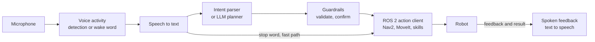

<LessonMeta level="Advanced" time="45 min" prereqs={["ROS 2 actions", "Navigation with Nav2", "LLMs as robot planners"]} />

ہسپتال کی راہداری میں ایک شخص کہتا ہے، "روبوٹ، اسے روم نمبر بارہ میں لے جاؤ۔" اس جملے کے پیچھے سسٹمز کی ایک زنجیر ہے: ایک مائیکرو فون، ایک اسپیچ ریکگنائزر، بولے گئے الفاظ کا مطلب سمجھنے والا نظام، ایک پلانر، ایک نیویگیشن اسٹیک، اور ایک آواز جو کہتی ہے "میں جا رہا ہوں۔" اس زنجیر کی ہر کڑی ناکام ہو سکتی ہے، اور انسان اسے دیکھ رہا ہوتا ہے۔ یہ سبق اس پوری زنجیر کو تعمیر کرتا ہے، ایک ایسے آرکیٹیکچر کے ساتھ جسے آپ کسی بھی بولے گئے حکم کے لیے دوبارہ استعمال کر سکتے ہیں۔

<Objectives>

- ایک وائس ٹو ایکشن (voice-to-action) پائپ لائن کا آرکیٹیکچر بنائیں اور ہر مرحلے کے کام کی نشاندہی کریں۔
- اوپن اسپیچ ٹو ٹیکسٹ (speech-to-text) ماڈل کے ساتھ آڈیو کو تحریر میں تبدیل کریں۔
- ایک ایسا انٹینٹ پارسر (intent parser) لکھیں جو حفاظتی الفاظ، تصدیق اور نامعلوم احکامات کو سنبھال سکے۔
- ROS 2 نوڈ سے Nav2 ہدف بھیجیں، فیڈ بیک رپورٹ کریں، اور "stop" پر اسے منسوخ کریں۔
- تاخیر (latency)، غلطیوں اور پرائیویسی کے بارے میں غور و فکر کریں۔

</Objectives>

## آرکیٹیکچر



اسے بائیں سے دائیں پانچ کاموں کے طور پر پڑھیں:

1. **سننا (Hear)۔** آڈیو کیپچر کریں، اور فیصلہ کریں کہ حکم کب شروع اور ختم ہوتا ہے۔ *Voice activity detection* گفتگو کو تلاش کرتا ہے؛ ایک *wake word* (یا push-to-talk بٹن) یہ طے کرتا ہے کہ کیا یہ حکم روبوٹ کے لیے تھا۔
2. **تحریر میں لانا (Transcribe)۔** <Term def="خودکار اسپیچ ریکگنیشن (STT): بولے گئے الفاظ کی آڈیو کو لکھے ہوئے ٹیکسٹ میں تبدیل کرنا۔">Speech-to-text</Term> (STT) آڈیو کو ایک اسٹرنگ (string) میں تبدیل کرتا ہے۔
3. **سمجھنا (Understand)۔** اسٹرنگ کو پیرامیٹرز کے ساتھ ایک <Term def="جملے کے پیچھے کا مقصد یا ارادہ، جیسے کسی جگہ جانا یا رکنا، ایک مخصوص مشین کے پڑھنے کے قابل فارم میں۔">intent</Term> میں تبدیل کریں۔ یہ احکامات کے ایک چھوٹے سیٹ کے لیے چند قواعد ہو سکتے ہیں، یا غیر محدود درخواستوں کے لیے [LLMs as robot planners](./01-llms-as-robot-planners.mdx) کی طرح ایک LLM پلانر ہو سکتا ہے۔
4. **جائزہ اور عمل (Check and act)۔** اس بات کی تصدیق کریں کہ روبوٹ کو کیا کرنے کی اجازت ہے، اگر یہ خطرناک یا غیر واضح ہو تو تصدیق طلب کریں، پھر اسے ROS 2 ایکشن سرور کو بھیجیں۔
5. **رپورٹ (Report)۔** جو کچھ سمجھا گیا، کام کیسے چل رہا ہے، اور اس کا اختتام کیسے ہوا، وہ بول کر یا دکھا کر بتائیں۔

شارٹ کٹ تیر کا نشان دیکھیں: روکنے کا لفظ (stop word) پلانر کو بائی پاس کرتا ہے اور براہ راست ایکشن لیئر پر جاتا ہے۔ روکنے کے حکم کو کبھی بھی LLM کا انتظار نہیں کرنا چاہیے۔

<KeyIdea title="ہر مرحلہ غلط ہو سکتا ہے، اس لیے ہر مرحلے کو اس کا اظہار کرنا چاہیے">

اسپیچ ریکگنیشن غلط سن سکتی ہے، پارسر غلط پڑھ سکتے ہیں، پلانرز غلط معلومات گھڑ سکتے ہیں (hallucinate)، اور روبوٹ ناکام ہو سکتے ہیں۔ ایک اچھا پائپ لائن اپنے اعتماد (confidence) کو آگے منتقل کرتا ہے، جسے وہ نہیں سمجھتا اسے رد کرتا ہے، اور انسان کو عمل کرنے سے پہلے بالکل واضح بتاتا ہے کہ وہ کیا کرنے جا رہا ہے۔

</KeyIdea>

## سننا اور تحریر میں لانا

Whisper ایک اوپن اسپیچ ریکگنیشن ماڈل ہے جسے OpenAI نے جاری کیا ہے، اور اس کے کئی تیز رفتار متبادل موجود ہیں۔ درج ذیل اسکرپٹ `faster-whisper` کا استعمال کرتی ہے (اسے `pip install faster-whisper` سے انسٹال کریں؛ ماڈل پہلی بار استعمال کرنے پر ڈاؤن لوڈ ہوتا ہے، اور `command.wav` آپ کی اپنی ایک چھوٹی ریکارڈنگ ہے):

```python title="transcribe.py"
from faster_whisper import WhisperModel

model = WhisperModel("small", device="cpu", compute_type="int8")
segments, info = model.transcribe("command.wav", language="en")
text = " ".join(seg.text.strip() for seg in segments)
print(f"[{info.language}] {text}")
```

ایک لیپ ٹاپ CPU پر چھوٹا ماڈل عام طور پر ایک چھوٹے کلپ کے لیے ایک سیکنڈ کے قریب وقت لیتا ہے؛ GPU زیادہ تیز ہوتا ہے۔ اپنے ہارڈ ویئر پر اس کی پیمائش کریں، کیونکہ یہ کافی مختلف ہو سکتا ہے۔

عملی مشورہ:

- **شروع میں push-to-talk یا wake word کا استعمال کریں۔** شور والے کمرے میں مسلسل سنتے رہنے سے غلط احکامات کا ایک سلسلہ پیدا ہوتا ہے۔
- **16 kHz، مونو (mono) پر ریکارڈ کریں۔** ماڈلز اسی کی توقع کرتے ہیں۔
- **ایک مائیکرو فون اَرے (microphone array) مدد کرتا ہے۔** روبوٹ کے موٹرز شور کرتے ہیں، اور روبوٹ کی باڈی پر موجود ایک سستا سنگل مائیکرو فون زیادہ تر موٹرز کا شور ہی سنتا ہے۔
- **ذخیرہ الفاظ (vocabulary) کے ساتھ محدود کریں۔** اگر آپ صرف چند جگہوں کے ناموں کو سپورٹ کرتے ہیں، تو تحریر کے ساتھ ان کی تصدیق کریں اور قریب ترین غلط الفاظ ("kitchen" اور "chicken") کو اندازہ لگانے کے بجائے نامعلوم قرار دیں۔

## سمجھنا: ایک چھوٹا، محفوظ پارسر

احکامات کے ایک محدود سیٹ کے لیے، قواعد LLM سے بہتر ہیں: وہ تیز، قابلِ پیشن گوئی اور قابلِ ٹیسٹ ہوتے ہیں۔ نیچے دیا گیا پارسر پہلے حفاظتی الفاظ کو سنبھالتا ہے، فعل اور جگہ تلاش کرتا ہے، اور باقی تمام چیزوں کے لیے `unknown` واپس کرتا ہے۔

```python title="intent_parser.py"
import re

PLACES = {
    "kitchen": ["kitchen", "cooking area"],
    "door": ["door", "entrance", "front door"],
    "charger": ["charger", "charging station", "dock"],
    "desk": ["desk", "workstation"],
}
STOP_WORDS = ("stop", "halt", "freeze", "emergency")

def normalize(text):
    text = text.lower().strip()
    text = re.sub(r"[^a-z0-9 ]+", " ", text)          # drop punctuation
    text = re.sub(r"^(hey robot|ok robot|robot)\s+", "", text)   # drop the wake phrase
    return re.sub(r"\s+", " ", text)

def parse_intent(raw):
    """Map a transcript to a small, fixed set of intents. Anything else is 'unknown'."""
    text = normalize(raw)
    words = text.split()
    if any(w in STOP_WORDS for w in words):            # safety words win over everything
        return {"intent": "stop", "confirm": False}
    if re.search(r"\b(go|come|drive|navigate|walk|head)\b", text) or text.startswith("take me"):
        for place, names in PLACES.items():
            if any(re.search(rf"\b{re.escape(n)}\b", text) for n in names):
                return {"intent": "go_to", "place": place, "confirm": False}
        return {"intent": "unknown", "reason": "no known place in the request"}
    if re.search(r"\b(status|battery|how are you)\b", text):
        return {"intent": "report_status", "confirm": False}
    return {"intent": "unknown", "reason": "not a supported command"}

if __name__ == "__main__":
    tests = [
        "Hey robot, go to the kitchen.",
        "please drive to the charging station",
        "Take me to the front door",
        "STOP!",
        "go to the moon",
        "what is your battery level",
        "make me a sandwich",
    ]
    for t in tests:
        print(f"{t!r:42} -> {parse_intent(t)}")
```

اسے چلائیں۔ پہلے تین جملے صحیح جگہ کے ساتھ `go_to` انٹینٹ دیتے ہیں؛ `STOP!` سے `stop` ملتا ہے؛ "go to the moon" اور "make me a sandwich" کے نتائج `unknown` ہیں۔ یہ کہنا کہ "میں سمجھ نہیں سکا" ایک صحیح نتیجہ ہے۔ محض اندازہ لگانا صحیح نہیں ہے۔

غیر محدود گفتگو کے لیے، `parse_intent` کو ایک LLM کال سے تبدیل کریں جو ایک JSON پلان واپس کرے، اور اس کے بعد وہی چیکس رکھیں (schema، allow-list، تصدیق)، جیسا کہ سبق 1 میں ہے۔ لیکن اسٹاپ ورڈ کا چیک ماڈل کے *باہر* رکھیں۔

## عمل کرنا: ایک ROS 2 نوڈ

اب انٹینٹ کو روبوٹ سے جوڑیں۔ یہ نوڈ `speech/text` ٹاپک پر سنتا ہے (آپ کا STT عمل اسے شائع کرتا ہے)، متن کو پارس کرتا ہے، اور Nav2 کو ایک `NavigateToPose` ہدف بھیجتا ہے، جیسا کہ آپ نے [Navigation with Nav2](../06-motion/02-navigation-with-nav2.mdx) میں سیکھا تھا۔ یہ ٹیکسٹ ٹو اسپیچ نوڈ کے لیے `speech/say` پر صوتی فیڈ بیک دیتا ہے، اور "stop" سنتے ہی ہدف کو منسوخ کر دیتا ہے۔ یہ فرض کرتا ہے کہ `intent_parser.py` اسی پیکیج میں اس کے ساتھ موجود ہے، اور نقشے میں نامزد جگہیں موجود ہیں۔

```python title="voice_commander.py"
import math

import rclpy
from action_msgs.msg import GoalStatus
from geometry_msgs.msg import PoseStamped
from nav2_msgs.action import NavigateToPose
from rclpy.action import ActionClient
from rclpy.node import Node
from std_msgs.msg import String

from intent_parser import parse_intent

# Named places in the map frame: x (m), y (m), yaw (rad). Fill in from your own map.
PLACES = {
    "kitchen": (3.0, 1.5, 0.0),
    "door": (0.5, -2.0, 1.57),
    "charger": (-1.0, 0.0, 3.14),
    "desk": (2.0, -1.0, 0.0),
}


class VoiceCommander(Node):
    def __init__(self):
        super().__init__("voice_commander")
        self.nav = ActionClient(self, NavigateToPose, "navigate_to_pose")
        self.say_pub = self.create_publisher(String, "speech/say", 10)
        self.create_subscription(String, "speech/text", self.on_text, 10)
        self.goal_handle = None

    def say(self, text):
        msg = String()
        msg.data = text
        self.say_pub.publish(msg)
        self.get_logger().info(f"say: {text}")

    def on_text(self, msg):
        intent = parse_intent(msg.data)
        self.get_logger().info(f'heard "{msg.data}" -> {intent}')
        if intent["intent"] == "stop":
            self.stop()
        elif intent["intent"] == "go_to":
            self.go_to(intent["place"])
        else:
            self.say("Sorry, I did not understand that.")

    def go_to(self, place):
        if not self.nav.wait_for_server(timeout_sec=2.0):
            self.say("Navigation is not available right now.")
            return
        x, y, yaw = PLACES[place]
        goal = NavigateToPose.Goal()
        goal.pose = PoseStamped()
        goal.pose.header.frame_id = "map"
        goal.pose.header.stamp = self.get_clock().now().to_msg()
        goal.pose.pose.position.x = x
        goal.pose.pose.position.y = y
        goal.pose.pose.orientation.z = math.sin(yaw / 2.0)
        goal.pose.pose.orientation.w = math.cos(yaw / 2.0)
        self.say(f"Going to the {place}.")
        future = self.nav.send_goal_async(goal, feedback_callback=self.on_feedback)
        future.add_done_callback(self.on_goal_response)

    def on_goal_response(self, future):
        handle = future.result()
        if not handle.accepted:
            self.say("I could not plan a path there.")
            return
        self.goal_handle = handle
        handle.get_result_async().add_done_callback(self.on_result)

    def on_feedback(self, feedback_msg):
        remaining = feedback_msg.feedback.distance_remaining
        self.get_logger().info(f"{remaining:.1f} m to go")

    def on_result(self, future):
        status = future.result().status
        self.goal_handle = None
        if status == GoalStatus.STATUS_SUCCEEDED:
            self.say("I have arrived.")
        elif status == GoalStatus.STATUS_CANCELED:
            self.say("Stopped.")
        else:
            self.say("I could not get there.")

    def stop(self):
        if self.goal_handle is not None:
            self.goal_handle.cancel_goal_async()
        else:
            self.say("I am not moving.")


def main():
    rclpy.init()
    node = VoiceCommander()
    try:
        rclpy.spin(node)
    finally:
        node.destroy_node()
        rclpy.shutdown()


if __name__ == "__main__":
    main()
```

مائیکرو فون کے بغیر ٹیسٹ کرنے کے لیے، سمولیشن میں Nav2 چلائیں (ڈرائیو کرنے کے لیے روبوٹ کی خاطر [Simulated sensors and ros_gz](../04-simulation/03-simulated-sensors-and-ros-gz.mdx) دیکھیں)، نوڈ کو اسٹارٹ کریں، اور ٹرمینل سے ایک فرضی تحریر شائع کریں:

```bash title="terminal"
ros2 topic pub --once /speech/text std_msgs/msg/String "{data: 'go to the kitchen'}"
ros2 topic pub --once /speech/text std_msgs/msg/String "{data: 'stop'}"
```

روبوٹ کو حرکت شروع کرتے اور پھر رکتے ہوئے دیکھیں۔ فیڈ بیک کال بیک جیسے جیسے روبوٹ آگے بڑھتا ہے، باقی ماندہ فاصلہ پرنٹ کرتا ہے۔ ایک بار جب یہ ٹائپ شدہ ٹیکسٹ کے ساتھ کام کرنے لگے، تو اسی ٹاپک پر STT آؤٹ پٹ شائع کرکے اصلی اسپیچ چین کو جوڑیں۔ اس طرح ہر مرحلے کا الگ سے تجربہ کیا جا سکتا ہے۔

:::note
اسپیکر کے بغیر بھی فیڈ بیک اہمیت رکھتا ہے: تسلیم شدہ متن اور منتخب کردہ عمل کو اسکرین پر دکھائیں۔ لوگ روبوٹ پر اس وقت زیادہ بھروسہ کرتے ہیں جب وہ دیکھ سکتے ہیں کہ اس نے کیا سمجھا ہے۔
:::

## تاخیر، غلطیاں اور پرائیویسی

**تاخیر (Latency)۔** گفتگو ختم ہونے سے لے کر پہلی حرکت تک کا وقت ان تمام مراحل کا مجموعہ ہے: گفتگو کے اختتام کی نشاندہی، ٹرانسکرپشن، تفہیم، تصدیق اور ایکشن سرور کا آغاز۔ ہر مرحلہ چند ملی سیکنڈ سے لے کر چند سیکنڈز تک لے سکتا ہے، اور مجموعی وقت وہی ہوتا ہے جو انسان محسوس کرتے ہیں۔ ہر مرحلے کی پیمائش کریں اور اسے لاگ کریں۔ اگر پائپ لائن میں LLM شامل ہے، تو عام احکامات کے لیے ایک تیز رفتار قواعد پر مبنی (rule-based) راستے پر غور کریں۔

**غلطیاں (Errors)۔** ہر ایک غلطی کے لیے منصوبہ بندی کریں:

- *غلط ٹرانسکرپشن:* کسی بھی ناقابلِ واپسی عمل سے پہلے جو کچھ سمجھا گیا اسے دہرائیں ("کچن میں جانا ہے۔ کیا یہ صحیح ہے؟")۔
- *ابہام (Ambiguity):* اندازہ لگانے کے بجائے سوال پوچھیں ("کون سا مگ، سرخ یا نیلا؟")۔
- *خاموشی یا شور:* کسی ادھورے حکم پر عمل کرنے کے بجائے، وقت ختم (time out) ہونے دیں اور دوبارہ پوچھیں۔
- *نامعلوم احکامات:* صراحت سے بتائیں، اور تجویز دیں کہ روبوٹ کیا کر سکتا ہے۔

**پرائیویسی (Privacy)۔** گھر یا کام کی جگہ پر مائیکرو فون والا روبوٹ نجی بات چیت سنتا ہے۔ ڈیوائس پر ہی ٹرانسکرپشن کو ترجیح دیں، صرف wake word یا بٹن کے بعد ریکارڈ کریں، لوگوں کو بتائیں کہ یہ کب سن رہا ہے (روشنی مدد کرتی ہے)، اور وہ آڈیو اسٹور نہ کریں جس کی آپ کو ضرورت نہیں ہے۔

:::warning[اسٹاپ کو ہمیشہ کام کرنا چاہیے]
روبوٹ کی مکمل رفتار پر، شور میں، اور نیٹ ورک منقطع ہونے کی صورت میں روکنے کے لفظ (stop word) اور جسمانی ایمرجنسی اسٹاپ کو ٹیسٹ کریں۔ آواز سہولت کی ایک لیئر ہے؛ یہ روبوٹ کو روکنے کا واحد طریقہ کبھی نہیں ہونی چاہیے۔
:::

## عملی لیب

<Steps>

1. `intent_parser.py` کو محفوظ کریں اور اسے چلائیں۔ تصدیق کریں کہ تمام سات ٹیسٹ جملے بتائے گئے طریقے کے مطابق کام کرتے ہیں۔
2. اپنے تین مزید جملے شامل کریں، بشمول ایک مبہم جملہ اور ایک غلط ٹرانسکرپشن والا ("go to the chicken")۔ فیصلہ کریں کہ پارسر کو کیا کرنا چاہیے اور اس سے وہی کروائیں۔
3. ایک نیا انٹینٹ، `"bring_me"` شامل کریں، جس کا کنفرم فلیگ True پر سیٹ ہو۔ نوڈ سے کہیں کہ وہ پوچھے "Do you want me to bring the item?" اور اگلی تحریر میں "yes" یا "no" کا انتظار کرے۔
4. اگر آپ کے پاس ROS 2 Jazzy اور سمولیٹڈ روبوٹ کے ساتھ Nav2 ہے، تو `voice_commander.py` کو ایک پیکیج میں محفوظ کریں، اسے چلائیں، اور روبوٹ کو چلانے اور روکنے کے لیے دو `ros2 topic pub` کمانڈز کا استعمال کریں۔
5. یہ اس وقت مکمل ہوگا جب ٹائپ شدہ "go to the kitchen" روبوٹ کو حرکت دے، "stop" ہدف کو منسوخ کرے، اور بے معنی بات کو اخلاق سے مسترد کر دیا جائے۔

</Steps>

## مشقیں

<Exercise title="اسٹاپ کہاں جاتا ہے؟" level="Beginner">

آرکیٹیکچر اسٹاپ ورڈ کو LLM پلانر کے ذریعے بھیجنے کے بجائے براہ راست ایکشن لیئر پر کیوں بھیجتا ہے؟

<Solution>

LLM کال میں ایک سیکنڈ یا اس سے زیادہ وقت لگ سکتا ہے، یہ ناکام ہو سکتی ہے، یا غلط تعبیر کر سکتی ہے۔ روکنا انتہائی حساس کام ہے اور اس کا قابلِ بھروسہ ہونا ضروری ہے، اس لیے اسے ایک سادہ، تیز اور ٹیسٹ شدہ راستے سے سنبھالا جاتا ہے جو کسی ماڈل پر منحصر نہیں ہوتا۔

</Solution>

</Exercise>

<Exercise title="تصدیق کا مرحلہ شامل کریں" level="Intermediate">

وضاحت کریں کہ روبوٹ کے "ممنوعہ" (restricted) کے طور پر نشان زد جگہ پر جانے سے پہلے آپ تصدیق کا مرحلہ کیسے شامل کریں گے۔ کوڈ کا کون سا حصہ تبدیل ہوگا، اور آپ کو کس اسٹیٹ کی ضرورت ہوگی؟

<Solution>

`on_text` میں، جب انٹینٹ `go_to` ہو اور جگہ restricted ہو، تو زیرِ التوا انٹینٹ کو ایک ایٹریبیوٹ (جیسے `self.pending`) میں محفوظ کریں اور کہیں "Go to the lab? Say yes to confirm." اگلی تحریر پر، اگر یہ چند سیکنڈز کے اندر "yes" ہو، تو `go_to` چلائیں؛ "no" یا ٹائم آؤٹ پر، اسے منسوخ کر دیں۔ آپ کو جس اسٹیٹ کی ضرورت ہے وہ زیرِ التوا انٹینٹ اور ٹائم اسٹیمپ ہے۔

</Solution>

</Exercise>

<Exercise title="تاخیر کا تخمینہ لگائیں" level="Intermediate">

فرض کریں گفتگو کے اختتام کی نشاندہی میں 0.4 سیکنڈ، STT میں 0.8 سیکنڈ، پارسنگ میں 0.01 سیکنڈ اور ایکشن شروع کرنے میں 0.2 سیکنڈ لگتے ہیں۔ گفتگو کے اختتام سے حرکت تک کا وقت کیا ہے؟ اسے کم کرنے کے دو طریقے بتائیں۔

<Solution>

$0.4 + 0.8 + 0.01 + 0.2 \approx 1.4$ سیکنڈ۔ اسے کم کرنے کے لیے ایک چھوٹا یا GPU سے تیز رفتار STT ماڈل استعمال کریں، اسٹریمنگ ٹرانسکرپشن جو گفتگو ختم ہونے سے پہلے شروع ہو جائے، خاموشی کی حد کو کم کرنا، یا فوری صوتی جواب ("OK") دینا تاکہ تاخیر کا احساس کم ہو۔

</Solution>

</Exercise>

## اپنی تفہیم کی جانچ کریں

<Quiz questions={[
  {q: "اس سبق میں انٹینٹ پارسر کا پہلا کام کیا ہے؟", options: ["جگہ کا نام تلاش کرنا", "حفاظتی الفاظ جیسے stop کو چیک کرنا", "روبوٹ کے لیے آواز کا انتخاب کرنا", "نقشہ ڈاؤن لوڈ کرنا"], answer: 1, explain: "حفاظتی الفاظ کو پہلے چیک کیا جاتا ہے تاکہ وہ کسی بھی دوسری تعبیر پر ہمیشہ غالب رہیں۔"},
  {q: "ROS 2 نوڈ میں، نوڈ روبوٹ کو کیسے روکتا ہے؟", options: ["یہ Nav2 پروسیس کو ختم کرتا ہے", "یہ ایکشن کلائنٹ کے ذریعے فعال ہدف کو منسوخ کرتا ہے", "یہ مائیکرو فون کو غیر فعال کرتا ہے", "یہ نقشے کو ری سیٹ کرتا ہے"], answer: 1, explain: "نوڈ گول ہینڈل کو برقرار رکھتا ہے اور اس پر cancel_goal_async کال کرتا ہے۔"},
  {q: "جو کچھ سمجھا گیا اسے دہرانا کیوں ضروری ہے؟", options: ["یہ صرف بااخلاق لگتا ہے", "غلط ٹرانسکرپشن عام ہے، اور تصدیق صارف کو روبوٹ کے عمل کرنے سے پہلے غلطی پکڑنے کا موقع دیتی ہے", "یہ ماڈل کو تیز بناتا ہے", "یہ بیٹری بچاتا ہے"], answer: 1, explain: "تعبیر کو دہرانے سے لوگوں کو جسمانی نتائج برآمد ہونے سے پہلے غلطیوں کو پکڑنے میں مدد ملتی ہے۔"},
  {q: "مائیکرو فون والے روبوٹ کے لیے پرائیویسی کی اچھی مشق کون سی ہے؟", options: ["سب کچھ ریکارڈ کریں اور اپ لوڈ کریں", "wake word یا push-to-talk کا استعمال کریں، جہاں ممکن ہو ڈیوائس پر ٹرانسکرائب کریں، اور سنتے وقت اشارہ دیں", "کبھی کسی کو نہ بتائیں کہ یہ سن رہا ہے", "تمام آڈیو ہمیشہ کے لیے اسٹور کریں"], answer: 1, explain: "جو کچھ آپ کیپچر کرتے ہیں اسے محدود کریں، جہاں ممکن ہو اسے لوکل رکھیں، اور سننے کے عمل کو واضح بنائیں۔"}
]} />

<Takeaways>

- پائپ لائن یہ ہے: سننا، تحریر میں لانا، سمجھنا، جائزہ اور عمل، اور رپورٹ۔
- Whisper کی فیملی کے ماڈلز اچھے اوپن اسپیچ ٹو ٹیکسٹ فراہم کرتے ہیں؛ اپنے ہارڈ ویئر پر تاخیر کی پیمائش کریں۔
- قواعد احکامات کے چھوٹے سیٹ کے لیے موزوں ہیں؛ غیر محدود درخواستوں کے لیے LLM کا استعمال کریں، جس کے بعد وہی تصدیقی عمل ہو۔
- حفاظتی الفاظ پلانر کو بائی پاس کرتے ہیں اور براہ راست ایکشن لیئر پر جاتے ہیں۔
- ایک ROS 2 نوڈ انٹینٹ کو Nav2 ایکشن ہدف میں تبدیل کر سکتا ہے، فیڈ بیک آگے بھیج سکتا ہے، اور حکم ملنے پر منسوخ کر سکتا ہے۔
- خطرناک یا غیر واضح احکامات کی تصدیق کریں، غلطیوں کو اونچی آواز میں سنبھالیں، اور لوگوں کی پرائیویسی کی حفاظت کریں۔

</Takeaways>

## مزید گہرائی میں جائیں

- [Robust Speech Recognition via Large-Scale Weak Supervision](https://arxiv.org/abs/2212.04356)، Whisper کا پیپر۔
- Jazzy ڈاکومینٹیشن میں [ROS 2 actions: writing an action client](https://docs.ros.org/en/jazzy/Tutorials/Intermediate/Writing-an-Action-Server-Client/Py.html)۔
- `NavigateToPose` ایکشن اور نامزد وے پوائنٹس کے لیے [Nav2 documentation](https://navigation.ros.org/)۔

اگلا: [Evaluation and safety](./05-evaluation-and-safety.mdx)
