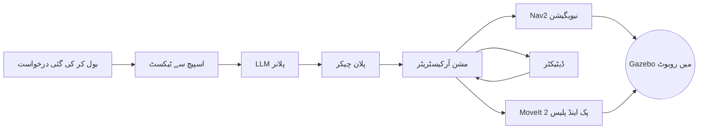

<LessonMeta level="Advanced" time="40 min" prereqs={["ماڈیولز 03 سے 09 (یا وہ اسباق جن پر آپ انحصار کرنے کا ارادہ رکھتے ہیں)", "ایک کام کرتا ہوا ROS 2 Jazzy اور Gazebo Harmonic سیٹ اپ"]} />

آپ ایک سیمیولیٹڈ اپارٹمنٹ میں کھڑے ہیں۔ آپ کہتے ہیں، "سرخ کپ میز پر لے اؤ۔" ایک موبائل روبوٹ آپ کی بات سنتا ہے، آپ کا مطلب سمجھتا ہے، کاؤنٹر کی طرف ڈرائیو کرتا ہے، تین دیگر اشیاء کے درمیان سرخ کپ کو تلاش کرتا ہے، اسے پکڑتا ہے، کمرے کے آر پار لے جاتا ہے اور میز پر رکھ دیتا ہے۔ کوئی بھی کی بورڈ کو ہاتھ نہیں لگاتا۔

یہ ایک جملہ آپ کی سیکھی ہوئی تقریباً ہر چیز کو چھوتا ہے: گفتگو (speech)، لینگویج ماڈلز، نیویگیشن، پرسیپشن (perception)، مینیپولیشن اور وہ ربط جو انہیں آپس میں جوڑتا ہے۔ یہ سبق اسے بنانے کا ایک معاہدہ ہے۔

<Objectives>

- اینڈ ٹو اینڈ کیپسٹون سسٹم کی وضاحت کریں اور ہر قدم کے ذمہ دار ذیلی سسٹم (subsystem) کا نام بتائیں۔
- ضروریات کو ایک ایسے سنگ میل کے منصوبے میں تبدیل کریں جسے آپ واقعی مکمل کر سکیں۔
- روبارک (rubric) کا استعمال کرتے ہوئے پیش گوئی کریں کہ آپ کے پروجیکٹ کی گریڈنگ کیسے کی جائے گی، اور اپنے شواہد کو اس کے مطابق ڈیزائن کریں۔
- ایک ایسا اضافی ہدف (stretch goal) منتخب کریں جو آپ کے وقت اور عزائم کے مطابق ہو۔

</Objectives>

## آپ کیا بنا رہے ہیں

کیپسٹون **سیمیولیشن میں آواز سے چلنے والا ایک روبوٹ اسسٹنٹ** ہے۔ روبوٹ ایک <Term def="پہیوں یا ٹریکس والے بیس کا روبوٹ جو ارد گرد ڈرائیو کر سکتا ہے، اور اس کے ساتھ ایک یا زیادہ بازو ہوتے ہیں جو اشیاء کو پکڑ اور منتقل کر سکتے ہیں۔">موبائل مینیپولیٹر (mobile manipulator)</Term> ہے: ایک ڈرائیو کرنے والا بیس اور گرپر کے ساتھ ایک بازو۔ یہ Gazebo Harmonic میں رہتا ہے، `ros_gz` کے ذریعے ROS 2 Jazzy سے بات کرتا ہے، اور کمانڈ کے بعد بغیر کسی انسانی مدد کے بولے گئے سامان لانے اور لے جانے کی درخواستوں کو مکمل کرتا ہے۔

یہاں ایک نظر میں پورا لوپ دکھایا گیا ہے۔



ہر باکس ایک ایسے سبق سے جڑا ہے جو آپ پہلے پڑھ چکے ہیں۔ پلانر [روبوٹ پلانرز کے طور پر LLMs](../09-foundation-models/01-llms-as-robot-planners.mdx) سے آتا ہے، مکمل سلسلہ [آواز سے کارروائی تک](../09-foundation-models/04-voice-to-action-pipeline.mdx) سے، نیویگیشن [Nav2 کے ساتھ نیویگیشن](../06-motion/02-navigation-with-nav2.mdx) سے، اور مینیپولیشن [MoveIt 2 کے ساتھ مینیپولیشن](../06-motion/03-manipulation-with-moveit2.mdx) سے۔

<KeyIdea title="انٹیگریشن اصل مشکل کام ہے">
ہر ذیلی سسٹم بذاتِ خود پچھلے ماڈیول کی ایک حل شدہ مشق ہے۔ کیپسٹون اس لیے مشکل ہے کیونکہ انہیں ایک ساتھ کام کرنا ہوتا ہے: ٹائمنگ، فریمز، ناکامی کی ہینڈلنگ اور مشترکہ اسٹیٹ۔ ایک روبوٹ جو 90 فیصد وقت چار کام کرتا ہے، وہ پورا کام صرف دو تہائی وقت میں مکمل کرتا ہے۔ جوڑوں (seams) کے لیے منصوبہ بندی کریں۔
</KeyIdea>

## دنیا اور روبوٹ

آپ اپنے روبوٹ کا ماڈل خود منتخب کرتے ہیں، لیکن اسے ان کم از کم ضروریات کو پورا کرنا ہوگا:

- اوڈومیٹری (odometry) کے ساتھ ایک ڈفرنشل-ڈرائیو یا اومنی ڈائریکشنل بیس۔
- لوکلائزیشن اور رکاوٹوں سے بچاؤ کے لیے ایک 2D lidar (یا نیویگیشن کے لیے قابلِ استعمال ڈیپتھ کیمرہ)۔
- کم از کم 5 ڈگریز آف فریڈم (degrees of freedom) اور پیرالل-جا گرپر کے ساتھ ایک بازو۔
- ایک RGB-D کیمرہ جو بازو کے سامنے موجود ورک اسپیس کو دیکھ سکے۔
- آڈیو موصول کرنے کا ایک طریقہ۔ سیمیولیشن میں یہ آپ کے کمپیوٹر کا مائیکروفون ہو سکتا ہے، یا پائپ لائن میں چلائی جانے والی ریکارڈ شدہ `.wav` فائلیں۔

دنیا اپارٹمنٹ کے طرز کا ایک ماحول ہے جسے آپ Gazebo میں بناتے ہیں: کم از کم دو کمرے، ایک کاؤنٹر، ایک میز، اور چار سے چھ گھریلو اشیاء۔ اشیاء میں ایک سرخ کپ، ایک نیلا کپ اور ایک سبز باکس، اور ساتھ ہی ایک یا دو دھیان بھٹکانے والی اشیاء (distractors) شامل ہیں۔ کاؤنٹر پر اشیاء کی پوزیشنیں ہر ٹرائل کے لیے بے ترتیب (randomized) کی جاتی ہیں۔ طے شدہ پوزیشنوں کی اجازت نہیں ہے، کیونکہ وہ آپ کو پرسیپشن کا مرحلہ چھوڑنے دیتی ہیں۔

## ضروریات

ضروریات کو نمبر دیے گئے ہیں تاکہ آپ کی تحریر اور گریڈنگ میں ان کا حوالہ دیا جا سکے۔

| ID | ضرورت | لازمی (Must) یا ہونی چاہیے (Should) |
|---|---|---|
| R1 | انگریزی میں بولی گئی درخواست قبول کرنا اور اسے ٹیکسٹ میں تبدیل کرنا | لازمی |
| R2 | ٹیکسٹ سے اسٹرکچرڈ پلان تیار کرنے کے لیے LLM کا استعمال کرنا | لازمی |
| R3 | کسی بھی حرکت سے پہلے اقدامات اور معروف مقامات کی ایک الو لسٹ (allowlist) کے خلاف ہر پلان کی توثیق کرنا | لازمی |
| R4 | Nav2 کے ساتھ کمروں کے درمیان نیویگیٹ کرنا، متحرک یا غیر متوقع رکاوٹ سے بچنا | لازمی |
| R5 | گراؤنڈ ٹروتھ کے بجائے کیمرے کے ڈیٹا سے ہدف شے کی نشان دہی اور لوکلائزیشن کرنا | لازمی |
| R6 | MoveIt 2 کے ساتھ شے کو اٹھانا اور اسے نامزد سطح پر رکھنا | لازمی |
| R7 | ٹیکسٹ میں صارف کو پیشرفت اور ناکامیوں کی اطلاع دینا (آواز کی آؤٹ پٹ ایک اضافی ہدف ہے) | لازمی |
| R8 | انسانی مدد کے بغیر کم از کم دو قسم کی ناکامیوں سے بازیافت (recovery) کرنا (مثال کے طور پر ناکام گرفت یا مسدود راستہ) | لازمی |
| R9 | ایک کمانڈ کے ذریعے برنگ-اپ اور ایک کمانڈ کے ذریعے ایویلیویشن رن فراہم کرنا | لازمی |
| R10 | اسٹاپ کمانڈ شائع ہونے پر ایک سیکنڈ کے اندر حرکت روکنا | ہونی چاہیے |

R3 اور R10 صرف دکھاوے کے لیے نہیں ہیں۔ ایک لینگویج ماڈل پرعتماد، غلط پلان جاری کر سکتا ہے، اور آپ کے روبوٹ کو اس سے بچنا ہے۔ آپ اس خیال سے دوبارہ [ایویلیویشن اور سیفٹی](../09-foundation-models/05-evaluation-and-safety.mdx) اور [اخلاقیات، سیفٹی اور معیارات](./04-ethics-safety-and-standards.mdx) میں ملیں گے۔

:::warning[گراؤنڈ ٹروتھ ایک دھوکہ ہے]
Gazebo آپ کو بالکل بتا سکتا ہے کہ ہر شے کہاں ہے۔ R5 کے لیے اس کا استعمال ڈیمو کو آسان اور گریڈ کو کم کر دے گا۔ اسے صرف اپنے ٹرائلز کو اسکور کرنے کے لیے استعمال کریں، روبوٹ کو چلانے کے لیے نہیں۔
:::

## سنگ میل (Milestones)

اگر آپ ہر ہفتے کچھ شامیں کام کرتے ہیں تو آٹھ ہفتے ایک آرام دہ رفتار ہے۔ اگر آپ پہلے سے ہی کچھ شعبوں میں مضبوط ہیں تو اسے مختصر کریں، لیکن ترتیب کو برقرار رکھیں، کیونکہ بعد کے سنگ میل پہلے والوں پر منحصر ہوتے ہیں۔

| سنگ میل | ہفتہ | مکمل ہونے کا مطلب ہے |
|---|---|---|
| M1: روبوٹ اور دنیا | 1 | روبوٹ اسپون ہوتا ہے، ٹیلی آپ کے ساتھ ڈرائیو کرتا ہے، اور ROS 2 میں سینسرز شائع کرتا ہے |
| M2: نیویگیشن | 2 سے 3 | روبوٹ نقشے میں نامزد مقامات پر قابلِ اعتماد طریقے سے پہنچتا ہے، 10 میں سے 9 بار |
| M3: پرسیپشن | 3 سے 4 | ڈیٹیکٹر ایک ماپے گئے ایرر کے ساتھ میپ فریم میں ہدف شے کا پوز واپس کرتا ہے |
| M4: مینیپولیشن | 4 سے 5 | بازو ایک اسکرپٹ کے ذریعے کسی معروف جگہ پر معلوم شے کو اٹھاتا اور رکھتا ہے |
| M5: زبان اور آواز | 6 | بولی جانے والی ٹیکسٹ ایک تصدیق شدہ پلان بن جاتی ہے، جس کی 20 جملوں پر تصدیق کی گئی ہے |
| M6: انٹیگریشن | 7 | مکمل درخواست اینڈ ٹو اینڈ کام کرتی ہے، ریکوری کے رویوں کے ساتھ |
| M7: ایویلیویشن اور ڈیمو | 8 | ٹرائل کے نتائج، ایک ڈیمو ویڈیو اور ایک تحریری رپورٹ |

ہفتہ وار تفصیلی ہدایات، پیکیج لے آؤٹ اور نوڈ گراف [کیپسٹون بلڈ گائیڈ](./02-capstone-build-guide.mdx) میں موجود ہیں۔

## آپ کی گریڈنگ کیسے کی جائے گی

آپ کا کام 100 میں سے اسکور کیا جاتا ہے۔ چاہے آپ کسی انسٹرکٹر، اسٹیڈی گروپ یا صرف اپنے آپ کو جمع کروا رہے ہوں، اس ٹیبل کے مطابق ایمانداری سے گریڈ کریں۔

| معیار | وزن | مکمل نمبرز ایسے دکھائی دیتے ہیں |
|---|---|---|
| فنکشنلٹی | 30 | اینڈ ٹو اینڈ درخواست زیادہ تر ٹرائلز میں بے ترتیب اشیاء کی جگہ کے ساتھ کامیاب ہوتی ہے |
| ایویلیویشن اور روبسٹنس | 20 | کم از کم 20 لاگ شدہ ٹرائلز، کامیابی کی شرح، مرحلے کے لحاظ سے ناکامی کی بریک ڈاؤن، اور اس بریک ڈاؤن پر مبنی اصلاحات |
| آرکیٹیکچر اور کوڈ کے معیار | 15 | واضح پیکیجز، ٹائپ شدہ انٹرفیس، لانچ فائلیں، YAML میں پیرامیٹرز، کچھ حقیقی ٹیسٹ |
| سیفٹی اور ناکامی کی ہینڈلنگ | 15 | پلان کی توثیق، اسٹاپ کمانڈ، ٹائم آؤٹ، اور ریکوری کے رویے جو آپ دکھا سکتے ہیں |
| ڈاکومینٹیشن اور ری پروڈیوسبیلیٹی | 10 | ایک اجنبی آپ کی README کا استعمال کرتے ہوئے 30 منٹ کے اندر کلون، بلڈ اور رن کر سکتا ہے |
| ڈیمو اور تحریر | 10 | ایک واضح 3 منٹ کی ویڈیو اور ایماندارانہ حد بندیوں کے ساتھ ایک مختصر رپورٹ |

<KeyIdea title="پہلے ماپیں، پھر ٹھیک کریں">
سب سے مضبوط سبمیشنز وہ نہیں ہیں جو پہلی بار کام کرتی ہیں۔ وہ وہ ہیں جو ہر ٹرائل کو لاگ کرتی ہیں، یہ تلاش کرتی ہیں کہ، مثال کے طور پر، 60 فیصد ناکامیاں گرفت کے وقت ہوتی ہیں، اور پھر گرفت میں بہتری لاتی ہیں۔ ناکامی کی بریک ڈاؤن ٹیبل پالش شدہ ویڈیو سے زیادہ قیمتی ہے۔
</KeyIdea>

### ایک ٹرائل کی پیمائش کرنا

ایک ٹرائل ایک بولی جانے والی درخواست ہے، کمانڈ قبول ہونے کے لمحے سے لے کر اس لمحے تک جب روبوٹ کام مکمل ہونے کی اطلاع دیتا ہے یا ہمت ہار دیتا ہے۔ کامیابی کا مطلب ہے کہ درست شے ہدف کی جگہ کے 10 سینٹی میٹر کے اندر، درست سطح پر رکھی گئی ہے، اور کوئی چیز نہیں گری۔ ہر ٹرائل کو JSON کی ایک لائن کے طور پر ریکارڈ کریں۔

```yaml title="eval/scenario.yaml"
name: bring_red_cup_to_table
trials: 20
randomize:
  red_cup_on_counter: {x_range: [-0.3, 0.3], y_range: [-0.2, 0.2]}
  distractors: [blue_cup, green_box]
command: "Bring the red cup to the table."
success:
  object: red_cup
  surface: table
  max_distance_m: 0.10
timeout_s: 240
```

آپ کا ایویلیویشن اسکرپٹ پھر لاگ کو ان نمبروں میں بدل دیتا ہے جو روبارک مانگتا ہے۔

```python title="eval/summarize.py"
import json
import statistics
import sys
from collections import Counter
from pathlib import Path


def load(path):
    lines = Path(path).read_text(encoding="utf-8").splitlines()
    return [json.loads(line) for line in lines if line.strip()]


def summarize(trials):
    wins = [t for t in trials if t["success"]]
    print(f"trials: {len(trials)}")
    print(f"success rate: {len(wins) / len(trials):.0%}")
    if wins:
        median = statistics.median(t["duration_s"] for t in wins)
        print(f"median time of successful trials: {median:.0f} s")
    failures = Counter(t["failure_stage"] for t in trials if not t["success"])
    for stage, count in failures.most_common():
        print(f"  failed at {stage}: {count}")


if __name__ == "__main__":
    summarize(load(sys.argv[1]))
```

`trials.jsonl` میں ہر لائن `{"success": false, "duration_s": 212.4, "failure_stage": "grasp"}` جیسی نظر آتی ہے۔ کامیاب ٹرائلز کے لیے، `failure_stage` کو `null` پر سیٹ کریں۔

## اضافی اہداف (Stretch goals)

پہلے لازمی کام کریں۔ پھر ایک اضافی ہدف منتخب کریں، تین نہیں۔ گہرائی وسعت سے بہتر ہے۔

- **اسپیچ آؤٹ (Speech out):** ٹیکسٹ ٹو اسپیچ شامل کریں تاکہ روبوٹ بتائے کہ وہ کیا کر رہا ہے اور جب درخواست مبہم ہو تو واضح کرنے والا سوال پوچھے ("مجھے دو کپ نظر آ رہے ہیں۔ کون سا؟")۔
- **کثیر النکاتی درخواستیں (Multi-step requests):** "نیلا کپ کاؤنٹر پر رکھو، پھر مجھے سبز باکس لا دو۔" آپ کے پلان ولیڈیٹر کو ترتیب اور مشترکہ اسٹیٹ کو سنبھالنے کی ضرورت ہے۔
- **ہیومنائیڈ کی قسم (Humanoid variant):** سیمیولیشن میں پہیوں والے بیس کی جگہ ایک ہیومنائیڈ کا استعمال کریں اور اسے لوکوموشن پالیسی کے ذریعے کمروں کے درمیان چلائیں یا لے جائیں۔ اسے [لوکوموشن](../08-humanoids/03-locomotion.mdx) اور [ہول باڈی کنٹرول](../08-humanoids/04-whole-body-control.mdx) کے ساتھ جوڑیں۔ توقع کریں کہ اس میں چند اضافی ہفتے لگیں گے۔
- **لرنڈ گراسپنگ یا VLA:** اسکرپٹ شدہ گرفت کو سیکھی ہوئی پالیسی سے بدلیں، جیسے [ویژن-لینگویج-ایکشن ماڈلز](../09-foundation-models/03-vision-language-action-models.mdx) میں، اور اپنے روایتی بیس لائن کے مقابلے میں کامیابی کی شرح کا موازنہ کریں۔
- **حقیقی ہارڈویئر:** [ہارڈویئر پر تعیناتی](./03-deploying-on-hardware.mdx) کی پیروی کرتے ہوئے، ایک حقیقی روبوٹ پر ایک کم شدہ ورژن چلائیں۔ ایک چھوٹے بازو کے ساتھ کم قیمت والا پہیوں والا بیس کافی ہے۔

## عملی لیب

کسی بھی روبوٹ کا کوڈ لکھنے سے پہلے پروجیکٹ کا سکیلیٹن (skeleton) اور ایویلیویشن ہارنس سیٹ اپ کریں۔ باقی پروجیکٹ کو قابلِ پیمائش بنانے کا یہ سب سے ارزاں طریقہ ہے۔

<Steps>

1. `kinemata-capstone` کے نام سے ایک ریپوزٹری بنائیں جس میں ایک `README.md` ہو جس میں پروجیکٹ کے ہدف، ضروریات کی ٹیبل (R1 سے R10) اور آپ کی سنگ میل کی تاریخیں بیان کی گئی ہوں۔
2. اس سبق سے `scenario.yaml` اور `summarize.py` کو ایک `eval/` فولڈر میں کاپی کریں۔ اپنی دنیا سے میل کھانے کے لیے کمانڈ اور اشیاء کو تبدیل کریں۔
3. دسویں ایجاد کردہ ٹرائلز کے ساتھ ایک چھوٹا `eval/fake_trials.jsonl` لکھیں (مختلف مراحل میں کامیابیوں اور ناکامیوں کا آمیزہ) اور `python eval/summarize.py eval/fake_trials.jsonl` چلائیں۔ آپ کو کامیابی کی شرح اور ناکامی کی بریک ڈاؤن دیکھنی چاہیے۔
4. اپنی README میں، ایک پیراگراف کی خطرے کی فہرست شامل کریں: وہ تین چیزیں جن کے غلط ہونے کا سب سے زیادہ امکان ہے اور ہر ایک کے لیے آپ کا منصوبہ۔
5. "Add capstone skeleton and eval harness" جیسے پیغام کے ساتھ کمٹ کریں، اور اسے `m0` ٹیگ کریں۔

</Steps>

آپ کو معلوم ہوگا کہ یہ کام کر گیا جب سمری اسکرپٹ آپ کے فرضی ڈیٹا سے معقول نمبر پرنٹ کرے اور کوئی دوسرا شخص آپ کی README پڑھ کر بتا سکے کہ "مکمل" کا کیا مطلب ہے۔

پھنس گئے ہیں؟ کورس کے اسسٹنٹ، **Rivet** سے نیچے دائیں جانب پوچھیں۔

## مشقیں

<Exercise title="امکان کی ترکیب کریں" level="Intermediate">
فرض کریں کہ آپ کے سسٹم کے چار مراحل ہیں جن میں کامیابی کی آزادانہ شرحیں ہیں: اسپیچ 0.95، پلاننگ 0.95، نیویگیشن 0.9 اور مینیپولیشن 0.8۔ اینڈ ٹو اینڈ کامیابی کی متوقع شرح کیا ہے، اور اگر آپ صرف ایک مرحلے کو 0.05 سے بڑھا سکتے ہیں تو آپ کو سب سے پہلے کس مرحلے کو بہتر بنانا چاہیے؟

<Solution>
مراحل کو ضرب دیں: 0.95 × 0.95 × 0.9 × 0.8 = 0.65، تقریباً 65 فیصد۔ مینیپولیشن کو 0.8 سے 0.85 تک بڑھانے سے 0.69 حاصل ہوتا ہے۔ نیویگیشن کو 0.9 سے 0.95 تک بڑھانے سے بھی 0.69 ملتا ہے، جبکہ اسپیچ یا پلاننگ کو 1.0 تک بڑھانے سے تقریباً 0.68 حاصل ہوگا۔ عملی طور پر، سب سے کم شرح والے اس مرحلے کو بہتر بنائیں جسے ٹھیک کرنا سب سے سستا ہو، اور ہمیشہ ماپے گئے ناکامی کے ڈیٹا سے تصدیق کریں، کیونکہ آزادی کا مفروضہ شاذ و نادر ہی سچ ہوتا ہے۔
</Solution>
</Exercise>

<Exercise title="ابہام کا ایک اصول لکھیں" level="Beginner">
صارف کہتا ہے، "مجھے کپ لا دو۔" منظر میں دو کپ ہیں۔ دو یا تین جملوں میں وہ رویہ لکھیں جو آپ کے روبوٹ کو دکھانا چاہیے، اور بتائیں کہ یہ کس ضرورت سے متعلق ہے۔

<Solution>
روبوٹ کو اندازے نہیں لگانے چاہئیں۔ اسے یہ رپورٹ کرنا چاہیے کہ اسے دو کپ (سرخ اور نیلا) نظر آ رہے ہیں اور پوچھنا چاہیے کہ کون سا لانا ہے، پھر جواب کا انتظار کرنا چاہیے یا محفوظ طریقے سے ٹائم آؤٹ ہو جانا چاہیے۔ اس کا تعلق R3 (حرکت سے پہلے پلان کی توثیق کرنا، کیونکہ پلان غیر واضح ہے) اور R7 (صارف کو واپس رپورٹ کرنا) سے ہے۔ ایک اضافی ہدف سوال کو بلند آواز میں بولنا ہوگا۔
</Solution>
</Exercise>

<Exercise title="اپنا اضافی ہدف منتخب کریں" level="Advanced">
ایک اضافی ہدف کا انتخاب کریں اور آدھے صفحے کا منصوبہ لکھیں: آپ کیا بنائیں گے، آپ بیس لائن کے مقابلے میں اس کی پیمائش کیسے کریں گے، اور اگر آپ پیچھے رہ جاتے ہیں تو آپ کیا کم کریں گے۔

<Solution>
ایک اچھا جواب ایک قابلِ پیمائش نتیجہ کا نام دیتا ہے ("سیکھی ہوئی گرفت 20 ٹرائلز میں کم از کم اسکرپٹ شدہ گرفت کی کامیابی کی شرح تک پہنچتی ہے")، مطلوبہ بیس لائن سے موازنہ، ایک تاریخ، اور ایک واضح فال بیک ("اگر سیکھی ہوئی پالیسی ہفتہ 7 تک کام نہیں کر رہی ہے، تو رپورٹ کریں کہ میں نے کیا کوشش کی اور اسکرپٹ شدہ گرفت بھیجیں")۔ ایسے منصوبے جن میں فال بیک کا نام شامل ہوتا ہے ان کے مکمل ہونے کا زیادہ امکان ہوتا ہے۔
</Solution>
</Exercise>

## اپنی سمجھ کی پڑتال کریں

<Quiz questions={[
  {
    q: "روبوٹ کو چلانے کے لیے اشیاء کے مقامات کے لیے Gazebo گراؤنڈ ٹروتھ کا استعمال کیوں ممنوع ہے؟",
    options: [
      "یہ سیمیولیشن میں بہت سست چلتا ہے",
      "یہ پرسیپشن کو چھوڑ دیتا ہے، جس کی کیپسٹون میں مشق کروائی جانی مقصود ہے",
      "ROS 2 گراؤنڈ ٹروتھ شائع نہیں کرتا",
      "یہ Nav2 کاسٹ میپ کو توڑ دیتا ہے"
    ],
    answer: 1,
    explain: "گراؤنڈ ٹروتھ کام کو مصنوعی طور پر آسان بناتا ہے اور ضرورت R5 کو بائی پاس کرتا ہے۔ اسے صرف ٹرائلز کو اسکور کرنے کے لیے استعمال کریں۔"
  },
  {
    q: "کون سی ضرورت روبوٹ کو پرعتماد لیکن غلط LLM پلان سے بچاتی ہے؟",
    options: [
      "R1، اسپیچ سے ٹیکسٹ",
      "R3، حرکت سے پہلے الو لسٹ کے خلاف ہر پلان کی توثیق کرنا",
      "R6، MoveIt 2 کے ساتھ پک اینڈ پلیس",
      "R9، ون-کمانڈ برنگ-اپ"
    ],
    answer: 1,
    explain: "پلان کی توثیق کسی بھی چیز کے حرکت کرنے سے پہلے نامعلوم اقدامات اور مقامات کو رد کر دیتی ہے، تاکہ غلط فہمی پر مبنی قدم کبھی بھی ہارڈویئر تک نہ پہنچے۔"
  },
  {
    q: "وقت کے ساتھ پروجیکٹ کو بہتر بنانے کے لیے گریڈنگ روبارک سب سے زیادہ برائے راست کس چیز کو انعام دیتا ہے؟",
    options: [
      "ایک لمبی ڈیمو ویڈیو",
      "ریپوزٹری میں مزید پیکیجز",
      "ناکامی کی بریک ڈاؤن کے ساتھ لاگ شدہ ٹرائلز جو اصلاحات کو چلاتی ہیں",
      "جدید ترین لینگویج ماڈل کا استعمال"
    ],
    answer: 2,
    explain: "ایویلیویشن اور روبسٹنس کے 20 پوائنٹس ہوتے ہیں، اور ناکامی کی بریک ڈاؤن سے ظاہر ہوتا ہے کہ آپ نے حقیقی مسائل تلاش کیے اور انہیں ٹھیک کیا۔"
  },
  {
    q: "90 فیصد والے چار ذیلی سسٹمز کا سلسلہ صرف دو تہائی وقت میں پورا کام کیوں مکمل کرتا ہے؟",
    options: [
      "کامیابی کے امکانات تمام مراحل میں ضرب ہوتے ہیں",
      "ROS 2 ہر ہاپ پر لیٹنسی کا اضافہ کرتا ہے",
      "لینگویج ماڈلز ناقابلِ اعتماد ہیں",
      "Gazebo ناکامیوں کو بے ترتیب بناتا ہے"
    ],
    answer: 0,
    explain: "0.9 کی پاور 4 تقریباً 0.66 ہوتی ہے، اس لیے جیسے جیسے مراحل کو جوڑا جاتا ہے، قابلِ اعتماد ہونے کی شرح کم ہوتی جاتی ہے۔"
  }
]} />

<Takeaways>

- کیپسٹون Gazebo Harmonic میں آواز سے چلنے والا ایک موبائل مینیپولیٹر ہے جو سنتا ہے، منصوبہ بندی کرتا ہے، نیویگیٹ کرتا ہے، پرسیو کرتا ہے اور پک اینڈ پلیس کرتا ہے۔
- ضروریات R1 سے R10 مکمل ہونے کی تعریف کرتی ہیں؛ R3 (پلان کی توثیق) اور R10 (اسٹاپ کمانڈ) سیفٹی کی بنیاد ہیں۔
- انٹیگریشن، نہ کہ کوئی ایک ذیلی سسٹم، زیادہ تر دشواری کا مرکز ہے۔
- آپ کو ماپے گئے شواہد پر گریڈ دیا جاتا ہے: لاگ شدہ ٹرائلز، ناکامی کی بریک ڈاؤن، ری پروڈیوسبیلیٹی اور ایک ایماندارانہ تحریر۔
- روبوٹ کو سیمیولیٹر گراؤنڈ ٹروتھ سے کبھی نہ چلائیں؛ اسے صرف ٹرائلز کو اسکور کرنے کے لیے استعمال کریں۔
- ایک اضافی ہدف منتخب کریں اور شروع کرنے سے پہلے فال بیک کی منصوبہ بندی کریں۔

</Takeaways>

## مزید گہرائی میں جائیں

- دنیاؤں، ماڈلز اور `ros_gz` برج کے لیے [Gazebo ڈاکومینٹیشن](https://gazebosim.org/docs)۔
- نیویگیشن اسٹیک کے لیے [Nav2 ڈاکومینٹیشن](https://navigation.ros.org) جسے آپ کنفیگر کریں گے۔
- پلاننگ اور پک اینڈ پلیس کے ٹیوٹوریلز کے لیے [MoveIt 2 ڈاکومینٹیشن](https://moveit.picknik.ai)۔
- ان سب کے نیچے موجود ہر چیز کے لیے [ROS 2 Jazzy ڈاکومینٹیشن](https://docs.ros.org/en/jazzy/)۔

آگے: [کیپسٹون بلڈ گائیڈ](./02-capstone-build-guide.mdx)
