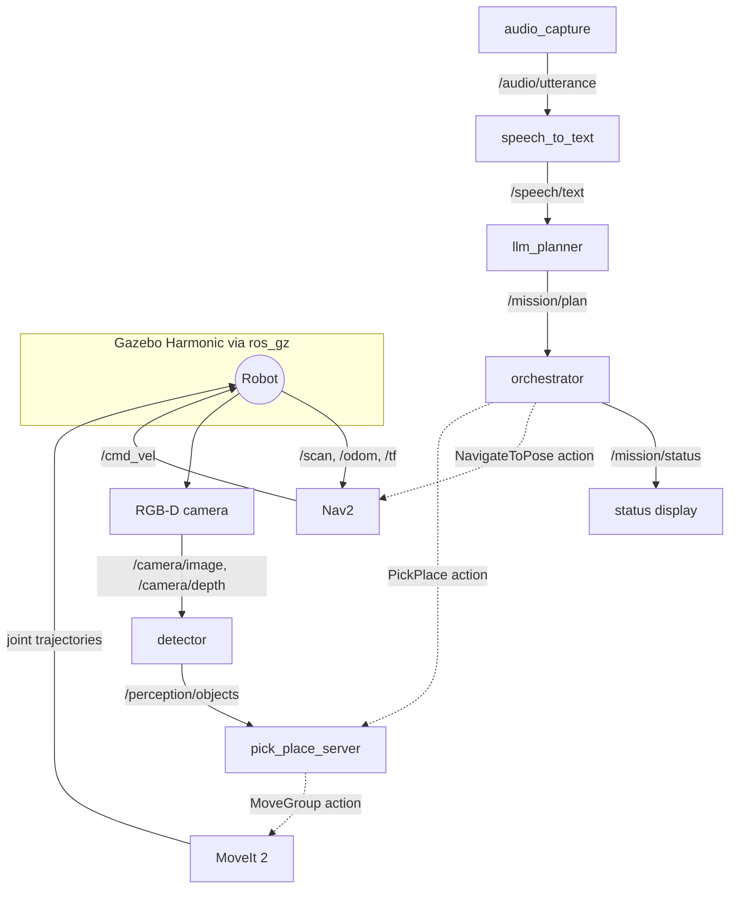

<LessonMeta level="Expert" time="45 min" prereqs={["Capstone brief", "ROS 2 actions, launch files and tf2", "Nav2 and MoveIt 2 basics"]} />

بناوٹ کا تیسرا ہفتہ۔ روبوٹ خود سے بہترین ڈرائیو کرتا ہے، بازو خود سے شاندار انداز میں اشیاء اٹھاتا ہے، اور جب آپ ان دونوں کو ایک ساتھ جوڑتے ہیں تو بازو ایک خالی کاؤنٹر کی طرف اشارہ کرتا ہے کیونکہ کیمرہ فریم (camera frame) کبھی نقشے (map) سے منسلک ہی نہیں ہوا تھا۔ ہر کیپسٹن پروجیکٹ میں ایسا وقت آتا ہے۔ اس کا حل شاذ و نادر ہی کوئی انتہائی دانشمندانہ ہوتا ہے؛ بلکہ ایک واضح ڈھانچہ ہوتا ہے جو مسئلے کو تلاش کرنا آسان بنا دیتا ہے۔

یہ گائیڈ آپ کو وہ ڈھانچہ فراہم کرتی ہے: اپنے پیکیجز کو کیسے مرتب کریں، نوڈز کیسے بات چیت کرتے ہیں، ہر ہفتے کیا بنانا ہے اور اسے کیسے ٹیسٹ اور ڈیبگ کرنا ہے۔

<Objectives>

- صاف ستھری پیکیج حدود کے ساتھ متعدد ذیلی سسٹمز (subsystems) والے روبوٹ کے لیے ROS 2 ورک اسپیس تیار کریں۔
- ذیلی سسٹمز کو جوڑنے والے ٹاپکس اور ایکشنز (actions) کی وضاحت کریں، بشمول ایک کسٹم ایکشن۔
- اگلے درجے سے پہلے ہر درجے کا ٹیسٹ کرتے ہوئے، درست ترتیب میں سسٹم بنائیں۔
- خرابی کس درجے میں موجود ہے، اس کی نشاندہی کے لیے ڈیبگنگ چیک لسٹ کا استعمال کریں۔

</Objectives>

## پیکیج کا لے آؤٹ

پروجیکٹ کو ذمہ داری کی بنیاد پر تقسیم کریں، نہ کہ پروگرامنگ زبان کی بنیاد پر۔ ہر پیکیج کا ایک کام ہے اور انحصار (dependencies) کی ایک مختصر فہرست ہے۔ یہ بلڈ کو تیز رکھتا ہے اور آپ کو ہر حصے کو الگ سے ٹیسٹ کرنے کی اجازت دیتا ہے۔

```text title="kinemata_ws/src/"
kinemata_interfaces/     custom msg and action definitions (CMake package)
kinemata_description/    URDF/xacro, meshes, ros2_control tags
kinemata_sim/            Gazebo worlds, ros_gz bridge config, spawn launch
kinemata_navigation/     Nav2 params, maps, localization launch
kinemata_perception/     detector node, pose estimation, camera config
kinemata_manipulation/   MoveIt 2 config, pick_place action server
kinemata_voice/          audio capture, speech-to-text node
kinemata_planner/        LLM client, prompt, plan validator
kinemata_mission/        orchestrator (state machine over actions)
kinemata_bringup/        top-level launch files and parameter YAML
kinemata_eval/           trial runner, scoring, scenario files
```

ہر قابلِ تبدیلی قدر (فریم کے نام، آبجیکٹ کے نام، ٹائم آؤٹس، ماڈل کے نام) کو `kinemata_bringup/config/` کے تحت YAML فائلوں میں رکھیں۔ انہیں کبھی بھی نوڈز کے اندر ہارٹ کوڈ نہ کریں۔ یہ [Actions, parameters and launch files](../03-ros2/03-actions-parameters-launch.mdx) سے سیکھی گئی عادت ہے۔

## نوڈ گراف (Node graph)

یہاں بتایا گیا ہے کہ رن ٹائم پر نوڈز کیسے بات چیت کرتے ہیں۔ ٹھوس تیر (solid arrows) ٹاپکس ہیں؛ آرکیسٹریٹر Nav2 اور آپ کے pick-and-place سرور پر ایکشنز کو کال کرتا ہے۔



### انٹرفیسز

پہلے انٹرفیسز پر متفق ہوں۔ اگر معاہداں مستحکم ہیں، تو آپ کسی بھی ترتیب میں حصوں کو بنا اور ٹیسٹ کر سکتے ہیں۔

| انٹرفیس | قسم | سمت | مقصد |
|---|---|---|---|
| `/audio/utterance` | `audio_common_msgs` یا `std_msgs/String` میں فائل پاتھ | مائیک سے ASR | ایک ریکارڈ شدہ آواز (آپ کا انتخاب، اسے ڈاکیومنٹ کریں) |
| `/speech/text` | `std_msgs/String` | ASR سے پلانر | درخواست کی تحریری نقل |
| `/mission/plan` | `std_msgs/String` (JSON فہرست) | پلانر سے آرکیسٹریٹر | تصدیق شدہ مراحل کی فہرست |
| `/mission/status` | `std_msgs/String` | آرکیسٹریٹر سے صارف | پیشرفت اور ناکامیاں |
| `navigate_to_pose` | `nav2_msgs/action/NavigateToPose` | آرکیسٹریٹر سے Nav2 | نامزد جگہ پر ڈرائیو کریں |
| `pick_place` | `kinemata_interfaces/action/PickPlace` | آرکیسٹریٹر سے مینیپولیشن | چیز اٹھانا (pick) یا رکھنا (place) |
| `/perception/objects` | `vision_msgs/Detection3DArray` | ڈیٹیکٹر سے مینیپولیشن | میپ فریم پوزیز کے ساتھ شناخت شدہ اشیاء |
| `/emergency_stop` | `std_msgs/Bool` | تمام تحرک کرنے والوں کے لیے | ہنگامی روک تھام کی درخواست |

صرف ایک انٹرفیس کسٹم ہے۔ اسے ایک بار `kinemata_interfaces` میں بیان کریں۔

```text title="kinemata_interfaces/action/PickPlace.action"
# mode is "pick" or "place"
string mode
# object to pick, or surface to place on
string name
---
bool success
string message
---
string phase
```

منصوبہ خود تین اقدامات کی **منظور شدہ فہرست (allowlist)** کے ساتھ ایک مختصر JSON فہرست ہے۔

```json title="example plan"
[
  {"action": "navigate_to", "target": "counter"},
  {"action": "pick", "object": "red_cup"},
  {"action": "navigate_to", "target": "table"},
  {"action": "place", "target": "table"}
]
```

<KeyIdea title="آرکیسٹریٹر ایک چھوٹا، آسان اسٹیٹ مشین ہے">
جوڑنے والے منطق (glue logic) میں ضرورت سے زیادہ ذہانت ڈالنے سے گریز کریں۔ LLM فیصلہ کرتا ہے کہ کیا کرنا ہے؛ آرکیسٹریٹر صرف تصدیق شدہ مراحل کو ایک وقت میں چلاتا ہے، ہر نتیجہ چیک کرتا ہے اور ناکامی پر صاف طور پر عمل روک دیتا ہے۔ ایک مختصر، قطعی (deterministic) آرکیسٹریٹر کو ٹیسٹ کرنا اور اس پر بھروسہ کرنا آسان ہوتا ہے۔
</KeyIdea>

## آرکیسٹریٹر (Orchestrator)

یہ نوڈ منصوبے کی تصدیق کرتا ہے، پھر ترتیب سے مراحل کو نافذ کرتا ہے۔ نوٹس کریں کہ یہ کسی بھی چیز کے متحرک ہونے سے پہلے غلط منصوبوں کو مسترد کر دیتا ہے۔

```python title="kinemata_mission/orchestrator.py"
import json
import math

import rclpy
from action_msgs.msg import GoalStatus
from geometry_msgs.msg import PoseStamped
from nav2_msgs.action import NavigateToPose
from kinemata_interfaces.action import PickPlace
from rclpy.action import ActionClient
from rclpy.node import Node
from std_msgs.msg import String

# (x, y, yaw) in the map frame; load these from YAML in your real project
PLACES = {"table": (2.0, 0.5, 0.0), "counter": (-1.0, 2.0, 1.57)}
ALLOWED = {"navigate_to": "target", "pick": "object", "place": "target"}


def validate(plan):
    if not isinstance(plan, list) or not plan:
        raise ValueError("plan must be a non-empty list")
    for step in plan:
        if not isinstance(step, dict) or step.get("action") not in ALLOWED:
            raise ValueError(f"unknown step: {step!r}")
        field = ALLOWED[step["action"]]
        if set(step) != {"action", field}:
            raise ValueError(f"bad fields for {step['action']}: {sorted(step)}")
        if field == "target" and step["target"] not in PLACES:
            raise ValueError(f"unknown place: {step['target']!r}")
    return plan


def pose_for(name, stamp):
    x, y, yaw = PLACES[name]
    pose = PoseStamped()
    pose.header.frame_id = "map"
    pose.header.stamp = stamp
    pose.pose.position.x = x
    pose.pose.position.y = y
    pose.pose.orientation.z = math.sin(yaw / 2)
    pose.pose.orientation.w = math.cos(yaw / 2)
    return pose


class Orchestrator(Node):
    def __init__(self):
        super().__init__("orchestrator")
        self.nav = ActionClient(self, NavigateToPose, "navigate_to_pose")
        self.manip = ActionClient(self, PickPlace, "pick_place")
        self.status_pub = self.create_publisher(String, "/mission/status", 10)
        self.create_subscription(String, "/mission/plan", self.on_plan, 10)
        self.steps = []
        self.busy = False

    def say(self, text):
        self.get_logger().info(text)
        self.status_pub.publish(String(data=text))

    def on_plan(self, msg):
        if self.busy:
            self.say("busy: plan ignored")
            return
        try:
            self.steps = validate(json.loads(msg.data))
        except ValueError as err:
            self.say(f"rejected plan: {err}")
            return
        self.busy = True
        self.next_step()

    def next_step(self):
        if not self.steps:
            self.busy = False
            self.
