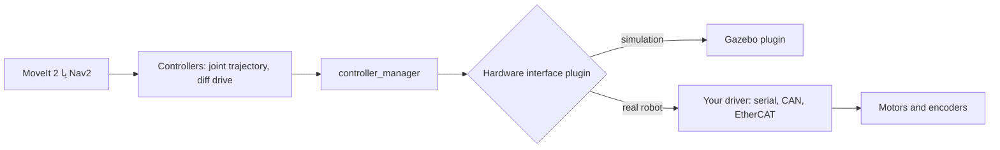

<LessonMeta level="Expert" time="45 min" prereqs={["Capstone build guide", "ros2_control basics", "Sim-to-real gap"]} />

سیمیولیشن میں، کسی بگ (bug) کا مطلب صرف ری اسٹارٹ ہوتا ہے۔ ایک حقیقی روبوٹ پر، وہی بگ کسی موٹر، ٹیبل لیمپ یا انگلی کا نقصان کر سکتا ہے۔ جو روبوٹ آپ نے بنایا ہے وہ Gazebo میں بالکل سیدھا چلتا ہے؛ لیکن فرش پر وہ بائیں طرف مڑنے لگتا ہے، کیونکہ ایک پہیا دوسرے پہیے سے ملی میٹر کے ایک چھوٹے سے حصے کے برابر چھوٹا ہے۔ کوڈ وہی ہے۔ دنیا وہ نہیں ہے۔

یہ سبق اس خلا کو احتیاط سے پار کرنے کے لیے ایک چیک لسٹ ہے: کون سا ہارڈ ویئر آپ کے سافٹ ویئر کو چلاتا ہے، ٹائمنگ کو کیسے درست رکھا جائے، موٹروں سے کیسے بات کی جائے، محفوظ طریقے سے کیسے روکا جائے اور کسی چیز کو نقصان پہنچائے بغیر کیسے ٹیسٹ کیا جائے۔

<Objectives>

- روبوٹ کے لیے ایمبیڈڈ کمپیوٹ (embedded compute) منتخب اور سیٹ اپ کریں، اور اس کے فوائد و نقصانات بیان کریں۔
- وضاحت کریں کہ روبوٹ کے لیے ریئل ٹائم (real-time) کا کیا مطلب ہے اور اسٹیک کے کن حصوں کو اس کی ضرورت ہوتی ہے۔
- سیمیولیشن اور ہارڈ ویئر پر ایک ہی کنٹرولرز چلانے کے لیے ros2_control کا استعمال کریں۔
- تہہ دار سیفٹی اسٹاپس (layered safety stops) شامل کریں، سینسرز کو کیلیبریٹ کریں اور ہر رن کو لاگ کریں۔
- ایک مرحلہ وار فیلڈ ٹیسٹ کا منصوبہ بنائیں جو کم خطرے کے ساتھ مسائل کو ظاہر کرے۔

</Objectives>

## ہارڈ ویئر مختلف کیوں ہے

آپ نے جو کچھ بھی بنایا ہے اس میں ایسی چیزیں فرض کی گئی ہیں جو حقیقی ہارڈ ویئر آپ کو مفت میں نہیں دیتا۔

- **وقت کی پابندی غیر مستحکم ہوتی ہے۔** سیمیولیشن میں، کلاک آپ کا ہوتا ہے۔ ہارڈ ویئر پر، سینسر کا ڈیٹا دیر سے آتا ہے، اس میں جٹر (jitter) ہوتا ہے اور ڈیٹا ضائع بھی ہوتا ہے۔
- **فزکس بالکل درست نہیں ہوتی۔** رگڑ (friction)، بیک لیش (backlash)، بیٹری کا ڈراپ ہونا اور پہیوں کا ہسلنا (wheel slip) سب کچھ موجود ہوتا ہے۔
- **ناکامی جسمانی ہوتی ہے۔** کریش کا مطلب ری اسٹارٹ نہیں؛ بلکہ مرمت ہے۔
- **وسائل محدود ہوتے ہیں۔** آپ کا لیپ ٹاپ GPU روبوٹ پر موجود نہیں ہے۔ پاور، حرارت اور وزن سب کی ایک حد (budget) ہے۔

[The sim-to-real gap](../04-simulation/05-sim-to-real-gap.mdx) سے معلوم ہونے والا <Term def="ماڈلنگ کی غلطیوں، سینسر کے شور، تاخیر اور غیر ماڈل شدہ فزکس کی وجہ سے سیمیولیٹڈ روبوٹ اور حقیقی روبوٹ کے رویے میں فرق۔">sim-to-real gap</Term> یہاں صرف تحقیقی دلچسپی کی چیز نہیں ہے؛ یہ وہ چیز ہے جسے آپ ہر روز سنبھالتے ہیں۔

<KeyIdea title="دونوں دنیاؤں کے لیے ایک ہی سافٹ ویئر اسٹیک رکھیں">
اس طرح ڈیزائن کریں کہ سیمیولیشن سے ہارڈ ویئر پر منتقل ہونے کا مطلب صرف سب سے نچلی تہہ (ہارڈ ویئر انٹرفیس) اور کچھ YAML فائلوں کو بدلنا ہو، اپنے نوڈز کو دوبارہ لکھنا نہ ہو۔ وہی ٹاپکس، وہی کنٹرولرز، اور وہی لانچ سٹرکچر۔ آپ کا چھوڑا ہوا ہر ایک فرق ایک نیا بگ بن جاتا ہے۔
</KeyIdea>

## ایمبیڈڈ کمپیوٹ

ایک روبوٹ اپنا کمپیوٹر خود ساتھ لے کر چلتا ہے۔ بہت سی ٹیمیں مربوط (integrated) GPU والے سنگل بورڈ کمپیوٹر کا انتخاب کرتی ہیں، جیسے کہ NVIDIA Jetson کلاس کے بورڈز، کیونکہ روبوٹ پر ہی ڈٹیکشن اور اسپیچ کے لیے نیورل نیٹ ورکس چلانے سے نیٹ ورک کی تاخیر (latency) بچتی ہے اور یہ Wi-Fi کے بغیر بھی کام کرتا ہے۔ دیگر آپشنز میں چھوٹے x86 mini PCs، یا ایک تقسیم شدہ (split) ڈیزائن شامل ہے جہاں ایک مائیکرو کنٹرولر موٹروں اور سینسرز کو تیز لوپس میں سنبھالتا ہے جبکہ ایک بڑا کمپیوٹر پرسیپشن (perception) اور پلاننگ کو سنبھالتا ہے۔

ان باتوں پر غور کریں:

- **کمپیوٹ اور میموری۔** کیا بورڈ آپ کے ڈٹیکٹر کو مطلوبہ فریم ریٹ پر چلا سکتا ہے؟ آپٹمائزڈ انفرنس انجنز (مثال کے طور پر NVIDIA ہارڈ ویئر پر TensorRT) اکثر 5 اور 30 فریمز فی سیکنڈ کے درمیان کا فرق پیدا کرتے ہیں۔
- **پاور اور حرارت۔** بورڈز کے پاور موڈز ہوتے ہیں۔ ایک بورڈ جو بینچ پر ٹھیک چلتا ہے وہ بند چیسس کے اندر اوور ہیٹ ہو کر سلو (throttle) ہو سکتا ہے۔ طویل رن کے دوران درجہ حرارت ناپیں۔
- **آپریٹنگ سسٹم کا مطابقت رکھنا۔** اس کورس میں ریفرینس اسٹیک Ubuntu 24.04 کے ساتھ ROS 2 Jazzy ہے۔ وینڈر کی امیجز مختلف Ubuntu ریلیز کے ساتھ آ سکتی ہیں۔ چیک کریں کہ آپ کا بورڈ کس کو سپورٹ کرتا ہے؛ اگر یہ مختلف ہے، تو ROS 2 کو کنٹینر کے اندر چلائیں تاکہ سافٹ ویئر کا ماحول بالکل وہی رہے جو آپ نے ٹیسٹ کیا تھا۔
- **اسٹوریج اور I/O۔** مکمل ریٹ پر لاگنگ کے لیے تیز رفتار اسٹوریج کی ضرورت ہوتی ہے۔ کیمروں، lidar اور CAN یا سیریل بسوں کے پورٹس کو چیک کریں۔

ایک عام تقسیم یہ ہے: 1 kHz یا اس سے زیادہ پر موٹر لوپس کے لیے مائیکرو کنٹرولر، ROS 2 نوڈز کے لیے آن بورڈ کمپیوٹر، اور نیٹ ورک کے ذریعے ویژولائزیشن کے لیے ایک اختیاری آپریٹر لیپ ٹاپ۔

## سادہ الفاظ میں ریئل ٹائم

ایک <Term def="ایک ایسا سسٹم جہاں کسی نتیجے کا درست ہونا صرف اس کی قیمت پر نہیں بلکہ اسے ڈیڈ لائن سے پہلے پہنچانے پر منحصر ہوتا ہے۔">real-time</Term> سسٹم وہ نہیں ہوتا جو تیز ہو۔ یہ وہ ہوتا ہے جس کی پیش گوئی کی جا سکے (predictable): ایک کنٹرول لوپ جسے ہر 5 ms میں چلنا چاہیے، اسے ہر بار 5 ms میں ہی چلنا چاہیے۔ تاخیر سے دی گئی موٹر کمانڈ ایک غلط موٹر کمانڈ ہوتی ہے۔

اسٹینڈرڈ لینکس ایک عام مقصد کا شیڈولر ہے اور بدقسمتی کے لمحے میں آپ کے پروسیس کو کئی ملی سیکنڈز کے لیے ملتوی کر سکتا ہے۔ 20 سے 50 Hz پر چلنے والے ایک سست موبائل بیس کے لیے یہ عام طور پر قابل قبول ہے۔ تیز روبوٹک آرم کے کنٹرول یا ٹانگوں والے روبوٹ کو بیلنس کرنے کے لیے، یہ قابل قبول نہیں ہے۔

عملی مشورے، سب سے سستے سے لے کر سخت ترین تک:

1. **ہارڈ ریئل ٹائم لوپ کو مائیکرو کنٹرولر** یا خود موٹر ڈرائیو پر رکھیں۔ آن بورڈ کمپیوٹر کو مناسب شرح پر سیٹ پوائنٹس (setpoints) بھیجنے دیں۔
2. **کمپیوٹر پر ریئل ٹائم کرنل** (PREEMPT_RT کرنل) کا استعمال کریں اگر اسے تیز لوپس کو خود بند کرنا ہو۔
3. **کنٹرول لوپ کو صاف رکھیں۔** لوپ کے اندر میموری ایلوکیشن نہ ہو، ڈسک پر لاگنگ نہ ہو، اور بلاک کرنے والی کالز نہ ہوں۔ میموری کو پہلے سے ایلوکیٹ اور لاک کریں، اور کنٹرول تھریڈ کو ریئل ٹائم شیڈولنگ ترجیح دیں۔
4. **کمپیوٹرز کے درمیان کلاکس کو ہم آہنگ (sync) رکھیں** نیٹ ورک ٹائم سروس جیسے chrony کے ذریعے، ورنہ آپ کے ٹائم اسٹیمپ اور `tf` لک اپس عجیب طریقوں سے ناکام ہو جائیں گے۔
5. **DDS سیٹنگز اور QoS کا انتخاب سوچ سمجھ کر کریں۔** سینسر اسٹریمز عام طور پر best-effort اور چھوٹی کیوز (queues) چاہتی ہیں؛ جبکہ کمانڈز اور میپس کو قابل اعتماد ترسیل (reliable delivery) کی ضرورت ہوتی ہے۔

امید رکھنے کے بجائے پیمائش کریں۔ اپنے کنٹرول لوپ کے واقعی دورانیے کو لاگ کریں اور اوسط کے بجائے بدترین حالت (worst case) کا گراف بنائیں۔

## ros2_control: ہر جگہ ایک جیسے کنٹرولرز

<Term def="ایک ROS 2 فریم ورک جو کنٹرولرز (کیا حساب کتاب کرنا ہے) کو ہارڈ ویئر انٹرفیسز (کسی مخصوص ڈیوائس سے کیسے بات کرنی ہے) سے الگ کرتا ہے۔">ros2_control</Term> بالکل اسی مقصد کے لیے بنایا گیا ہے۔ ایک کنٹرولر، جیسے کہ جوائنٹ ٹریجیکٹری کنٹرولر، جوائنٹ کی حالتوں کو پڑھتا ہے اور نامزد انٹرفیسز کے ذریعے کمانڈز لکھتا ہے۔ ایک <Term def="ایک پلگ ان جو کسی ڈیوائس سے سینسر کی قیمتیں پڑھتا ہے اور اس پر کمانڈز لکھتا ہے، انہیں کنٹرولرز کے سامنے نامزد اسٹیٹ اور کمانڈ انٹرفیسز کے طور پر پیش کرتا ہے۔">hardware interface</Term> پلگ ان ان ناموں کو واقعی بس ٹریفک میں تبدیل کرتا ہے۔ سیمیولیشن میں، Gazebo پلگ ان اس کی جگہ لیتا ہے۔



آپ URDF میں `ros2_control` ٹیگ کے ساتھ ہارڈ ویئر کی وضاحت کرتے ہیں۔ سیمیولیشن اور حقیقی دنیا کے درمیان صرف پلگ ان کا نام اور اس کے پیرامیٹرز بدلتے ہیں۔

```xml title="kinemata_description/urdf/arm.ros2_control.xacro"
<ros2_control name="ArmSystem" type="system">
  <hardware>
    <!-- simulation: -->
    <plugin>gz_ros2_control/GazeboSimSystem</plugin>
    <!-- real robot: replace with your own plugin and add its parameters
    <plugin>kinemata_hardware/ArmSystemHardware</plugin>
    <param name="serial_port">/dev/ttyUSB0</param>
    -->
  </hardware>
  <joint name="shoulder_joint">
    <command_interface name="position"/>
    <state_interface name="position"/>
    <state_interface name="velocity"/>
  </joint>
</ros2_control>
```

کنٹرولر کی ترتیب سادہ YAML فائل ہے اور دونوں دنیاؤں میں بالکل ایک جیسی ہے۔

```yaml title="kinemata_bringup/config/controllers.yaml"
controller_manager:
  ros__parameters:
    update_rate: 100

    joint_state_broadcaster:
      type: joint_state_broadcaster/JointStateBroadcaster

    arm_controller:
      type: joint_trajectory_controller/JointTrajectoryController

arm_controller:
  ros__parameters:
    joints:
      - shoulder_joint
    command_interfaces:
      - position
    state_interfaces:
      - position
      - velocity
```

ایک حقیقی ہارڈ ویئر انٹرفیس لکھنے کا مطلب ہے ros2_control سسٹم انٹرفیس سے ماخوذ ایک C++ کلاس کا اطلاق (implement) کرنا۔ کم از کم یہ اپنے جوائنٹس کا اعلان کرتا ہے، اسٹیٹ اور کمانڈ انٹرفیسز ایکسپورٹ کرتا ہے، اور `read` (ڈیوائس سے انٹرفیس) اور `write` (انٹرفیس سے ڈیوائس) کے ساتھ ساتھ لائف سائیکل کے مراحل جیسے configure اور activate پر عمل کرتا ہے۔ ROS 2 کی ریلیزز کے درمیان اصل میتھڈ سگنیچرز بدلتے رہتے ہیں، اس لیے Jazzy کے لیے ros2_control کی دستاویزات پر عمل کریں اور اس کے نمونے کے ہارڈ ویئر انٹرفیسز سے شروعات کریں۔ `read` اور `write` کو تیز اور غیر بلاکنگ رکھیں۔

:::note
بس ڈرائیور کے ساتھ ایک الگ لائبریری کے طور پر شروعات کریں جسے آپ سکرپٹ کے ساتھ ٹیسٹ کر سکتے ہیں۔ اسے ہارڈ ویئر انٹرفیس میں صرف تب لپیٹیں جب وہ پہلے سے کام کر رہا ہو۔ ایک ہی وقت میں ڈرائیور اور پلگ ان کا ڈیبگ کرنا دوگنا مشکل ہوتا ہے۔
:::

## سیفٹی اسٹاپس، تہوں میں

روبوٹ کو روکنے کے لیے کبھی بھی ایک واحد طریقہ کار پر بھروسہ نہ کریں۔ خود مختار تہوں کو ایک دوسرے کے اوپر رکھیں، تاکہ اگر ایک ناکام ہو جائے تب بھی دوسری موجود رہے۔

1. **ہارڈ ویئر ایمرجنسی اسٹاپ (E-stop)۔** ایک جسمانی بٹن جو ایک سرکٹ کے ذریعے موٹر کی پاور کاٹتا ہے، سافٹ ویئر کے ذریعے نہیں۔ یہ آپ کی دفاعی لائن ہے اور اسے تب بھی کام کرنا چاہیے جب کمپیوٹر ہینگ (frozen) ہو۔
2. **ڈرائیو لیول کی حدیں۔** کرنٹ، ٹارک، رفتار اور پوزیشن کی حدیں جو خود موٹر ڈرائیوز میں کنفیگر کی گئی ہوں۔
3. **واچ ڈاگز (Watchdogs)۔** اگر کمانڈز آنا بند ہو جائیں تو روبوٹ رک جاتا ہے۔ ایک ڈیڈ مین ٹائمر (dead-man timer) سادہ اور بہت موثر ہے۔
4. **سافٹ ویئر کی حدیں اور اسٹیٹ مشین۔** لوگوں کے قریب رفتار کی حدیں، جوائنٹ کی حدیں، ورک اسپیس کی حدیں، اور ایک اسٹیٹ مشین جو فالٹ کی حالت میں حرکت کرنے سے انکار کر دیتی ہے۔
5. **آپریٹر کا طریقہ کار۔** ایک اسپاٹر جو e-stop کی پہنچ میں ہو، صاف ٹیسٹ ایریا، اور تحریری چیک لسٹ۔

یہاں ایک کمانڈ واچ ڈاگ ہے جسے آپ کسی بھی پلانر اور بیس کے درمیان رکھ سکتے ہیں۔ یہ رفتار کی کمانڈز کو صرف اس وقت آگے بھیجتا ہے جب وہ تازہ ہوتی ہیں اور بصورت دیگر صفر رفتار شائع کرتا ہے۔

```python title="kinemata_bringup/cmd_vel_watchdog.py"
import rclpy
from geometry_msgs.msg import Twist
from rclpy.node import Node


class CmdVelWatchdog(Node):
    def __init__(self):
        super().__init__("cmd_vel_watchdog")
        self.declare_parameter("timeout_s", 0.5)
        self.timeout = self.get_parameter("timeout_s").value
        self.last_cmd = Twist()
        self.last_time = self.get_clock().now()
        self.create_subscription(Twist, "cmd_vel_raw", self.on_cmd, 10)
        self.pub = self.create_publisher(Twist, "cmd_vel", 10)
        self.create_timer(0.05, self.tick)  # 20 Hz

    def on_cmd(self, msg):
        self.last_cmd = msg
        self.last_time = self.get_clock().now()

    def tick(self):
        age = (self.get_clock().now() - self.last_time).nanoseconds * 1e-9
        self.pub.publish(self.last_cmd if age < self.timeout else Twist())


def main():
    rclpy.init()
    rclpy.spin(CmdVelWatchdog())


if __name__ == "__main__":
    main()
```

چیک کریں کہ آپ کا بیس کنٹرولر آپ کے ROS 2 ورژن میں کس ویلوسیٹی میسج ٹائپ کی توقع کرتا ہے اور اسے میچ کریں۔ مفہوم دونوں صورتوں میں ایک ہی ہے۔

:::warning[سافٹ ویئر اسٹاپ ایمرجنسی اسٹاپ نہیں ہے]
ایک ROS ٹاپک جو "stop" کہتا ہے وہ کمپیوٹر، نیٹ ورک، مڈل ویئر اور آپ کے کوڈ کے کام کرنے پر منحصر ہوتا ہے۔ اسے ایک سہولت کی تہہ سمجھیں۔ ہارڈ ویئر e-stop کا ان میں سے کسی پر بھی انحصار نہیں ہونا چاہیے۔
:::

## کیلیبریشن (Calibration)

سیمیولیشن نے آپ کو بالکل کامل نمبرز دیے تھے۔ حقیقت کو پیمائش کی ضرورت ہوتی ہے۔

- **کیمرے کے اندرونی پیرامیٹرز (Camera intrinsics)۔** فوکل لینتھ، اپٹیکل سینٹر، ڈسٹورشن۔ چیکر بورڈ اور ROS کیمرہ کیلیبریشن ٹولز کا استعمال کریں۔
- **کیمرے کے بیرونی پیرامیٹرز اور ہینڈ آئی کیلیبریشن (Camera extrinsics)۔** کیمرہ روبوٹ کے بیس یا گرپر کے لحاظ سے کہاں واقع ہے۔ یہاں کچھ ملی میٹر کی غلطی گرپر پر سینٹی میٹرز کا فرق بن جاتی ہے۔ پچھلے سبق سے "آرم ایک مستقل آفسیٹ سے چھوٹ جاتی ہے" کی علامات عام طور پر یہاں پائی جاتی ہیں۔
- **جوائنٹ زیرو آفسیٹس۔** وہ زاویہ جو آپ کا انکوڈر پڑھتا ہے جب آرم اپنے ماڈل کے مطابق زیرو پر ہوتی ہے۔ ایک جسمانی ریفرینس پوز کو نشان زد کریں اور اس کی تصدیق کریں۔
- **ویل اوڈومیٹری (Wheel odometry)۔** ایک طے شدہ فاصلے اور ایک مکمل چکر پر ڈرائیو کر کے واقعی پہیے کے رداس (radius) اور ٹریک کی چوڑائی کی پیمائش کریں، پھر پیرامیٹرز کو درست کریں۔
- **IMU بائیس (IMU bias)۔** گائروسکوپ بائیس کا تخمینہ لگانے کے لیے ساکن حالت میں کچھ سیکنڈ ریکارڈ کریں۔

کیلیبریشن کی قیمتوں کو تاریخ اور طریقہ کار کے ساتھ ورژن کنٹرولڈ YAML میں محفوظ کریں۔ جس کیلیبریشن کو آپ دوبارہ تیار نہیں کر سکتے وہ ایک ایسی کیلیبریشن ہے جس پر آپ بھروسہ نہیں کر سکتے۔

## لاگنگ اور فیلڈ ٹیسٹنگ

ہر رن کو لاگ کریں۔ سینسرز، ٹرانسفارمز، کمانڈز، اسٹیٹس اور اپنے مشن کی حیثیت کو ریکارڈ کریں۔

```bash title="terminal"
ros2 bag record -s mcap -o run_$(date +%F_%H%M) \
  /tf /tf_static /odom /scan /joint_states /cmd_vel /mission/status
```

اپنے انسٹالیشن پر دستیاب اسٹوریج پلگ انز کو چیک کریں، اور ڈسک کے استعمال پر نظر رکھیں، کیونکہ کیمرے کی تصاویر بڑی ہوتی ہیں۔ اپنے رن فولڈر میں سافٹ ویئر ورژن (`git rev-parse HEAD`) اور پیرامیٹر فائلز شامل کریں تاکہ کسی بھی رن کو دوبارہ بنایا جا سکے۔

مراحل میں ٹیسٹ کریں، اور مراحل کو اسکپ نہ کریں۔

1. **بینچ، پہیے یا آرم بغیر کسی بوجھ کے۔** موٹریں درست سمت میں ردعمل دیتی ہیں اور e-stop پاور کاٹتا ہے۔
2. **بندھا ہوا (tethered) یا پہیے ہوا میں اٹھائے ہوئے۔** پورا اسٹیک چل رہا ہے، روبوٹ دور نہیں جا سکتا۔
3. **کم رفتار، کھلی جگہ۔** رفتار کو معمول کے ایک چھوٹے حصے تک محدود کیا گیا ہو، اور ایک اسپاٹر e-stop تھامے ہوئے ہو۔
4. **حقیقی ماحول، کوئی انسان نہیں۔** کیپ اسٹون منظر نامے کو چلائیں۔
5. **حقیقی ماحول، زیر نگرانی۔** صرف اس وقت جب پچھلے مراحل بار بار کامیاب ہو جائیں۔

ہر مرحلے کے بعد، لاگز کا جائزہ لیں۔ کوئی بھی حیران کن چیز موجودہ مرحلے پر ہی رہنے کی وجہ ہے۔

پھنس گئے ہیں؟ **Rivet** سے پوچھیں، جو کورس کا اسسٹنٹ ہے، نیچے دائیں طرف۔

## عملی لیب

آپ اپنے سیمیولیٹڈ روبوٹ میں ایک واچ ڈاگ شامل کریں گے اور ثابت کریں گے کہ یہ کام کرتا ہے، جو بالکل وہی عمل ہے جو آپ ہارڈ ویئر پر اپنائیں گے۔

<Steps>

1. اس سبق سے `cmd_vel_watchdog.py` کو ایک پیکیج میں محفوظ کریں، اسے انٹری پوائنٹ کے طور پر شامل کریں، اور بلڈ کریں۔
2. اپنے teleop یا Nav2 اؤٹ پٹ کو `cmd_vel_raw` پر ری میپ کریں، اور واچ ڈاگ کو چلائیں تاکہ `cmd_vel` سیمیولیٹڈ بیس کو ڈرائیو کرے۔
3. روبوٹ کو teleop نوڈ کے ساتھ ڈرائیو کریں، پھر روبوٹ کی حرکت کے دوران Ctrl+C کے ساتھ teleop پروسیس کو روکیں۔
4. `ros2 topic echo /cmd_vel` کے ساتھ تصدیق کریں کہ تقریباً آدھے سیکنڈ کے اندر زیرو ویلوسیٹی ظاہر ہوتی ہے، اور روبوٹ Gazebo میں رک جاتا ہے۔
5. `ros2 bag record -s mcap /tf /odom /cmd_vel_raw /cmd_vel` شروع کریں، ٹیسٹ کو دہرائیں، اور ٹائمنگ چیک کرنے کے لیے `ros2 bag play` کے ساتھ بیگ کو دوبارہ چلائیں۔

</Steps>

آپ کو معلوم ہو جائے گا کہ یہ کام کر گیا جب کمانڈ اسٹریم ختم ہونے کے بعد روبوٹ خود بخود رک جائے، اور بیگ دکھائے کہ زیرو کمانڈ وقت پر پہنچی ہے۔

## مشقیں

<Exercise title="اسٹاپس کو تہوں میں رکھیں" level="Beginner">
اپنے کیپ اسٹون روبوٹ کے لیے پانچ سیفٹی لیئرز کی فہرست بنائیں، اور ہر ایک کے بارے میں بتائیں کہ وہ کس ناکامی سے بچاتی ہے جو باقی نہیں بچا سکتیں۔

<Solution>
ہارڈ ویئر e-stop: ہینگ سافٹ ویئر یا نیٹ ورک کے ضائع ہونے سے بچاتا ہے۔ ڈرائیو لمٹس: ایسی خراب کمانڈ سے بچاتی ہیں جو کرنٹ یا رفتار سے تجاوز کرتی ہو۔ واچ ڈاگ: کریش شدہ یا منقطع پلانر سے بچاتا ہے۔ سافٹ ویئر لمٹس: ممنوعہ علاقے میں منصوبہ بند حرکت سے بچاتی ہیں۔ آپریٹر کا طریقہ کار: ان حالات سے بچاتا ہے جو کسی نے ماڈل نہیں کیے تھے، جیسے کہ کسی شخص کا چل کر آ جانا۔ ہر تہہ ایک ایسے کیس کو کور کرتی ہے جہاں اس کے نیچے کی تہیں ناکام ہو سکتی ہیں۔
</Solution>
</Exercise>

<Exercise title="لوپ کا بجٹ بنائیں" level="Advanced">
آپ کے آرم کنٹرولر کو 200 Hz لوپ کی ضرورت ہے۔ اس کا دورانیہ (period) کیا ہے، اور لوپ کے اندر ڈسک پر لاگنگ کرنا کیوں مسئلہ بن سکتا ہے؟

<Solution>
دورانیہ 1 / 200 = 5 ms ہے۔ ڈسک پر لکھنا غیر متوقع اوقات میں کئی ملی سیکنڈز کے لیے بلاک ہو سکتا ہے، جس کی وجہ سے ڈیڈ لائن مس ہو جائے گی اور حرکت میں جھٹکے یا غیر محفوظ عمل پیدا ہوگا۔ لاگنگ کو ایک الگ کم ترجیح والے تھریڈ یا پروسیس میں منتقل کریں، اور ڈیٹا کو بلاک نہ ہونے والے (lock-free) بفر کے ذریعے پاس کریں یا لوپ کے باہر ros2 bag کا استعمال کریں۔
</Solution>
</Exercise>

<Exercise title="مرحلہ وار ٹیسٹ کا منصوبہ بنائیں" level="Intermediate">
پہلی بار جب آپ کا روبوٹ کپ اٹھائے تو اس کے لیے پانچ سطروں کا ٹیسٹ پلان لکھیں، لیڈر کے ہر مرحلے کے لیے ایک سطر، اور ہر ایک کے لیے پاس ہونے کی شرط کے ساتھ۔

<Solution>
مثال: (1) بینچ: گرپر کپ کے بغیر کھلتا اور بند ہوتا ہے، e-stop پاور کاٹتا ہے۔ (2) بندھا ہوا (Tethered): آرم کسی فکسچر میں موجود کپ کو پکانے کی حرکت مکمل کرتی ہے، کوئی بیس موومنٹ نہیں۔ (3) کم رفتار: بیس کپ تھام کر ایک چوتھائی رفتار سے 2 میٹر ڈرائیو کرتا ہے۔ (4) مکمل منظر نامہ، کوئی انسان نہیں: 10 ٹرائلز، کوئی کپ نہ گرے۔ (5) زیر نگرانی: اسپاٹر کے ساتھ ڈیمو، صرف اس صورت میں جب مرحلہ 4 میں صفر سیفٹی واقعات ہوئے ہوں۔
</Solution>
</Exercise>

## اپنی سمجھ کی تصدیق کریں

<Quiz questions={[
  {
    q: "ros2_control آپ کو سیمیولیشن اور حقیقی روبوٹ کے درمیان کیا ایک جیسا رکھنے دیتا ہے؟",
    options: [
      "فزکس",
      "کنٹرولرز اور ان کی YAML کنفیگریشن",
      "سینسر کا شور",
      "بیٹری"
    ],
    answer: 1,
    explain: "کنٹرولرز نامزد انٹرفیسز سے بات کرتے ہیں؛ Gazebo اور آپ کے حقیقی ڈرائیور کے درمیان صرف ہارڈ ویئر پلگ ان بدلتا ہے۔"
  },
  {
    q: "کون سا اسٹاپ دفاعی لائن کی آخری حد ہے اور اسے سافٹ ویئر پر منحصر نہیں ہونا چاہیے؟",
    options: [
      "ایک واچ ڈاگ ٹائمر نوڈ",
      "پلانر میں رفتار کی حد",
      "ایک ہارڈ ویئر ایمرجنسی اسٹاپ جو موٹر کی پاور کاٹتا ہے",
      "ایک ROS ٹاپک جسے /stop کہا جاتا ہے"
    ],
    answer: 2,
    explain: "صرف ایک سرکٹ لیول کا اسٹاپ اس وقت بھی کام کرتا ہے جب کمپیوٹر، نیٹ ورک یا سافٹ ویئر ناکام ہو چکا ہو۔"
  },
  {
    q: "کنٹرول لوپ کے لیے ریئل ٹائم کا کیا مطلب ہے؟",
    options: [
      "یہ جتنی جلدی ہو سکے چلتا ہے",
      "یہ ہر سائیکل میں پیش گوئی کے مطابق اپنی ڈیڈ لائن پر پورا اترتا ہے",
      "یہ GPU کا استعمال کرتا ہے",
      "یہ کلاؤڈ سرور پر چلتا ہے"
    ],
    answer: 1,
    explain: "ریئل ٹائم کا تعلق پیش گوئی کے مطابق ٹائمنگ سے ہے؛ ایک تاخیر سے دی گئی کمانڈ اتنی ہی غلط ہو سکتی ہے جتنی کہ ایک خراب کمانڈ۔"
  },
  {
    q: "ایک روبوٹ ہارڈ ویئر پر ہمیشہ ہدف سے 15 سینٹی میٹر دور پہنچتا ہے لیکن سیمیولیشن میں نہیں کاشف۔ آپ کو پہلے کیا چیک کرنا چاہیے؟",
    options: [
      "کیلیبریشن، خاص طور پر کیمرے کے extrinsics اور جوائنٹ آفسیٹس",
      "شے کا رنگ",
      "ڈیمو ویڈیو کی لمبائی",
      "Wi-Fi کا پاس ورڈ"
    ],
    answer: 0,
    explain: "ایک مستقل آفسیٹ شور کے بجائے کیلیبریشن کی باقاعدہ غلطی کی طرف اشارہ کرتا ہے۔"
  }
]} />

<Takeaways>

- اس طرح ڈیزائن کریں کہ سیمیولیشن اور حقیقی روبوٹ کے درمیان صرف ہارڈ ویئر انٹرفیس اور کچھ YAML تبدیل ہو۔
- ایمبیڈڈ کمپیوٹ کا انتخاب انفرنس کی رفتار، پاور، حرارت اور آپریٹنگ سسٹم کی مطابقت سے کریں، اور ورژنز مختلف ہونے پر کنٹینرز کا استعمال کریں۔
- ریئل ٹائم کا مطلب پیش گوئی کے مطابق ٹائمنگ ہے؛ سخت لوپس کو مائیکرو کنٹرولرز یا ریئل ٹائم کرنل پر رکھیں اور بدترین حالت کی پیمائش کریں۔
- ros2_control کنٹرولرز کو ایک جیسا رکھتا ہے جبکہ ہارڈ ویئر پلگ انز مختلف ہوتے ہیں۔
- خود مختار سیفٹی لیئرز کو اسٹیک کریں، جس میں سب سے نیچے ہارڈ ویئر e-stop ہو۔
- کیلیبریٹ کریں، ہر رن کو لاگ کریں، اور بینچ سے لے کر زیر نگرانی فیلڈ ٹرائل تک مراحل میں ٹیسٹ کریں۔

</Takeaways>

## مزید گہرائی میں جائیں

- [ros2_control documentation for Jazzy](https://control.ros.org/jazzy/index.html)
- [ROS 2 Jazzy documentation](https://docs.ros.org/en/jazzy/)
- [Gazebo and ros2_control integration](https://gazebosim.org/docs)
- [NVIDIA developer documentation for embedded platforms](https://docs.nvidia.com)

اگلا: [اخلاقیات، تحفظ اور معیارات](./04-ethics-safety-and-standards.mdx)
